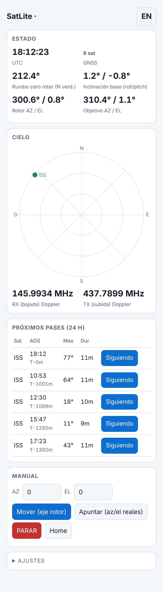

# PortableSatLite · estación portable de satélites V/U (145/435 MHz)

Rotor AZ/EL ligero impreso en ASA + antena yagi cruzada V/U plegable + caja de control con **punto de acceso Wi-Fi y web** (pases, seguimiento, Doppler), pensada para una **RT3S con OpenGD77**, un trípode de fotografía y la montaña.

**Estado: prototipo de ingeniería, no equipo terminado.** La matemática, SGP4, el buscador de pases, el parser de TLE, la interfaz web (contra un simulador), la geometría de los engranes y la simulación de antena están **verificados en PC**. El firmware del ESP32, los motores, los sensores y la RF **no se han construido ni probado**; léase `docs/TESTING.md` antes de fiarse de cualquier cifra.



## Qué hay
| Carpeta | Contenido |
|---|---|
| `docs/adr/` | **17 decisiones de arquitectura justificadas** (contexto, decisión, evidencia, límites) |
| `docs/ANTENNA.md` | yagis cruzadas VHF 3 el + UHF 4 el: dimensiones, NEC2, red de alimentación |
| `docs/MECHANICAL.md` | planetario herringbone 25:1, cargas, piezas, masa |
| `docs/ARCHITECTURE.md`, `ELECTRONICS.md`, `CONTROL-API.md` | sistema, pines/cableado, API |
| `docs/REFERENCE-ANALYSIS.md`, `SOURCES.md` | qué se tomó de cada referencia y licencias |
| `docs/TESTING.md`, `RISKS.md` | verificado / no verificado, puesta en marcha, riesgos |
| `calc/` | scripts de cálculo (NEC2, par, masa, red de alimentación) y sus resultados JSON |
| `cad/` | generador paramétrico de piezas (Python) y `cad/stl/` |
| `firmware/` | ESP32 (PlatformIO) y `firmware/lib/satcore` (núcleo probado en PC) + `data/` (web y catálogo) |
| `tests/` | `run_all.sh` ejecuta todas las pruebas de PC |
| `bom/bom.csv` | lista de materiales con precios orientativos **no cotizados** |
| `hardware/diplexer/` | Gerbers de tu diplexor existente |

## Cifras clave (todas con su origen en `docs/`)
* Antena: VHF 7,6 dBi / UHF 9,1 dBi, relación axial < 1 dB, haz 82°/70°, boom 0,83 m (NEC2, espacio libre).
* Rotor: 25:1, 0,0045°/micropaso, par de salida 2,5–3 N·m con la corriente limitada; límite de viento recomendado 10 m/s.
* Masa estimada de la estación (rotor + antena + caja + diplexor): ≈ 2,0 kg; con radio, trípode y fuente ≈ 4,0 kg (**estimaciones**, sin pesar).

## Reproducir
```bash
pip install numpy sgp4 PyNEC trimesh manifold3d playwright
git clone https://github.com/Hopperpop/Sgp4-Library ../ext/Sgp4-Library
tests/run_all.sh && python3 cad/build_all.py && python3 scripts/gen_docs.py
```
Firmware: `cd firmware && pio run -t upload && pio run -t uploadfs`. Cambia `AP_PASS` en `firmware/src/config.h`.

## Puntos abiertos principales
1. Probar el firmware en el ESP32 (compila con PlatformIO: 20 % RAM, 83 % flash; sin probar en placa). 2. Verificar la banda de los híbridos de SatcomRadio (ADR-004). 3. Imprimir y ajustar bisagras/bridas. 4. Ajuste con NanoVNA. 5. Leer los AS5600 y añadir un protocolo estándar de rotor (GS-232/Easycomm) si quieres usar Gpredict.
