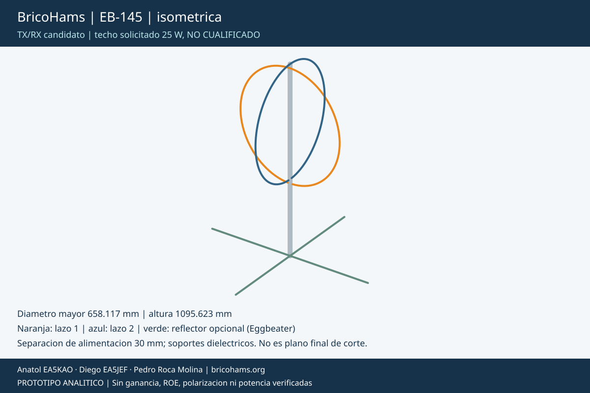
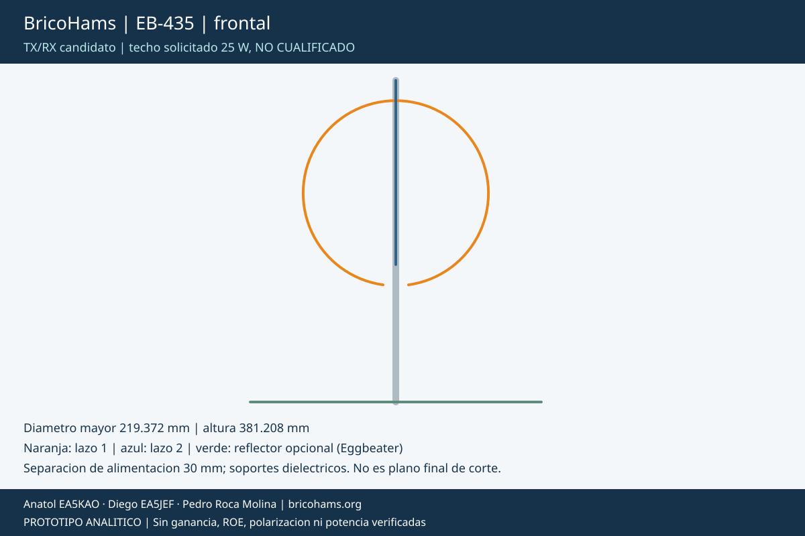
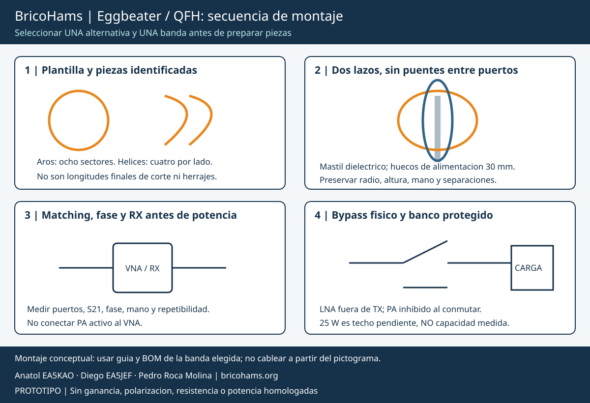

# BricoHams EB-145 / EB-435: Eggbeater desmontable TX/RX

Candidatas monobanda separadas; no antenas RX meteorologicas recicladas
con permiso TX supuesto. [Comparacion](ANTENNA-OPTIONS.md),
[BOM EB](../bom/antenna-eggbeater.csv) y
[fichas de cada componente](assembly/components/README.md).
Todas las cotas siguientes son semillas de ajuste, no cortes finales.

## Geometria e imagenes

Cada banda tiene dos lazos circulares verticales ortogonales de
circunferencia inicial lambda = c/f, con abertura de alimentacion de
30 mm en la parte inferior. El segundo aro se eleva 24 mm para evitar
contacto entre conductores; **esa separacion cambia el comportamiento RF**.
La configuracion no tiene por si sola impedancia de 50 ohm ni fase de 90°.

| Dimension nominal mm | EB-145 | EB-435 |
| --- | ---: | ---: |
| Diametro de aro | 658,117 | 219,372 |
| Circunferencia completa de referencia | 2067,534 | 689,178 |
| Conductor de un aro tras abertura | 2037,524 | 659,084 |
| Arco de sector completo, 45° | 258,442 | 86,147 |
| Cuerda de sector completo | 251,850 | 83,950 |
| Separacion inicial aro inferior / reflector | 413,507 | 137,836 |
| Longitud de cada uno de cuatro radiales opcionales | 516,884 | 172,295 |
| Altura de modelo con reflector y offset | 1095,623 | 381,208 |

Diametro de conductor candidato: 4 mm. El reflector de cuatro radiales
es una alternativa pasiva de ensayo, no una malla completa ni garantia
de patron hemisferico. La huella de radiales es mayor que la de los aros:
aproximadamente 1033,8 mm punta a punta en VHF.

Hay ocho sectores por aro. La abertura queda entre los sectores de
inicio/final: descontar la mitad del arco retirado en cada extremo,
no quitar 30 mm a todos los sectores. Cada aro tiene siete empalmes
internos y dos terminales de alimentacion. Las inserciones de manguitos,
el matching y la proximidad del mastil cambian la longitud electrica.

## Guia visual de montaje

1. **Seleccionar banda:** no mezclar sectores EB-145/EB-435. Imprimir
   tabla y marcar aro A/naranja, aro B/azul y sectores 1-8. Preparar
   plantilla circular con radio medido y cupon de soporte antes de hacer
   el lote. El soporte CAD es cupon, no abrazadera estructural liberada.
2. **Formar y unir un aro:** mantener ocho sectores de 45° con extremos
   alimentados recortados segun el arco de abertura; siete manguitos
   conductores retenidos, nunca contactos por ASA ni friccion sola.
   Medir diametro, planitud, continuidad y abertura de 30 mm.
3. **Montar mastil dielectrico y segundo aro:** planos a 90° y desfase
   vertical 24 mm. Sujetar ambos de forma independiente; no emplear el
   coaxial como soporte. Instalar aisladores en los pasos superiores por
   mastil; su ejecucion y debilitamiento estructural requieren prototipo.
4. **Reflector opcional:** cuatro radiales a z=0, con union conductora
   central definida y retenida, a distancia indicada del aro inferior.
   Para transporte VHF, cada radial puede dividirse en dos mitades
   nominales de 258,442 mm con manguito: afinar con esa union instalada.
5. **Alimentar dos puertos equilibrados:** continuidad de cada aro entre
   sus terminales es normal por el recorrido largo; no puentear el
   hueco. Usar dos matching/baluns y la red de fase medida a la banda.
   No conectar ambos aros directamente en paralelo a un SMA.
6. **Primero RX/VNA:** medir impedancia de cada puerto, S21 entre ellos,
   balance/fase, patron y relacion axial de la configuracion completa.
   Verificar alimentacion y reflexiones con puerto no medido terminado.
7. **Previo y TX:** incorporar [bypass y proteccion](ANTENNA-PREAMPS.md).
   Ensayar en carga y despues el conjunto a minima potencia autorizada;
   no usar el satelite como carga de prueba de 25 W.

## Recogida y aceptacion

Inhibir TX, quitar alimentacion, desconectar SMA etiquetados, retirar
radiales y separar manguitos sin retorcer el material. Guardar sectores
curvos en plantilla/funda que preserve el radio. No enrollar todos juntos
como alambre ni doblar repetidamente el mismo punto.
El sector VHF de 258,4 mm es una pieza corta, **no una demostracion de
paquete <=300 mm**: faltan diametros de la pila, soportes, mastil y RF.
No hay envolvente de transporte aprobada para EB.

Comparar resonancia y geometria antes/despues de sucesivos montajes.
Evaluar perdida/resistencia y calentamiento de cada empalme a potencia
progresiva dentro de ratings confirmados. Liberar TX solo despues de
[G2-G4](ACCEPTANCE.md); no se anuncian ROE, ganancia ni 25 W soportados.

Otras vistas: [EB-145 frontal](assembly/options/EB-145-front.svg),
[EB-435 isometrica](assembly/options/EB-435-iso.svg),
[preview CAD VHF](assembly/options/EB-145-cad.png) y
[preview CAD UHF](assembly/options/EB-435-cad.png).
