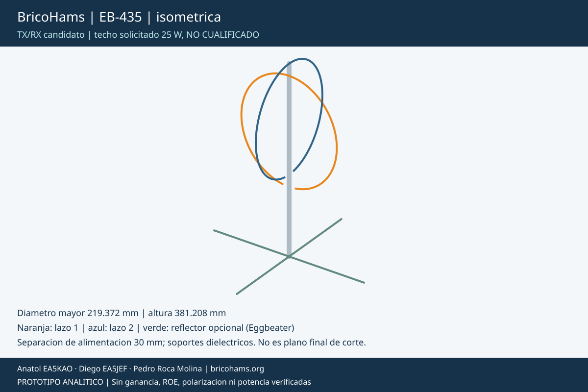
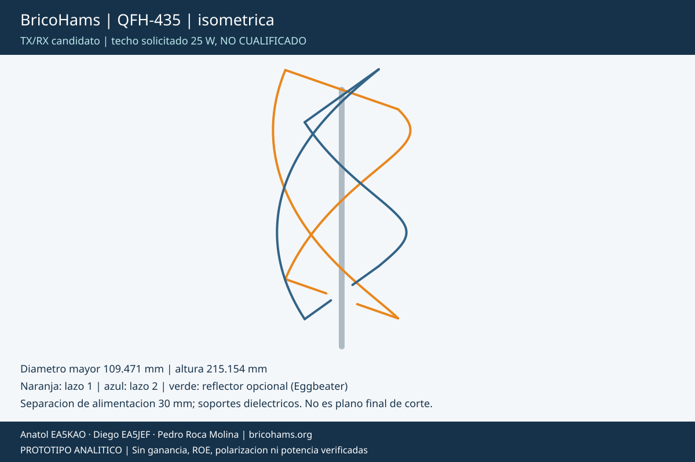

# BricoHams: elegir antena satelital portable TX/RX

Revision 2026-10-17. Tres **candidatas de ingenieria**, no productos RF
certificados. El techo solicitado es 25 W conducidos FM/CW o 25 W PEP
SSB, una sola cadena TX activa; utilizar la minima potencia necesaria.
Ninguna incluye todavia un PA, rele, previo o red de fase aprobados.

## Comparacion para escoger

| Opcion | Objetivo de cobertura | Transporte propuesto | Compromiso principal |
| --- | --- | --- | --- |
| [PF-01](ANTENNA-PORTABLE.md) con reflector de malla | Direccional, apuntada al satelite; patron pendiente | Cassettes plegados, puntas y malla retiradas; objetivo mecanico 170 x 140 x 300 mm | Exige orientacion, articulaciones repetibles y nueva comprobacion de viento |
| [Eggbeater](ANTENNA-EGGBEATER.md) | Cobertura hemisferica candidata sin seguimiento mecanico; no uniforme ni demostrada | Dos aros por banda, ocho sectores por aro; reflector opcional seccionable | VHF desplegada ocupa aproximadamente 1,10 m de altura con reflector |
| [QFH](ANTENNA-QFH.md) | Cobertura hemisferica candidata, polarizacion a verificar | Helices de media vuelta con cuatro sectores por lado y barras retirables | Geometria mas sensible a rearmado; no aplastar/estirar helices para recoger |

**Para priorizar portabilidad con apuntado:** PF-01 es la propuesta
preferente. Para evitar rotor, comparar Eggbeater y QFH en un prototipo
RX con la misma cadena y pases equivalentes antes de elegir. No hay datos
que permitan asignar una ganancia, relacion axial o ganador de sensibilidad.
Un previo no recupera una zona nula del patron ni corrige mano circular.

## Vistas calculadas de las opciones nuevas

| | 145 MHz | 435 MHz |
| --- | --- | --- |
| Eggbeater |  |  |
| QFH |  |  |

Las figuras salen de los mismos puntos que el CAD, con escala ajustada
por imagen; **no comparar tamanos por el ancho de la miniatura**.
Son proyecciones geometricas originales, no simulacion EM ni copia de
una antena comercial. Ver vistas frontales y previews CAD en cada guia.

## Alcance comun

- Construir cada alternativa **por banda**. Dos monobandas separadas
  para TX/RX V/U, no una falsa antena dualband conectando las dos juntas.
  Su separacion final, mastil compartido y acoplamiento quedan por ensayar.
- Las formulas usan 145 y 435 MHz como semillas. Comprobar canales de
  [AMSAT, modos y Doppler](SATELLITE-COMMS.md), especialmente 432 MHz
  para AO-7 B. No prometer cobertura por calcular solo la frecuencia central.
- Las dos nuevas geometrías tienen dos puertos equilibrados independientes.
  Requieren matching/baluns y red de fase por banda; la diferencia de
  longitudes QFH no se presenta como autoajuste o autofase garantizados.
- Incorporar [previo RX y bypass interbloqueado TX](ANTENNA-PREAMPS.md)
  a cualquiera de las tres. No sumar kits duplicados para una misma banda.
- La red QRP historica no queda cualificada para 25 W. Mantener HOLD
  TX hasta medir potencia, ROE, temperatura, espurios y proteccion.

## Fuentes y reproduccion

Parametros originales en [antenna-options.json](../calc/antenna-options.json);
ecuaciones y geometria en [generador](../scripts/antenna-options.cjs);
[informe de dimensiones](../calc/antenna-options-report.json) y
[CAD](../cad/antenna_options.scad).
Las relaciones lambda, circunferencia y longitud de helice son analiticas.
Los factores 1,03/0,97, aspecto 1,6 y distancias de reflector son
**hipotesis iniciales propias**, no especificaciones atribuidas a AMSAT.
AMSAT se usa para comunicaciones y buenas practicas, no como validacion
del diseno de estas antenas.

```powershell
node scripts\antenna-options.cjs
.\cad\export-antenna-options.ps1 -OpenSCAD 'C:\ruta\openscad.com'
node scripts\component-catalog.cjs
node scripts\antenna-options.cjs --check
node --test tests\antenna-options.test.cjs tests\portable-antenna.test.cjs tests\assembly-docs.test.cjs
```

Se entrega un cupon de soporte imprimible y los modelos de conductores,
no una liberacion de todos los herrajes. Pesar la configuracion elegida
completa y revisar CG, resistencia y estabilidad: no aumentar por defecto
la carga del rotor ni declarar cumplidos <=5 kg o dos horas de autonomia.
