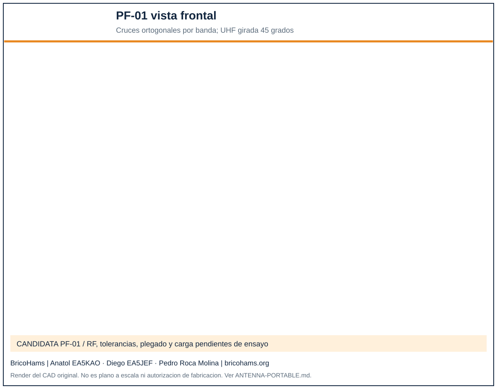
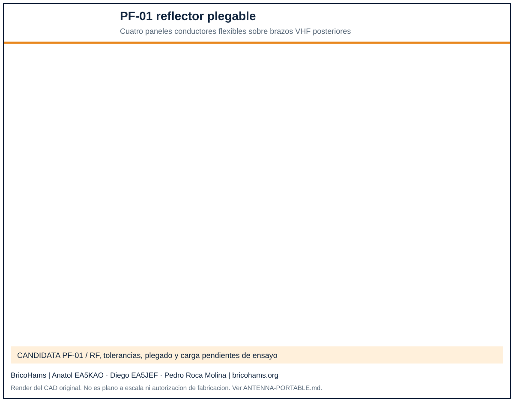
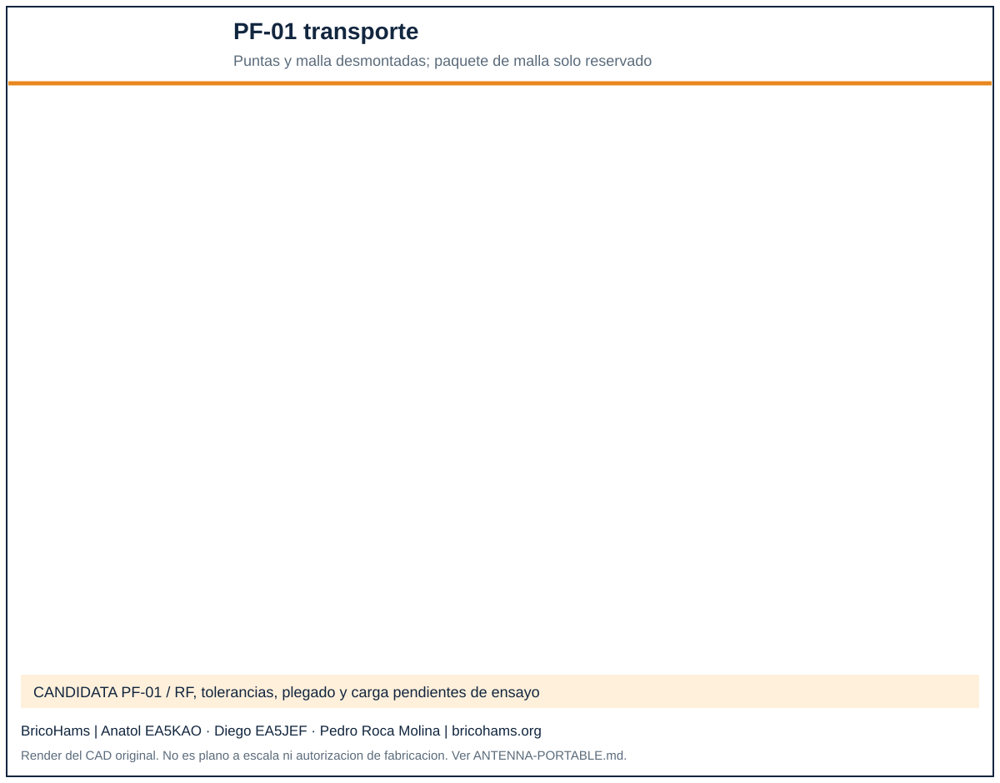

# BricoHams PF-01: rediseno portable de la antena V/U

Revision: 2026-10-17. **Nueva candidata preferente de portabilidad**, no
antena RF cualificada ni sustitucion silenciosa del conjunto anterior.
Se conserva el CAD anterior para comparar y no invalidar las interfaces
AZ/EL/POL que todavia necesitan ensayo. PF-01 es un diseno original;
no reproduce archivos, medidas o circuitos del producto del video.

## 1. Que se ha observado en la referencia

Se examino localmente el video facilitado, de 28,48 s y 1440 x 2560,
desde siete instantes (0, 4, 8, 12, 16, 20 y 24 s).
Identificador SHA-256:
`6bee19dcb67439f7770f4d1f7c5bf32033ee28b306b14fdd2a17201aa82b9601`.
El video y sus fotogramas no se publican en el repositorio.

| Observable | Uso en PF-01 | Lo que no se puede deducir |
| --- | --- | --- |
| Cuerpo alargado sobre eje central | Boom unico desmontable, en vez de dos booms paralelos y puente |
| Brazos/varillas radiales y uniones cerca del cuerpo | Cassettes con cuatro articulaciones y bloqueo positivo |
| Palas anchas delanteras y estructura posterior de varillas | Se conserva solo el concepto de piezas radiales recogibles; PF-01 usa conductores finos para V/U |
| Cable recogido junto al eje | Puentes flexibles cortos, conectores etiquetados y alivio de tension |
| Vistas frontal, lateral y detalles de articulaciones | Documentacion multivista del CAD propio |

**No se ve un ciclo completo de plegado**, ni una regla de escala. No se
conocen banda, impedancia, ganancia, potencia, materiales ni circuito de
alimentacion del ejemplo. No se afirma que sea dualband 145/435 MHz ni
que nuestras cuatro articulaciones reproduzcan su mecanismo.
Su radio no determina el presupuesto RF del proyecto.

El requisito de comunicaciones se contrasta con
[AMSAT y el techo de 25 W](SATELLITE-COMMS.md): PF-01 es candidata TX/RX,
no una antena ya aprobada a esa potencia. El previo se limita a RX,
con bypass fisico y enclavamiento del PA; revisar tambien redes de fase,
filtros y uniones plegables. Transmitir con la minima potencia necesaria.

## 2. Arquitectura elegida


- Un boom **dielectrico de 20 mm**, dividido en dos tubos comerciales de
  250 mm y unidos por espiga interior de 80 mm, con 40 mm nominales de
  insercion a cada lado. No usar carbono conductor como sustituto directo.
- Cuatro cassettes desmontables: reflector VHF (VR), reflector UHF (UR),
  excitado UHF (UD), excitado VHF (VD). Cada uno tiene cuatro brazos:
  dos pares ortogonales, no cuatro dipolos independientes.
- Brazos abatibles 90 grados alrededor de pivotes tangenciales, cada uno
  con **pivote M4 y bloqueo M3 distintos**. No sostener la geometria RF
  mediante friccion de la bisagra ni apretar plastico hasta bloquearlo.
- Ocho puntas VHF desmontables con manguito conductor y retencion
  positiva. UHF no necesita ese segundo corte.
- Conductores candidatos de tubo de aluminio **4 mm exterior / 2 mm
  interior**, para aligerar respecto de varilla maciza del mismo exterior.
  Comprobar aplastamiento en clamps y fatiga cerca de los taladros; no
  cambiar material/diametro sin repetir ajuste RF.
- Uniones de RF mediante conductores/puentes flexibles cualificados:
  el tornillo de bisagra y el ASA **no son el camino electrico**.
- Conectores y redes RF desmontables fuera del mecanismo; el roll POL
  sigue siendo independiente de la conmutacion RHCP/LHCP.

El reflector VR incorpora cuatro cuadrantes de malla conductora flexible,
retirables antes de plegar. La figura no representa redes RF, cables,
imanes, fijaciones seleccionadas ni compatibilidad certificada con POL.

## 3. Dimensiones iniciales: calculadas, no medidas

Las referencias RF siguen saliendo de [design.json](../calc/design.json);
no se han tomado longitudes del video. El generador reutiliza las
ecuaciones existentes para evitar tablas incoherentes.

| Plano | Posicion axial nominal (mm) | Diametro punta a punta nominal (mm) | Orientacion radial |
| --- | ---: | ---: | --- |
| VR | 0 | 998,619 | 0/90 grados |
| UR | 155,065 | 332,873 | 45/135 grados |
| UD | 310,130 | 317,022 | 45/135 grados |
| VD | 465,195 | 951,066 | 0/90 grados |

El boom ocupa de -16 a +484 mm. La union de tubos queda en z=234 mm,
entre UR y UD, no dentro de un cassette. Los pares UHF se centran entre
los planos VHF. Ese posicionamiento **no prueba aislamiento ni ganancia**:
ahora comparten boom y cambia el acoplamiento respecto del diseno anterior.
La rotacion UHF de 45 grados es una decision geometrica candidata, no un
resultado de optimizacion electromagnetica.

Cada varilla radial arranca nominalmente en r=55 mm:

| Pieza conductora | Cantidad | Longitud nominal (mm) |
| --- | ---: | ---: |
| Interior VHF, igual para VR y VD | 8 | 195 |
| Punta exterior VR | 4 | 249,310 |
| Punta exterior VD | 4 | 225,533 |
| Brazo UR | 4 | 111,437 |
| Brazo UD | 4 | 103,511 |

Son longitudes geometricas derivadas, **no una lista de corte final**.
Faltan stubs, puentes, clamp, manguitos y ajuste instalado. Dejar margen
de afinado, prototipar una banda y no cortar las dieciseis piezas a ciegas.
El factor 0,92 y la separacion 0,225 lambda son hipotesis heredadas, no
simulacion de esta nueva antena.

## 4. Vista frontal y continuidad RF



Cada par excitado tiene mitades electricamente separadas y una interfaz de
alimentacion equilibrada por definir/medir. **No cortocircuitar los dos
brazos opuestos del excitado** por interpretar la cruz de ASA como una
borna comun. Los reflectores necesitan continuidad entre mitades opuestas;
se debe definir su ruta sin puentear accidentalmente otros puertos.

El CAD no incluye un esquema RF aprobado ni un modelo de impedancia.
Se requiere disenar y verificar el punto de alimentacion, balun/matching,
fase/amplitud, SMA y redes de polarizacion por banda. No conectar un
hibrido sin cualificar solo porque hay cuatro brazos.
ROE, ganancia, relacion axial y potencia de trabajo siguen sin determinar.

### Reflector de malla plegable



Cuatro paneles candidatos forman un rombo de diagonal exterior 998,619 mm
y abertura central romboidal de diagonal 120 mm. Se propone inicialmente
reticula conductora flexible de paso 20 mm e hilo 0,2 mm, con ribete y
sujeciones desmontables. La continuidad de la malla, material y uniones
deben seleccionarse; el CAD no es patron de corte textil.

La superficie geometrica es aproximadamente 0,491 m2, antes de descontar
huecos. El calculo supone cobre estanado para estimar unos 14 g de hilo,
sin ribetes ni fijaciones. Que la reticula tenga aproximadamente 98% de
area abierta **no demuestra una carga de viento pequena**: revaluar fuerza,
par y estabilidad; no usar los 0,06 m2 del ejemplo historico del rotor.

El reflector puede modificar directividad, pero no se promete ganancia
de recepcion. Refleja tambien UHF: medir el conjunto con ambas bandas,
fase, mano, ROE y patron; una malla anadida puede empeorar el ajuste.
No se ha simulado electromagneticamente su geometria.

## 5. Plegado y paquete de transporte



El objetivo corregido es **170 x 140 x 300 mm** para el nucleo mecanico
recogido, no para antena con cajas RF, arnes, montura, rotor o tripode.
La envolvente geometrica y sus margenes se calculan en
[portable-antenna-report.json](../calc/portable-antenna-report.json).
El modelo no contiene funda, espuma, rack de puntas o cabezas/seguros
definitivos; hace falta comprobar el paquete real.
La envolvente calculada es **142 x 114 x 272 mm**, o
**162 x 134 x 292 mm** con 10 mm de margen por cara. Se amplio el objetivo
anterior para alejar pivotes a r=37 mm y eliminar interferencias sin
adelgazar mas las raices de 36 x 7 x 12 mm.
La caja translucida de 120 x 80 x 12 mm sobre z=260 mm es solo una
reserva para la malla: **no simula el tejido realmente plegado**.

1. Inhibir TX, parar, retener EL y desconectar alimentacion.
2. Retirar la antena del rotor/soporte en una superficie estable.
3. Desconectar por SMA etiquetado las redes/cables externos; no tirar del
   coaxial. Las redes RF van en compartimento protegido aparte.
4. Retirar y recoger los cuatro paneles de malla sin doblar bruscamente
   el hilo ni engancharlos en los excitados. Verificar que caben en la
   reserva y comprobar continuidad tras desplegar. Quitar los ocho
   manguitos y puntas VHF; guardar VR y VD en alojamientos
   identificados. Los manguitos y seguros se guardan en bolsa separada.
5. Retirar los cuatro pasadores de fijacion al boom y deslizar los cassettes.
   No intentar abatirlos en su posicion operativa sobre el boom largo:
   los brazos podrian atravesar los planos vecinos.
6. En cada cassette fuera del boom, retirar bloqueos M3 y abatir brazos
   hacia atras. No superar 90 grados ni forzar el puente RF.
7. Apilar **VR, VD, UR, UD**, a paso nominal de 20 mm y girados entre si
   22,5 grados, sobre una seccion del boom. Sujetar sin cargar varillas
   sobre los seguros de otro cassette.
8. Retirar dos pasadores de la union del boom y separar tubos/espiga.
   Colocar el segundo tubo a un lado y las ocho puntas al otro.
9. Sujetar con retenedores/funda a seleccionar; proteger extremos y SMA.
   Comprobar dimensiones exteriores con todo el material real.

**No es un cierre de un solo gesto tipo paraguas.** Se elige un paquete
corto y piezas reparables sin telescopios RF ni contactos deslizantes
sin caracterizar. No se promete tiempo de despliegue; cronometrarlo en
un ensayo repetido con guantes y sin piezas perdidas.

## 6. Articulacion y piezas fabricables de prueba


El [CAD PF-01](../cad/portable_antenna.scad) tiene selectores para
`hub`, `arm`, `coupler`, `boom`, `spigot`, `deployed`, `front`, `folded`
y `hinge`. Solo `hub` y `arm` se exportan como candidatos imprimibles ASA.
Los tubos, varillas, manguitos, espiga y pasadores son piezas comerciales
o mecanizadas; **no imprimirlos por aparecer modelados**.

Las [mallas candidatas](../cad/portable-stl/) no son una homologacion.
Antes de imprimir las cuatro bases y dieciseis raices, hacer cupones
de taladro, rod pocket y ajuste de boom con el proceso ASA elegido.
No hay orientacion de capa, relleno o par de apriete estructuralmente
calificados. No usar la raiz como prensa roscando M3 directamente en ASA;
seleccionar tuerca/retencion y comprobar el conjunto.

Inventario separado en [antenna-portable.csv](../bom/antenna-portable.csv)
y [catalogo de componentes](assembly/components/README.md). PF-01 reemplaza
el subconjunto de antena anterior si se elige: **no sumar ambas antenas,
el puente antiguo ni los tres booms anteriores**.

## 7. Montaje y aceptacion por etapas

1. Comparar stock real con la BOM; medir diametros, paredes, masa y rectitud.
2. Ensayar un hub y cuatro raices sin varillas: pivote, bloqueo y recorrido.
3. Comprobar que el bloqueo atraviesa ambas orejas sin holgura excesiva.
   Verificar retencion axial y resistencia a vibracion; no usar pegamento
   como retencion primaria.
4. Montar boom/espiga y revisar los taladros/pasadores. Fijar temporalmente
   VR/UR/UD/VD en las posiciones calculadas, midiendo desde la misma referencia.
5. Instalar conductores con margen y desarrollar puentes/alimentacion
   de una banda en banco, sin motores ni TX.
6. Desplegar, medir RF, plegar y desplegar repetidamente; comparar S11/S21
   y posicion de resonancia antes/despues. Medir ambas bandas juntas.
7. Incorporar redes de fase/matching/circular solo cuando esten definidas.
   Verificar mano, amplitud, fase, aislamiento y puertos terminados.
8. Pesar la antena completa con todo lo que gira: montura, conectores,
   cables y RF. Ajustar CG medido al eje EL; no usar el centro geometrico
   como sustituto del equilibrado.
9. Validar interfaz y envolvente AZ/EL/POL a mano y con masa retenida.
   Solo despues realizar pruebas de movimiento descargado y carga progresiva.
10. Aplicar [aceptacion](ACCEPTANCE.md) y [ensayos RF](testing/05-rf-y-radio.md).
    Permanecer en RX hasta cualificar la cadena TX completa.

Parar ante fisuras, bloqueo incompleto, deriva RF tras plegado, calentamiento
de un empalme, cable tirante, holgura, colision o inestabilidad del tripode.
No se ha aprobado un numero de ciclos, viento o potencia.

## 8. Masa, limites y reproduccion

El informe incluye solo masa teorica del stock de tubos, varillas,
manguitos y espiga con densidades supuestas. **No es masa de antena**.
No incluye partes impresas, fijaciones, puentes, coax, redes de fase,
diplexores, conmutadores o soporte. El objetivo historico de antena <=0,5 kg
no se declara cumplido ni se aumenta la carga autorizada del rotor.
El limite de estacion <=5 kg y las dos horas de autonomia no cambian.

```powershell
node scripts\portable-antenna.cjs
.\cad\export-portable-antenna.ps1 -OpenSCAD 'C:\ruta\openscad.com'
node scripts\portable-antenna.cjs --check
node --test tests\portable-antenna.test.cjs
```

El exportador verifica mallas y busca colisiones nominales de raiz/hub
en incrementos de 5 grados y entre cassettes recogidos. Esto no cubre
continuamente el recorrido, tolerancias, flexion, tornilleria, cableado
ni volumen barrido del conjunto. Los renders usan la geometria CAD,
no una ilustracion comercial ni una promesa de funcionamiento.

**Ultimo ensayo CAD (2026-10-17):** corregida la interferencia del primer
apilado mediante desplazamiento de pivotes/orejas y nueva envolvente.
Las mallas de hub y brazo estan cerradas, con una sola componente conexa;
volumen geometrico de 29690,5 y 2607,6 mm3 respectivamente.
El muestreo `hinge-clearance` y las intersecciones entre cassettes
`stow-clearance` resultan vacios. Es aprobacion digital nominal limitada
a esos solidos: no prueba plegado con tolerancias, seguros, coaxiales,
tejido o tornilleria reales, ni autoriza fabricacion en serie.

La variante se deja independiente de
[antenna.scad](../cad/antenna.scad): no se han alterado sus exports ni las
referencias del rotor para simular una integracion que no se ha ensayado.
Los ejemplos principales de montaje anterior siguen siendo historicos.
