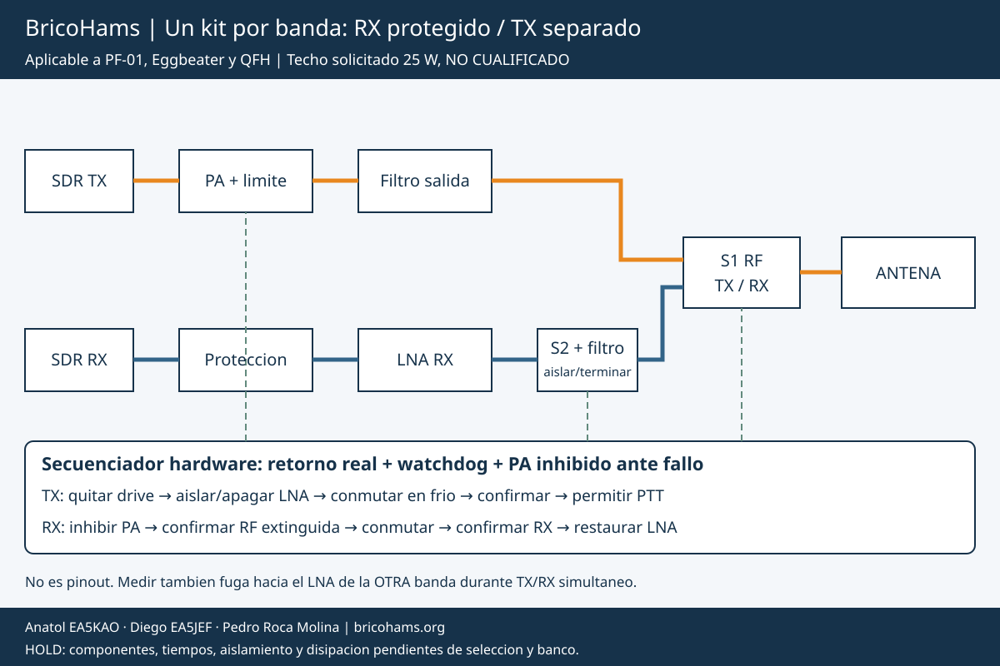

# BricoHams: previo RX por banda y bypass TX de hasta 25 W

Arquitectura funcional para PF-01, Eggbeater y QFH. **HOLD de hardware**:
no hay rele, PA, filtro ni previo seleccionados o certificados. No es
esquema de cableado por pines ni una promesa de 25 W soportados.
[BOM comun](../bom/antenna-preamps.csv),
[canales, modos y calculos AMSAT](SATELLITE-COMMS.md).

## Separar potencia y recepcion

Un kit por banda. ANT conecta mediante S1 a TX o RX; S2 debe aislar y
terminar el LNA en TX. La via de proteccion incluye preselector y
limitador donde corresponda a sus ratings. El diagrama no especifica
numero de polos, pinout, tensiones de bobina ni filtro comercial.
Dos SPDT dibujados no son por si solos una solucion de aislamiento.

1. **PRE-01/02:** seleccionar filtro y LNA por banda con curvas de
   ganancia, NF, retorno, estabilidad, compresion y maximo nivel admisible.
   La ganancia no es sensibilidad; perdidas antes del LNA empeoran la
   figura de ruido. Medir tambien ruido de convertidores/motores.
2. **PRE-03/04:** seleccionar conmutacion con potencia, frecuencia,
   aislamiento, perdida, ROE y vida util documentados. Alimentacion
   perdida o estado desconocido debe dejar PA inhibido fisicamente;
   no asumir una posicion segura solo por el dibujo de un rele.
3. **PRE-05/09:** proteger RX y dimensionar terminaciones. Verificar
   recuperacion despues de TX para no perder bajada. Ningun limitador
   generico sustituye los casi 60 dB del ejemplo de aislamiento:
   para 25 W=43,98 dBm, dano hipotetico -10 dBm y margen 6 dB,
   se requieren 59,98 dB. Sustituir la hipotesis por el rating real;
   evitar bloqueo puede requerir mas rechazo.
4. **PRE-06:** PA y filtro de salida por banda con limitacion independiente.
   Para SSB, comprobar linealidad/IMD a 25 W PEP, no solo portadora FM.
   25 W de RF no son 25 W de bateria: revaluar energia, cable/fusible,
   disipacion, caida de tension y autonomia.
5. **PRE-07/08:** secuenciador hardware con inhibicion, retorno de
   posicion real, supervision y parada por condiciones no cualificadas.
   Un ACK de software no prueba que el contacto RF haya cambiado.

## Secuencia: no inventar retardos

| Estado/transicion | Permiso PA | Accion y evidencia necesaria |
| --- | --- | --- |
| Arranque, reset o fallo | Inhibido | Ruta desconocida no permite TX; diagnostico explicito y rearme controlado |
| RX confirmado | Inhibido | S1 RX y S2 entrada LNA conectada; habilitar LNA solo con estado seguro |
| Solicitud TX | Inhibido | Quitar drive; apagar LNA, aislar/terminar entrada; conmutar en frio |
| Preparado TX | Aun inhibido | Confirmar contactos S1/S2, esperar asentamiento real y verificar condiciones de potencia/ROE/temperatura |
| TX permitido | Segun PTT y protecciones | Solo camino TX confirmado; LNA fuera de la ruta; monitorizar continuamente |
| Fin TX | Inhibido antes de mover RF | Quitar drive, confirmar decaimiento de RF, conmutar a RX, confirmar y restaurar LNA |
| Perdida de retorno o alimentacion | Inhibido por hardware | No restaurar automaticamente PTT al recuperarse |

Los tiempos se obtienen de fichas y medidas del conmutador/PA elegido,
incluyendo rebote, descarga y margenes. No se proporciona un retardo
arbitrario que parezca una proteccion validada. No usar VOX RF como
unica defensa ante el primer pulso TX.

## TX/RX simultaneo entre bandas

Durante TX VHF, el LNA UHF puede seguir recibiendo solo si se demuestra
proteccion suficiente contra fundamental, tercer armonico y fugas.
El previo de la otra banda tambien necesita proteccion verificada.
Apagar el LNA VHF no protege UHF. Un diplexor sin ensayos, dos antenas
proximas o un SMA aislado no prueban desensibilizacion aceptable.
Medir S21 real entre antenas, filtros, blindajes, coax y retornos de masa
en todas las posiciones de montaje. Si no se consigue RX simultaneo,
no anunciar full-duplex ni seguir transmitiendo sin escuchar bajada.

## Instalacion visual por etapas y banco

1. Seleccionar banda y alternativa, inventariar PRE-01 a PRE-10 y
   comprobar cada ficha. Ningun componente en HOLD es orden de compra.
2. Montar rutas en caja apantallada con divisiones, masas y alivio de
   tension; separar PA/LNA y RF/control. Verificar continuidad y
   ausencia de cortos **sin PA ni SDR conectados**.
3. Cualificar la logica de estados con fuente limitada y carga ficticia
   de control. Forzar reset, fallo de contacto, cable roto, watchdog,
   alimentacion perdida y PTT retenido al arrancar: PA siempre inhibido.
4. Medir redes pasivas con VNA y puertos terminados, PA desconectado.
   No medir un PA activo directamente con VNA.
5. Usar carga y atenuacion de PRE-10 con ratings termicos verificados.
   Medir potencia/fuga/espectro en escalones dentro del menor rating
   confirmado. No saltar a 25 W con la red QRP historica.
6. Documentar temperatura, duracion, duty cycle, ROE, transitorios,
   espurios e IMD, y bloqueo/recuperacion de ambos receptores.
   No hacer hot-switch ni ensayos deliberados de cortocircuito sobre
   componentes sin procedimiento seguro y ratings especificos.
7. Liberar una potencia medida por configuracion, no un numero global
   por el nombre de la antena. Aplicar [G2-G4](ACCEPTANCE.md) y licencia.

No se ha modificado firmware ni habilitado PTT automatico por esta
arquitectura. Su implementacion electrica requiere componentes exactos,
revision de esquema y pruebas en banco antes de energizar el PA.
