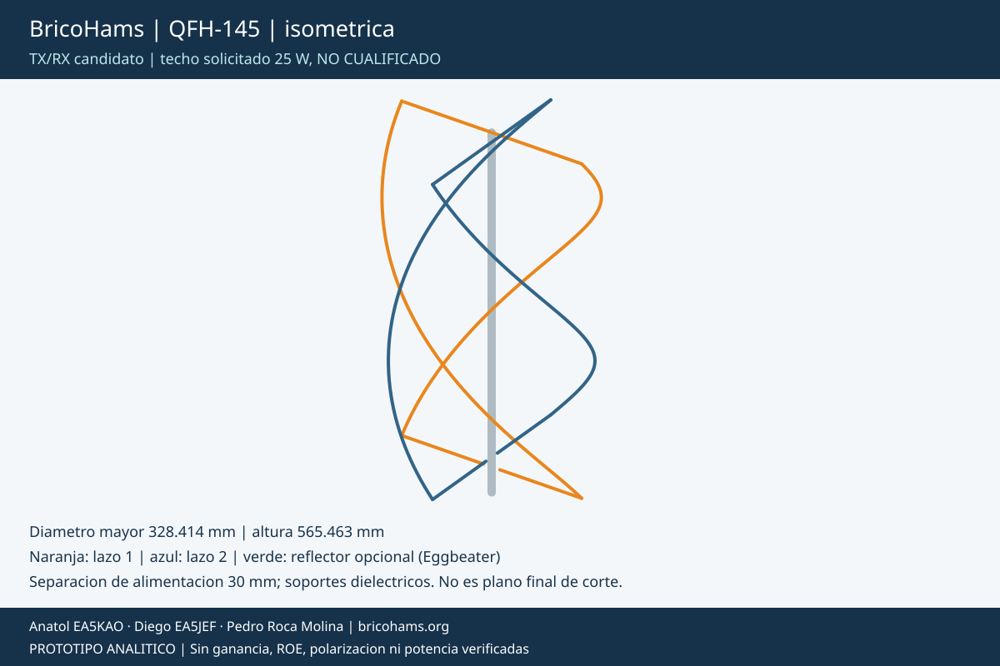
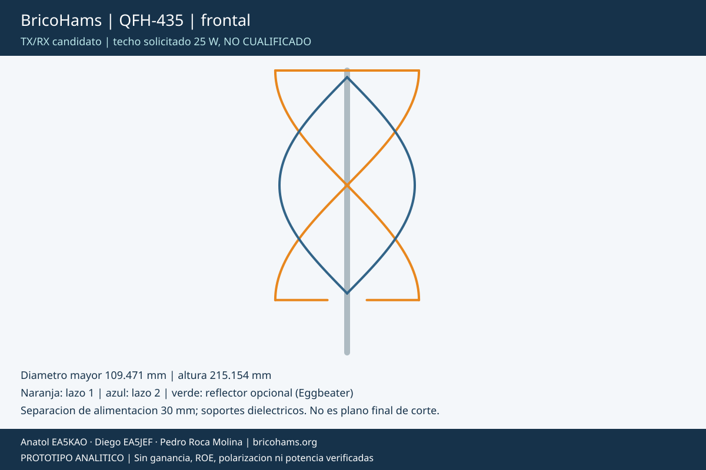

# BricoHams QFH-145 / QFH-435: cuadrifilar desmontable TX/RX

Dos candidatas monobanda con dos lazos por banda. No se atribuye capacidad
TX a una QFH de recepcion por cambiarle el conector.
[Comparacion](ANTENNA-OPTIONS.md), [BOM QFH](../bom/antenna-qfh.csv) y
[fichas de componentes](assembly/components/README.md).

## Modelo analitico y limites




Cada lazo ideal se compone de dos lados helicoidales de **media vuelta**
y dos barras diametrales. Se usan como hipotesis longitudes 1,03 lambda
y 0,97 lambda y altura/diametro 1,6:

```text
L = 2 sqrt(H² + (pi D / 2)²) + 2 D
D = L / [2 sqrt(1,6² + (pi/2)²) + 2]
H = 1,6 D
```

Se retiran 30 mm de la barra inferior para alimentar cada lazo.
No son las dimensiones de una QFH comercial ni optimizacion NEC.
La diferencia de longitudes **no garantiza auto-fase, 50 ohm o circular**.
Se prevén dos puertos y red de fase/matching ajustada, no una union
ciega de los lazos ni dos mecanismos de fase asumidos simultaneamente.

| Banda/lazo | D mm | H del lazo mm | L ideal mm | Conductor tras abertura mm | Sector helicoidal mm |
| --- | ---: | ---: | ---: | ---: | ---: |
| 145 grande | 328,414 | 525,463 | 2129,560 | 2099,560 | 184,091 |
| 145 pequeno | 309,283 | 494,853 | 2005,508 | 1975,508 | 173,368 |
| 435 grande | 109,471 | 175,154 | 709,853 | 679,853 | 61,364 |
| 435 pequeno | 103,094 | 164,951 | 668,503 | 638,503 | 57,789 |

Cuatro sectores por lado helicoidal; cuatro lados en total por antena,
por tanto 16 sectores y 12 empalmes helicoidales internos. Hay ademas
ocho transiciones a barras que requieren union conductora o codo formado.
Los lazos se centran verticalmente y sus barras se orientan a 90°:
las barras superiores/inferiores no comparten plano ni se cortocircuitan.
Altura del modelo con base de 40 mm: 565,463 mm VHF y 215,154 mm UHF.
Las longitudes no incluyen insercion de uniones, extremos ni afinado.

## Guia visual de montaje


1. **Hacer una plantilla por banda:** marcar cuatro generatrices
   alrededor del mastil dielectrico y alturas de extremos/sectores.
   Cada lado gira 180° en su altura; conservar la mano de la helice.
   El lazo pequeno tiene extremos centrados respecto del grande:
   z inferior 55,305 mm VHF o 45,102 mm UHF; grande a z=40 mm.
2. **Conformar sectores sin aplanarlos:** cuatro sectores de igual
   longitud de arco por lado, con retenedores y marcas grandes/pequenos.
   Empalmes metalicos con continuidad positiva; las piezas ASA son
   soportes, no parte del conductor. No cambiar el radio por encajar
   piezas mal curvadas.
3. **Montar lazo grande y luego pequeno:** usar vistas por banda para
   barras diametrales y helices. Mantener separacion de conductores;
   no cruzar los extremos de una helice para improvisar otra mano.
   Verificar aisladores alrededor del mastil y no perforar estructuras
   sin revisar resistencia. El cupon STL no define toda la araña soporte.
4. **Terminar alimentaciones inferiores:** dos mitades por barra,
   abertura central 30 mm. Una barra superior por lazo. Las barras VHF
   miden hasta 328,414 mm: si se quiere un bulto mas corto hay que
   disenar y cualificar un empalme adicional; no se afirma paquete de
   300 mm con las barras actuales.
5. **Desarrollar matching/fase de ambos puertos:** medir impedancia y
   acoplamiento antes de elegir red. No suponer que dos longitudes
   distintas bastan para un alimentador de 50 ohm y 90°. Definir
   referencias de fase y comprobar mano/relacion axial con instrumentacion.
6. **Comprobar RX y repetibilidad:** medir con todas las uniones reales,
   coaxiales fijados, mastil y banda vecina instalada si procede.
   Registrar resonancia, ROE, patron y cambios tras desmontar.
7. **Cualificar TX:** [previo, bypass y enclavamiento](ANTENNA-PREAMPS.md),
   temperatura y corrientes en uniones, filtro/PA/IMD y proteccion de
   la otra banda. No transmitir a traves del LNA.

## Transporte y eleccion

Inhibir TX y desconectar alimentacion antes de desarmar. Guardar sectores
helicoidales en alojamientos curvos identificados; retirar barras y red
RF por separado. **No comprimir la QFH como un muelle ni enderezar
las helices**: cambiaria radio/paso y repetibilidad.
La menor longitud de cada sector no demuestra un volumen de embalaje.
Funda, mastil seccionado, soportes y uniones estructurales siguen
pendientes de prueba; no se publica una envolvente aprobada.

QFH-435 es geometricamente mas pequena, pero no reemplaza QFH-145
para recibir/transmitir en 2 m. Elegir un par de bandas y medir su
aislamiento. No declarar que QFH gana a Eggbeater sin comparar prototipos.
Aplican [aceptacion](ACCEPTANCE.md) y [canales AMSAT](SATELLITE-COMMS.md).

Otras vistas: [QFH-145 frontal](assembly/options/QFH-145-front.svg),
[QFH-435 isometrica](assembly/options/QFH-435-iso.svg),
[preview CAD VHF](assembly/options/QFH-145-cad.png) y
[preview CAD UHF](assembly/options/QFH-435-cad.png).
