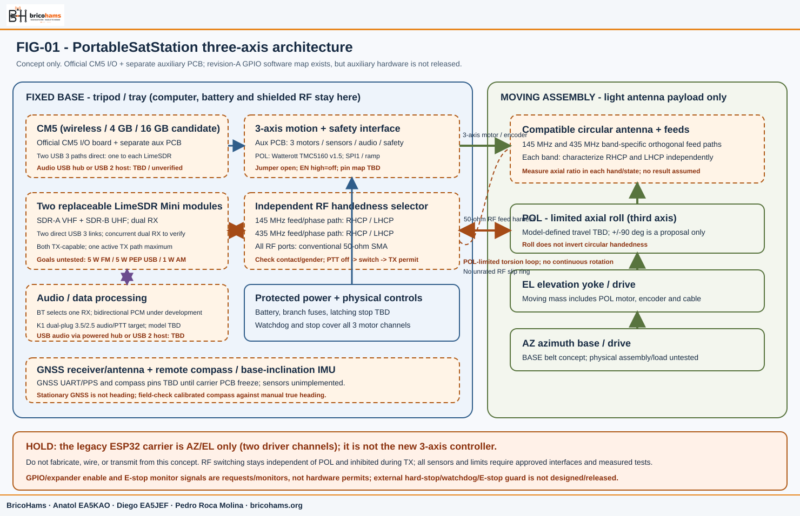
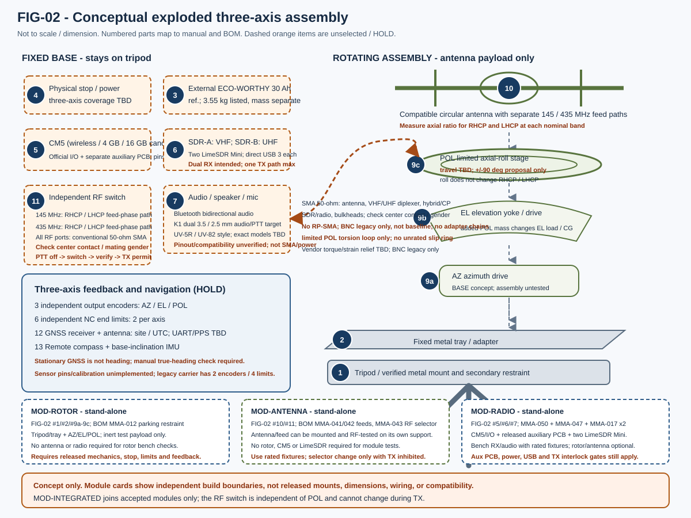
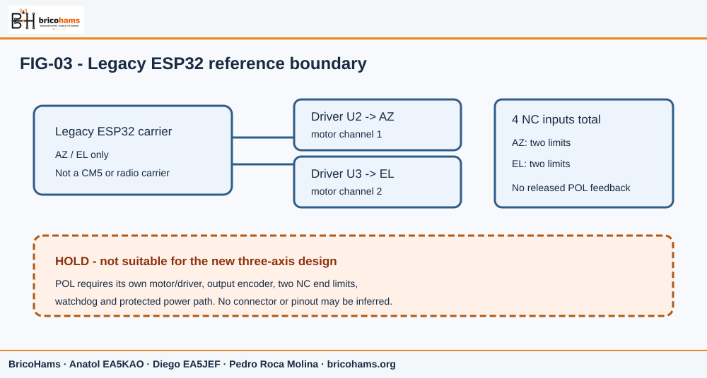
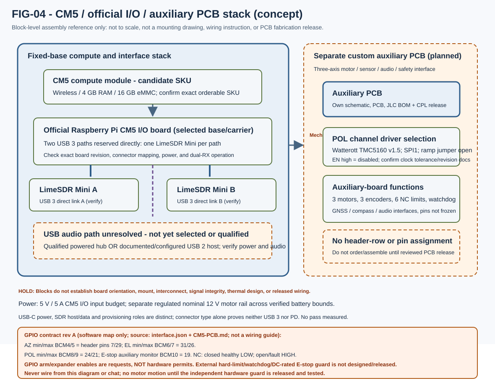
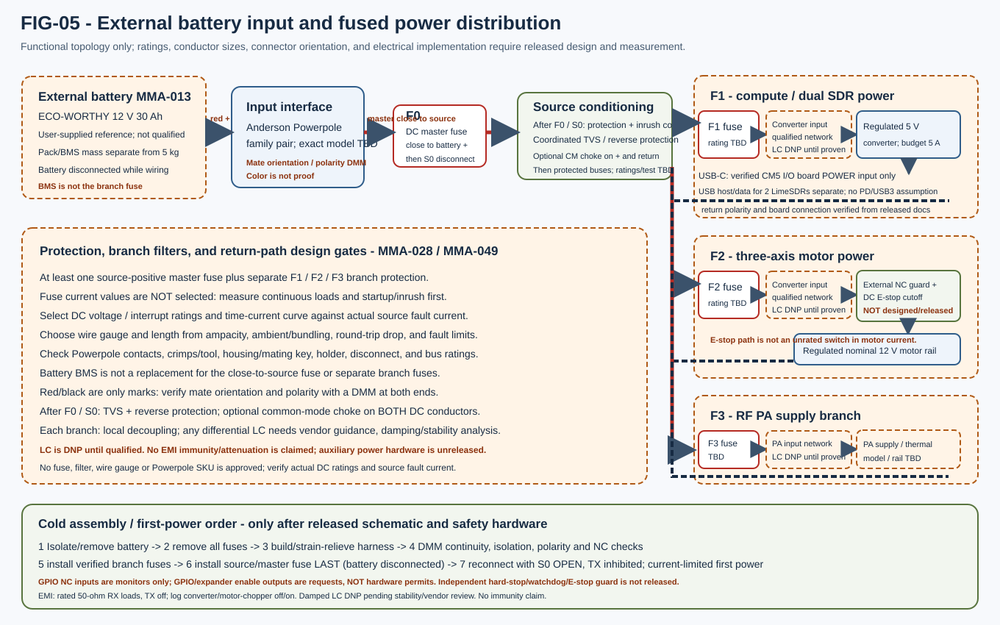

# PortableSatStation multimode: assembly and configuration

Revision: 2026-10-10. This is an integration guide and a set of release
gates, not a manufacturing drawing, electrical wiring plan, or authorization
to transmit.

## 1. Build status and safety boundary

The intended station covers amateur satellite operation around 145/435 MHz,
including FM, AM, and USB, full-duplex receive during transmit, Doppler/CAT,
PD120/PD180 SSTV, and AX.25 Bell 202 AFSK1200 messaging between callsigns.
These are system requirements, not proof that the corresponding hardware or
software is implemented.

Transmit output objectives, for either selected band but never simultaneous
dual TX, are 5 W FM carrier, 5 W PEP USB, and 1 W AM carrier at 100%
sinusoidal modulation through a future qualified PA chain. The AM objective
corresponds ideally to 4 W PEP; compatibility with a nominal 5 W PEP chain is
conditional on measured linearity, filter loss, and adequate distortion/
headroom margin. These are design objectives, not measured or authorized
operating results. Both LimeSDR Mini modules remain low-power exciters
(approximately +10 dBm maximum each, depending on frequency/revision), not
station PAs. PA topology must be linear for AM/USB; do not use a class-E PA
for these envelope-preserving modes. Battery, supply, fuse, conductor, and
thermal budgets remain open until exact parts and worst-case duty cycles are
measured.

The mechanical target is now three controlled axes: azimuth (AZ), elevation
(EL), and limited axial roll/polarization orientation (POL). POL is a
third mechanical axis around the antenna boresight; a provisional planning
guard of +/-90 degrees is proposed, but its actual travel, limits, reduction,
motor, encoder, cable route, and homing method remain **TBD pending the
mechanical agent's model and physical review**. Do not use +/-90 degrees as
an approved command range or fabricate stops from it. Continuous POL rotation
is out of scope unless a future design qualifies a suitable RF rotary joint
and other rotating connections; none is selected or rated now.

POL motion does **not** change RHCP to LHCP or vice versa. A separate RF
handedness selector is required, with band-specific 145 MHz and 435 MHz
quadrature/feed networks for a compatible circularly polarized antenna.
The selected switching topology must deliberately change the relative feed
phase/sign or use a verified feed-routing network designed for that purpose.
Do not swap arbitrary antenna ports, assume a connector reversal changes
handedness, or change the RF state during TX. The RF selector is an independent,
interlocked subsystem, not a function of the POL motor.

The new architecture is confirmed as a Raspberry Pi Compute Module 5 (CM5)
with the official CM5 I/O board and a separately designed custom auxiliary
PCB for the three motor axes, sensors, audio, and safety, plus **two replaceable
LimeSDR Mini modules**: intended VHF/UHF receive paths can operate together,
and each module is TX-capable. The safety default is exactly one active TX
path; simultaneous dual transmission is prohibited. The current CM5
configuration candidate is wireless, 4 GB RAM, and 16 GB eMMC; confirm the
exact orderable SKU before purchase. Exact board revisions, CM5 I/O-to-auxiliary
PCB physical interconnect, USB audio route, RF filters/duplexing/isolation network,
RX audio/channel selector, linear PA, audio codec, Bluetooth audio transport,
external connector pinouts, and auxiliary PCB hardware design/release are
**not yet released or fully qualified**. The separate revision-A CM5 GPIO
contract is a software allocation only, not a wiring release. Each
LimeSDR Mini's native RF output is low power (approximately +10 dBm maximum,
frequency-dependent; verify exact revision documentation and bench
measurement), not the station output objective. Conditional filtered-output
objectives for a separately qualified PA chain are 5 W FM carrier, 5 W PEP
USB, and 1 W AM carrier at 100% sinusoidal modulation (4 W ideal PEP).
AM/USB require a suitable linear PA, not class-E. These targets are unachieved;
verify gain, filter loss, distortion/headroom, emissions, thermal behavior,
isolation, and receiver desense physically.

Both RX channels may operate together. The Bluetooth audio path selects one
RX channel at a time; it does not mix or decode both channels simultaneously.
TX selection is separate. A hardware-enforced interlock must permit at most
one active TX path and default both TX paths disabled after boot, reset, stale
control, or fault.

The official CM5 I/O board is the confirmed CM5 base/carrier; the custom
auxiliary PCB is a separate board, not a replacement for its high-speed
interfaces. Reserve the two USB 3 paths for direct connections to the two
LimeSDR Mini modules. Confirm physical port mapping and simultaneous
throughput on the selected CM5/I/O-board revision before use. Audio must use
either a qualified powered USB hub or a documented/configured USB 2 host path;
which route, hub model, power budget, and audio device are **TBD**. Do not
claim a powered hub or USB audio path is already selected, wired, or verified.
Do not create a custom high-speed USB 3 mezzanine as an assumed substitute for
the official I/O board. Do not treat revision-A GPIO/physical-header
allocations as released PCB or field-wiring information. Auxiliary-board
connector pins, supply values, footprints, and physical interconnect must be
reviewed and released against official board documentation before connection.

The auxiliary PCB is planned to carry three-axis motor, encoder/limit, audio,
and safety interfaces. Its schematic, controlled interconnect to the CM5 I/O
board, exact connector/header assignments, PCB files, and JLCPCB BOM and CPL
exports remain design/release deliverables—not existing approved fabrication
files. Review generated BOM/CPL against the released schematic, footprints,
rotations, side, and exact manufacturer part numbers before any JLCPCB order.
Count the CM5, official I/O board, auxiliary PCB, both LimeSDRs, selected
USB/audio hardware, PA/filter chain, thermal hardware, shielding, and installed
cables in the 5.000 kg station weighing. External battery pack/BMS mass is
excluded from that station mass cap per the latest instruction, but weigh and
report separately; include the full battery system in project cost. A charger
counts in station mass if carried as ready-to-operate equipment. This
architecture does not establish
that the mass cap is met.

The current 180 x 130 mm ESP32 carrier and 228 x 178 mm enclosure belong to
the legacy AZ/EL rotor controller; they are not a footprint, enclosure,
schematic, or release for the CM5/SBC radio board. Do not wire or order a new
board from this guide.

The existing carrier has CAD and digital verification, but the carrier
documentation states that the prototype is unmounted and the fabrication
package is not released. Its stop switch, power path, exact physical modules,
and other stated release blockers must be closed before energizing motors.
Mechanical CAD and nominal component values likewise do not imply a
physically assembled station. Reported legacy AZ/EL-system mass planning
of about 3.130-3.200 kg is a historical estimate for the legacy system; it
excluded the radio and tripod and is not a measured mass or a pass result for
this redesign. The confirmed maximum mass for the complete, ready-to-operate
station is **5.000 kg**, including tripod, antenna, all three motor/rotor
axes, radios, SBC, cables, enclosures, and required mounting and retention
hardware, but excluding the external battery pack/BMS. Weigh and report the
pack separately; its mass remains part of the combined carried mass and its
cost remains in project accounting. The proposed design target is **at or below 4.500 kg**,
leaving 0.500 kg below the cap; neither limit nor target has been measured or
verified.

**Absolute stop conditions**

- Do not fabricate, populate, or energize a new multimode PCB until there is
  an approved schematic, exact module revisions/dimensions, pinout, protection
  design, and fabrication release.
- Do not order or assemble the auxiliary PCB from an unreleased JLC BOM/CPL.
  Revision A of the machine-readable GPIO contract is frozen for software
  integration in [interface.json](../hardware/cm5/interface.json), with its
  human-readable allocation in [CM5-PCB.md](CM5-PCB.md). Neither document
  releases the not-yet-designed/fabricated auxiliary PCB or authorizes
  wiring. Cross-check every actual connection against the reviewed schematic,
  board, connector drawings, and build revision; never wire from chat or a
  conceptual illustration.
- Do not connect a selected-by-appearance audio accessory, speaker/mic jack,
  SDR, radio, battery, or coax. The external accessory target is a Baofeng K1
  dual-plug audio/PTT lead with separate 3.5 mm and 2.5 mm plugs, intended for
  UV-5R/UV-82-style radios. The exact radio/accessory models are not selected;
  compatibility is pending continuity, bias, audio-level, and PTT-release
  tests. Do not infer a universal K1 pinout from the label or plug sizes. Keep
  programming cables/interfaces separate; neither their wiring nor an
  optional programming-cable PTT feature proves audio/PTT compatibility.
  These jacks are not SMA RF or power connectors.
- Do not transmit during assembly. No RF module, output filter, dummy-load
  rating, connector power rating, or full-duplex isolation has been selected.
- Keep a physical, latching motor-power disconnect and independently verified
  normally-closed (NC) stop path for all three motor axes in any motor test.
  POL requires its own bounded travel and two NC end limits; do not rely on
  Linux, Bluetooth, Wi-Fi, or an app as a safety interlock.
- Belt-driven elevation may backdrive when motor power is removed. Secure the
  moving load with a mechanical parking pin/restraint before disconnecting
  power; keep people out from under the load.
- Never hot-plug a coaxial connector or change the RHCP/LHCP RF switch while
  transmitting. Do not transmit into an antenna, open port, or unverified load.

## 2. Conceptual station assembly

The drawings are **original conceptual illustrations only**. They are not
dimensioned CAD, drilling templates, board layouts, cable pinouts, or
fabrication outputs.

The SBC, battery, RF/audio enclosure, and its shielding stay on the fixed
tripod/base. The lightweight antenna cradle and radiating assembly move in AZ,
EL, and limited axial POL roll. This avoids putting a heavy computer and
battery on a moving axis. Mechanical POL rotation is not an RF handedness
change. The RF selector shown in the architecture is electrically independent
from POL, band-specific, and inhibited while TX is active.

### Modular builds and prerequisites

This guide is the integrated assembly path, not a requirement to build every
module together. Keep these module boundaries when following the numbered
stages below:

| Module ID | Stand-alone scope | Prerequisites and exclusions |
| --- | --- | --- |
| `MOD-ROTOR` | Tripod interface, fixed tray, AZ/EL/POL mechanics, parking restraint, motors, encoders, NC limits, and motion safety | May be mounted, configured, and tested without the antenna or radio modules. Use a secured stand/tripod and inert dummy payload for unloaded tests. Do not add live antenna mass until the antenna module and mechanical load envelope are accepted. |
| `MOD-ANTENNA` | Antenna/radiator, 145/435 MHz feed paths, SMA coax, and band-specific RHCP/LHCP feed/switch interfaces | Must have its own safe support and RF measurement fixtures; no rotor, CM5, or LimeSDR is required for standalone assembly/measurement. Never use the antenna as a rotor test load before the rotor/load gate is passed. |
| `MOD-RADIO` | CM5 + official CM5 I/O board + released auxiliary PCB + two LimeSDR Mini modules, RF/audio configuration, and power interfaces | Can be configured and bench-tested without the rotor or antenna, using rated RF terminations/sources and the approved audio fixture. Auxiliary PCB, power, pinout, USB, and TX interlock gates still apply; standalone does not waive them. |
| `MOD-INTEGRATED` | Combined ready-to-operate station | Requires accepted `MOD-ROTOR`, `MOD-ANTENNA`, and `MOD-RADIO` interfaces, plus the complete mass, safety, RF, power, and field-acceptance gates. |

“Optional” means an item is not needed for that module's standalone build;
it does not mean that an item may be omitted from an integrated test which
depends on it. The tripod/fixture, safe supports, rated RF loads or antennas,
measurement instruments, and battery/charger are external equipment as
specified by each test; they are not silently counted as installed module
materials. Do not treat this table as a substitute for a module-specific BOM.
Use the independent guides for their own scope and materials: [rotor module](MODULE-ROTOR.md),
[antenna module](MODULE-ANTENNA.md), [radio module](MODULE-RADIO.md), and
[integrated assembly](MODULE-INTEGRATED.md). None overrides the release holds
or authorizes connecting unverified interfaces.

The current radio-host rotor binding is local:
[radio/rotor_integration.py](../radio/rotor_integration.py) opens
[rotor/radio_adapter.py](../rotor/radio_adapter.py), whose rotor replies use
`schema: "cm5-rotor/v1"`. The implemented controller paths are
`/rotor/status`, `/rotor/sensorsstatus`, `/rotor/home`,
`/rotor/calibrate`, `/rotor/target`, `/rotor/track`, `/rotor/stop`,
`/satellites/catalog`, and `/satellites/passes`. The Android orbit screen is
not yet a consumer of these replies: `MainActivity` currently passes no host
snapshot, and `OrbitSnapshotJson`'s separate `schemaVersion: 1` format is
proposed, not an actual host response. The UI's pending/unsupported state is
therefore intentional. Do not manufacture track/radar/radio-profile values
or silently convert schemas; any future Android adapter must parse actual
`cm5-rotor/v1` path envelopes and represent fields the host does not return
as unsupported/unavailable. `radio-host/1.0.0` and the legacy rotor BLE
protocol are distinct interfaces.

The coax/control harness must accommodate the approved AZ/EL/POL envelope.
Until that envelope and cable are selected, its bend radius, torsional life,
strain relief, routing, and any rotary connection remain open design inputs.
Do not use continuous rotation, an unqualified slip ring, or a generic coax
swivel as a workaround for a limited cable loop.

### Component map and release state

| No. | Assembly item | State and integration note |
| --- | --- | --- |
| 1 | Tripod and ground support | Existing interface is a metal photographic-tripod mount. Identify and weigh the actual tripod/head; verify structural ratings for the complete station, fixture, and measured external CG, plus lateral/torsional capacity, level, and retention. |
| 2 | Fixed metal tray / adapter | Fixed-base support only. Existing mechanical CAD includes a metal tray/mount; final dimensions and the new SBC/radio payload fit are not approved. No printed plastic thread is a primary load path. |
| 3 | External battery / energy source | User-supplied reference: [ECO-WORTHY LiFePO4 12 V 30 Ah, variant 40308275183822](https://es.eco-worthy.com/products/bateria-litio-lifepo4-12v-30ah?currency=EUR&country=ES&variant=40308275183822) / SKU DE-L13060202003-1 ("1 Pack", battery only). Vendor page lists 12.8 V, 30 Ah, 360 Wh, 3.55 kg, 183 x 176 x 83 mm, M5 terminals, 14.6 V maximum charge, and 10 V discharge cutoff. The page also lists maximum charge/discharge current of 30 A and says its lithium batteries include a BMS, but exact BMS specifications and a model-specific datasheet have not been verified. The product text lists 3.55 kg, while the linked store variant's shipping-weight metadata is zero; treat the mass as unverified and weigh the delivered pack. The printed energy is inconsistent with 12.8 V x 30 Ah = 384 Wh; use the lower published 360 Wh as a planning reference only, not measured usable energy. Battery/BMS mass is excluded from the 5.000 kg station cap but measured/reported separately; cost stays in project total. Station-side converter, fuse, connector, polarity protection, and wiring count in station mass; a charger counts if carried. The linked variant is the battery-only option; the page's separate 5 A charger option is a different variant, not evidence of included or approved charger compatibility. Two-hour autonomy remains unverified; see the energy calculation below and [reference pricing and source notes](REFERENCE-PRICES.md). |
| 4 | Main disconnect, fuses, motor stop | Legacy PCB values/paths are not a substitute for the new design. The exact latching, DC-rated stop component is a legacy release blocker; new-system ratings and reset behavior are TBD. |
| 5 | CM5, official I/O board, and auxiliary PCB | CM5 wireless / 4 GB RAM / 16 GB eMMC is a candidate SKU, not a confirmed purchase. Official CM5 I/O board is the selected base/carrier. A separate custom auxiliary PCB is planned for three-axis motor, sensor, audio, and safety functions; its GPIO software contract is revision A, but its hardware schematic, board, JLC BOM/CPL and electrical/mechanical mating release are pending. See FIG-04 and the pin-map safety note below. |
| 6 | Shielded RF/audio compartment | Two replaceable LimeSDR Mini modules provide intended dual VHF/UHF RX; both are TX-capable, but a hardware-enforced safety default allows only one active TX path and never simultaneous TX. Reserve two USB 3 paths for direct LimeSDR links, one per module. Audio via a qualified powered hub or documented/configured USB 2 host remains TBD and unverified. RX audio selects one channel at a time; no mixing or dual-channel decoding. Exact module revisions, conditional linear PA, filters, shielding and thermal design require qualification. Native module output is low power (approx. +10 dBm max by frequency/revision), not the conditional station output objectives: 5 W FM carrier, 5 W PEP USB, 1 W AM carrier at 100% modulation (4 W ideal PEP). Conventional 50-ohm SMA throughout; check every exact interface. ASA alone is not RF shielding. |
| 7 | Audio and user controls | Internal speaker/mic plus external Baofeng K1 dual-plug audio/PTT lead (3.5 mm + 2.5 mm), intended for UV-5R/UV-82-style radios. Exact radio and physical lead models are not selected. Compatibility awaits continuity-map, mic-bias, audio-level, and normally-off PTT/release tests. K1 is not a universal pinout. Keep programming-cable/interface wiring and any optional PTT function distinct from the audio/PTT lead. Jacks are not SMA RF or power interfaces. |
| 8 | RF and control harness | Conventional 50-ohm SMA is the base RF interface throughout antenna, VHF/UHF diplexer, hybrid/CP ports, both LimeSDR Mini modules, conditional PA/filter chain and bulkheads. Exact coax/length, SMA mating genders/center contacts, cable rating, shielding, band-specific feeds, AZ/EL/POL routing and torsional life remain TBD; no RP-SMA, BNC baseline or adapter chain. |
| 9 | AZ/EL/POL mechanism and feedback | New design requires three independent output encoders (one per axis) and six independent NC end-limit contacts (two per axis), plus hard stops and suitable fault handling. POL driver selected: Watterott TMC5160 v1.5 module, SPI1 intent, ramp jumper open, EN high=disabled; exact revision documentation, clock tolerance, electrical interface and auxiliary-PCB mapping remain to verify/freeze. Current light BASE CAD and legacy controller describe AZ/EL only; POL and the new six-limit/three-encoder implementation are not released. Sensor type, interface, channel, travel and load remain TBD; no assembly/load test is reported. |
| 10 | Rotating antenna cradle and radiators | 145/435 MHz antenna geometry is a starting concept only. Match, handedness, axial ratio, pattern, coupling, folded contacts, actual mass/CG, and coax interaction require measurement. Keep compute and battery off this moving assembly. |
| 11 | Independent RF handedness selector | Band-specific 145 MHz and 435 MHz circular-feed/phase networks plus a properly rated RHCP/LHCP switching topology for a compatible circular antenna. RF state is separate from POL position; inhibit switching during TX and verify the settled state. Standardize RF ports to 50-ohm SMA; actual part mating genders/contact types and ratings TBD. |
| 12 | GNSS receiver and antenna | Required for site position and UTC; receiver/antenna, placement, electrical interface, message format, and PPS hardware remain unselected/unverified. The revision-A software contract allocates UART0/PPS signals, but does not prove the auxiliary PCB is designed or wired. Use PPS only after the selected module documentation and signal levels are verified. A stationary GNSS fix does not provide heading. |
| 13 | Remote compass magnetometer and base-inclination IMU | Required for heading estimate and tilt compensation; sensor, mounting, interface, PCB pins and calibration are not implemented/released. Mount in a magnetically quiet location away from motor, RF-power, high-current wiring and ferromagnetic materials; calibrate the assembled installation and validate against an independent manual true-heading reference. |

### Three-axis and circular-polarization boundary

Treat the position vector as `(AZ, EL, POL)`. POL is limited axial roll, not
azimuth wrap and not a polarization-mode selector. The provisional +/-90-degree
mechanical guard is only a proposal for the mechanical model; until that model
defines safe travel, all numeric POL targets and commands are unavailable.
Independent hard stops, two NC end-limit contacts, encoder feedback, watchdog
handling, a third motor-driver channel, and an appropriately fused/powered
third-axis branch are requirements for the new design. Ratings, circuit,
connector, polarity, pinout, and whether the safety cutoff is common or
independently branched must be defined in its reviewed schematic; no wire-level
instructions are implied here.

### GNSS, compass, encoder, and limit-sensor integration

GNSS and compass are distinct sensors with distinct roles. GNSS provides
position and UTC from the selected receiver; it does **not** provide heading
while the station is stationary. Connect a GNSS antenna only per its selected
receiver's approved RF/power requirements. Use a UART only after the receiver
and SBC interface, logic levels, protocol, and connector are verified. Treat
PPS as optional and unimplemented until the exact module documents its
electrical levels, pulse polarity/width, and timing behavior and the carrier
design exposes a verified input. Revision A allocates GNSS UART0 to BCM
GPIO14/15 (physical header pins 8/10) and optional PPS to BCM GPIO27
(physical pin 13) for software integration; the auxiliary PCB signal path,
connector, and electrical implementation are not designed/released.

Provide one independent output encoder for AZ, EL, and POL, and two NC
end-limit contacts for each axis (six total). All six limits, encoder
interfaces, fault responses, and motor power cutoffs must be represented in
the reviewed hardware schematic and tested independently. The legacy ESP32 carrier's
two AS5600 encoders and four AZ/EL NC inputs do not satisfy these new
three-axis requirements. If AS5600-class sensors are considered, identical
devices share I2C address `0x36`; use a separately verified I2C bus for each
device or a specifically selected and validated bus multiplexer. Do not
assume three same-address sensors can coexist on one bus, or infer the legacy
board's bus wiring can be copied to the SBC carrier.

Mount the compass/magnetometer and inclination IMU rigidly on the fixed base
in a remote, magnetically quiet location, away from motor bodies, motor
leads/drivers, PA/transceiver and RF feed hardware, battery/high-current
wiring, and ferromagnetic structural/fastener material as far as the approved
layout permits. Calibrate the magnetic environment of the completed station
in its final assembled configuration (including hard-/soft-iron effects and
sensor-to-base alignment); apply documented local magnetic declination for
the site and date to report true heading. Use measured base inclination from
the IMU for tilt compensation. Save calibration method, declination
source/date, sensor orientation, and validation results; do not zero away
unexplained offsets.

GNSS/compass hardware wiring remains **TBD until the auxiliary PCB schematic,
connectors, and physical implementation are reviewed/released**. The
revision-A software GPIO assignments are frozen, but are not wiring
authorization. Commission receiver output and UTC with motors and RF
power off first. Then, with the station secured and no antenna/RF transmission,
compare compass heading with motors disabled and with each motor driver
energized/axes operated through approved restrained bench tests; log change
and interference. Assess RF/power-system effects only during an approved,
controlled test after RF safety gates, using a suitably rated dummy-load
configuration where applicable; otherwise keep RF power disabled and mark
that test pending. In field validation, compare heading against a manually
established independent true-heading reference at the actual site, verify
base inclination and GNSS site/time, and repeat checks in safe motors-off/on
states. A valid stationary GNSS fix must never substitute for heading, and
invalid, stale, unavailable, or disagreeing compass data must be reported as
an error/HOLD—never replaced by a zero-degree heading or silent fallback.

### Revision-A GPIO monitor map - reference, not wiring authorization

The software-integration contract in
[hardware/cm5/interface.json](../hardware/cm5/interface.json) revision A
assigns the following six normally-closed limit-monitor inputs. Physical
header-pin numbers are included to make the contract auditable against
[CM5-PCB.md](CM5-PCB.md); BCM numbers and header positions are identifiers,
not an instruction to connect field wiring. In the contract, a healthy
closed NC contact reads LOW and an open contact or broken wire reads HIGH:

| Signal | BCM GPIO | CM5IO physical header pin |
| --- | ---: | ---: |
| AZ minimum NC monitor | 4 | 7 |
| AZ maximum NC monitor | 5 | 29 |
| EL minimum NC monitor | 6 | 31 |
| EL maximum NC monitor | 7 | 26 |
| POL minimum NC monitor | 8 | 24 |
| POL maximum NC monitor | 9 | 21 |

The E-stop auxiliary monitor is BCM GPIO10 / physical header pin 19
(healthy LOW, open/fault HIGH); it is **only a monitor input**. BCM GPIO12
is the common motor-arm **request**; MCP23017 GPA0/GPA1/GPA2 are AZ/EL/POL
enable requests. These software/expander signals are not hardware permits
and cannot cut motor power. The revision-A JSON explicitly says the PCB
hardware is a routed digital review, not fabricated or commissioned, the NC inputs are not an
independent hard stop, and the external hard-limit/watchdog/E-stop guard
circuits remain release blockers. The separately rated, latching E-stop
power-cut path and independent hard-limit/driver-stop path must be designed,
reviewed, and tested before any motor motion. Do not wire, energize, or move
motors using a pin map from chat, a diagram, or this text alone.

The CM5 folder currently contains the interface contract only: no CM5
KiCad schematic/PCB routing sources, ERC/DRC reports, or CM5 fabrication
exports are available to inspect, and no CM5 layout/ERC/DRC verification is
claimed. The existing `PortableSatCarrier` KiCad/fabrication files are the
legacy ESP32 two-axis board, not CM5/auxiliary hardware; do not reuse them or
treat their checks/exports as evidence for this design.

For a circular antenna, define a separate RF state `RHCP` or `LHCP` per
supported band. A compatible circular feed needs its own correctly phased
orthogonal paths at nominal 145 MHz and nominal 435 MHz. The RF switch must
select a manufacturer-/design-verified feed-phase or feed-routing state that
reverses the relative quadrature sense. Verify both hands by measurement;
connector/port relabeling is not proof. The switch path needs documented
frequency, power, insertion-loss, isolation, mismatch, transient, and
break-before-make ratings. Interlock the switch so PTT is inhibited, RF power
is absent, and the selector's settled/verified state is known before TX can be
enabled. A software command alone is not the safety mechanism.

Measure axial ratio for **each band, each RHCP/LHCP setting**, across its
approved frequency span and the specified pointing/measurement geometry.
The existing project has an initial circular-antenna objective of axial ratio
<=3 dB toward the satellite; this is an acceptance target to test, not a
predicted value. Measure the selected antenna/feed/switch as one assembly.
Do not infer axial ratio from low VSWR, the switch command, a phase-network
simulation, or mechanical roll.

## 3. Materials and external tools

This is a consolidated planning checklist, not a quotation or a released
purchase BOM. See [multimode-assembly.csv](../bom/multimode-assembly.csv).
The belt-drive quantities below describe the current mechanical BASE only;
they do not close the new RF/SBC system design.

### External materials / hardware to identify

- The exact existing tripod, metal tripod adapter, tray, retainers, and
  secondary safety restraint. Confirm the thread standard and engagement on
  the actual tripod before buying an adapter. Obtain the actual tripod/head
  mass by weighing the purchased item; do not substitute a catalog estimate.
  Check manufacturer ratings and the assembled fixture against the complete
  station's measured mass and external centre of gravity, including applicable
  eccentric, lateral, and torsional loads.
- Current BASE transmission: four continuous GT2 belts, 126 teeth / 252 mm
  length / 6 mm width; eight metal pulleys (four 20-tooth and four
  100-tooth); four 608 bearings (8 x 22 x 7 mm), four 6000 bearings
  (10 x 26 x 8 mm), two 8 x 60 mm intermediate steel shafts, and two
  10 x 89 mm output steel shafts. Verify real hub widths, shaft features,
  alignment, belt tension limits, and clearances against selected parts.
- Third POL axis, pending the mechanical model: one motor, a dedicated third
  driver channel and protected power branch, limited-roll mount/hard stops,
  one output encoder, two NC end-limit switches, and watchdog/fault interlock.
  Exact parts, power, travel, ratio, connector/pinout and masses are TBD. The
  proposed +/-90-degree guard is not a released range. Do not reuse a spare
  connector assumption from the existing carrier.
- Current CAD calls for aluminum 6082, 3 mm plate elements; drawing-defined
  plates/supports and their actual masses must be checked against the latest
  CAD/DXF before cutting. Do not fabricate a prior planetary layout or legacy
  180 x 130 mm ESP32 carrier as the new SBC support.
- Mounting hardware: metal through-bolts, washers, locknuts, shaft keys/pins
  or collars, belt adjustment hardware, strain relief, cable clamps, and
  secondary retention sized from approved drawings and actual loads. Exact
  lengths, strengths, and torque values are TBD where the drawing/vendor
  specification does not establish them.
- RF path: correctly rated 50-ohm coax and connectors, band-specific matching
  and filtering, duplexing/isolation network, plus distinct 145 MHz and
  435 MHz quadrature/feed networks and an RF-rated RHCP/LHCP phase/feed
  selector. The selected base interface standard is conventional 50-ohm SMA
  for the antenna, VHF/UHF diplexer, hybrid and CP feed ports, SDR/radio, and
  RF bulkheads. Do not use RP-SMA. Before ordering, inspect and record the
  center-contact type (pin or socket) and coupling gender on both ends of
  every mating pair; "SMA" alone does not confirm they mate. Use direct
  compatible interfaces rather than adapter chains. Connector/cable mass,
  panel support, strain relief, bend radius and vendor-specified installation
  torque remain TBD; do not apply an invented torque or let coax load the PCB
  bulkhead. BNC in older variants is a legacy option only, not the baseline
  interface. The selector must be interlocked against TX. Do not purchase a
  hybrid based on watts alone or assume that swapping arbitrary ports changes
  handedness.
- Radio chain: two replaceable LimeSDR Mini modules provide intended
  simultaneous dual-band VHF/UHF RX; both modules can TX, but the safe
  operating design permits only one active TX path, never two simultaneously.
  Bluetooth audio selects one RX channel at a time without mixing or decoding
  both channels together. Each module's native output is low power,
  approximately +10 dBm maximum depending on frequency/revision; verify exact
  hardware and measure. Conditional filtered output objectives are 5 W FM
  carrier, 5 W PEP USB, and 1 W AM carrier at 100% sinusoidal modulation
  (4 W ideal PEP). These are not achieved outputs. A suitable linear PA and
  band/harmonic filters are needed. Ideal gain from +10 dBm (10 mW) to 5 W
  (36.99 dBm) is about 27 dB before losses and required headroom; measure the
  actual gain/compression budget. A 5 W PEP chain can support the ideal 4 W
  AM PEP only if post-filter output and measured distortion/headroom allow it;
  set AM carrier/modulation to remain within that verified envelope. No
  class-E PA for AM/USB. Qualify emissions, heat, isolation, and desense before
  any authorized operation.
- CM5 electronics: include the CM5, official CM5 I/O board, separate custom
  auxiliary PCB, both directly connected LimeSDR Mini modules, power
  conversion/distribution, and thermal solution in the weighed build. The
  wireless/4 GB RAM/16 GB eMMC CM5 remains a candidate SKU pending orderable
  part confirmation. USB audio via qualified powered hub or documented USB 2
  host remains TBD and unverified. No custom high-speed USB 3 mezzanine is
  assumed. Review the official I/O-board documentation and actual dual-SDR
  port behavior before connecting modules.
- External audio target: a Baofeng K1 dual-plug audio/PTT lead (separate 3.5 mm
  and 2.5 mm plugs) intended for UV-5R/UV-82-style radios. Exact radio and
  physical accessory model are not selected. Verify continuity and map each
  actual lead before connection; then test mic bias, levels, and PTT assertion
  and release with an isolated current-limited fixture and approved schematic.
  K1 is not a universal pinout. A programming cable/interface and any optional
  programming-cable PTT function are distinct from the audio/PTT lead and do
  not demonstrate its compatibility. The jacks are not SMA or power
  connectors. The internal amplifier may be bridged (BTL): do not bond either
  speaker output to chassis/ground or attach a grounded oscilloscope clip until
  the output topology and differential measurement method are verified.
- Shielded RF enclosure, conductive joints/bonding material, thermal
  management, and electrically insulating standoffs. Shield effectiveness,
  clearances, bonding, and heat flow need verification on the selected parts.
- Exact SBC, SDR/transceiver(s), filters, switching/duplexing components,
  audio codec, speaker, microphone, Bluetooth interface, external accessory,
  connectors, fuses, and protected power hardware: **TBD; no approved items
  or pinouts**.

### Bench instruments, test fixtures, and ordinary tools

- Calipers, square, straightedge, level, a suitable scale, and a dial
  indicator or equivalent means to check shaft alignment, output play, and
  runout. The scale must be suitable to weigh the complete station and its
  individual modules; record its identification, resolution, and calibration
  or verification status.
- Hand tools appropriate to the approved fasteners; controlled drill/deburr
  tools for metal parts; eye protection. Use a torque tool only where a
  selected fastener/vendor specifies a torque.
- Current-limited bench supply for low-voltage commissioning; DMM/ohmmeter;
  oscilloscope with suitable probes; temperature measurement for power
  components. Do not probe a bridged/BTL speaker output using a grounded scope
  lead until the circuit is known.
- For passive RF checks: calibrated VNA covering at least 100-500 MHz, SOL
  calibration standards/cables, and known 50-ohm terminations. Save calibrated
  S-parameter data and test configuration. Use a suitable calibrated antenna
  range/reference antenna and polarization measurement method to characterize
  axial ratio and handedness; a VNA alone does not measure radiated axial ratio.
- Before any later, authorized RF test: spectrum analyzer or calibrated
  receiver, suitable attenuators/couplers, and a 50-ohm dummy load whose
  frequency range, connector, peak power, average power, and duty-cycle
  ratings exceed the approved test. A load marked "50 ohm" alone is not enough.
- Computer and data capture for test logs. SBC-specific programming/debug
  hardware is TBD until the SBC and carrier are selected. Do not assume the
  existing ESP32 WebFlash procedure configures a Linux SBC.

### Whole-station weighed inventory

Complete this ledger using the actual parts in the ready-to-operate
configuration. Enter measured subtotals only; use additional rows for
different measured parts as needed. Do not use BOM estimates, catalog
tripod masses, or the legacy 3.130-3.200 kg figure as measurements.

| Assembly item | Quantity / included parts | Measured subtotal (kg) | Identification / notes |
| --- | --- | ---: | --- |
| Tripod and head | Actual purchased tripod/head |  |  |
| Station fixture, tray, adapter, and retention | Complete tripod interface and required restraint |  |  |
| AZ/EL rotor and motors | All installed AZ/EL structure, motors, shafts, belts, and bearings |  |  |
| POL axis and motor | Installed roll mechanism, motor, mount, encoder, stops, and supports |  |  |
| Antenna and feed assembly | Radiators, feed networks, mounts, and any permanently fitted RF switch |  |  |
| Radios and RF chain | Both LimeSDR Mini modules, any selected PA path(s), filters, duplexing/isolation, RF shielding and any required USB hub |  |  |
| SBC and control electronics | SBC, storage, carrier, control and safety electronics |  |  |
| Installed station power system | Converters, fuses, disconnects, station-side battery input connector/polarity protection, and distribution; external battery pack/BMS excluded |  |  |
| External energy system (separate) | External battery pack/integral BMS mass, measured and reported separately; candidate listing mass 3.55 kg for ECO-WORTHY 30 Ah variant, delivered unit must be weighed. Exclude pack/BMS only from station subtotal. Charger counts in station total if carried. |  |  |
| Cables and connectors | Required RF, power, control, audio, and external leads |  |  |
| Enclosures and thermal hardware | Installed enclosures, shielding, heat sinks, and cooling |  |  |
| Other required operating items | Installed or carried items needed for ready-to-operate configuration |  |  |
| **Complete ready-to-operate station total** | **Installed/carried station rows; tripod/head included; only external battery pack/integral BMS mass excluded** |  | **Must be <=5.000 kg including stated measurement uncertainty** |

Record the scale identification, resolution, and calibration/verification
status with the inventory. Measure the external centre of gravity of the
complete station relative to the tripod mount, and retain the method and
result with the test record. Verify the actual tripod and fixture ratings for
the complete mass/CG and applicable eccentric, lateral, and torsional loads.
Also report combined carried mass as station total plus the measured external
battery pack/BMS and any separately carried charger or accessories; exclusion
from the station cap does not remove transport mass or cost.
The separate proposed design target is <=4.500 kg; record whether the 0.500 kg
margin is demonstrated, not assumed.

## 4. Staged assembly and configuration

Every step is subject to the HOLD gates in Section 1. A checkmark means that
the named check was observed and recorded on the actual revision; it does not
mean that a calculation, render, or software test passed.

The figures are conceptual references, not dimensioned fabrication drawings.
Figure **FIG-01** is the system/connection-block overview; **FIG-02** is the
exploded physical component map (number bubbles correspond to the component
map above); **FIG-03** is the legacy ESP32 two-axis-only boundary diagram;
**FIG-04** is the CM5 / official I/O board / auxiliary PCB block-stack reference;
**FIG-05** ([power-distribution diagram](diagrams/multimode-power-distribution.svg))
is the conceptual external-battery / Powerpole / master-and-branch fuse
topology. FIG-05 shows functions and safety order only; it is not a
connector-orientation drawing, fuse schedule, wire schedule, or released
electrical schematic. Candidate EMI conditioning is shown for test planning,
not as a claim of RF immunity or an approved filter design.
Every numbered step below lists its figure and the exact planning-BOM IDs and
quantities applicable to that step. `1 set` quantities remain sets because
approved drawings/vendor definitions have not established constituent counts;
do not guess fastener or consumable quantities. “None” means no additional
installed item is consumed by that inspection/configuration step. Test
instruments and reusable tools are listed separately in the BOM and are not
added to station mass or counted again as installed parts; if packed as
ready-to-operate station equipment, weigh them once as carried equipment.

| Step | Module applicability / prerequisites | Figure | BOM items / quantities for step |
| ---: | --- | --- | --- |
| 1 | Shared inventory; no other module required | FIG-01, FIG-02, FIG-04 | MMA-015 x1 CM5 candidate; MMA-050 x1 official CM5 I/O board; MMA-017 x2 LimeSDR Mini modules (identify/label only; do not install or wire) |
| 2 | `MOD-ROTOR`; antenna/radio not required | FIG-02 | MMA-002 x1 tray reference; MMA-004 x4 belts; MMA-005 x4 20T pulleys; MMA-006 x4 100T pulleys; MMA-007 x4 608 bearings; MMA-008 x4 6000 bearings; MMA-009 x2 intermediate shafts; MMA-010 x2 output shafts; MMA-011 x1 set plate/support parts |
| 3 | Any standalone module or `MOD-INTEGRATED`; weigh only its listed contents | FIG-01, FIG-02, FIG-04 | Weigh each station part in its BOM quantity: MMA-001-MMA-012, MMA-014-MMA-021, MMA-023-MMA-028, MMA-035-MMA-044, MMA-046-MMA-050, and MMA-052 if selected/installed; include MMA-017 x2. Weigh external MMA-013 battery pack/BMS separately (vendor-published reference mass for the linked ECO-WORTHY 30 Ah variant: 3.55 kg; actual unit must be weighed) and exclude pack/BMS from the 5.000 kg station subtotal; retain all battery-system costs in project inventory. A charger counts in station mass if carried as ready-to-operate equipment; otherwise report separately. Count station-side input cable/converter/fuse hardware in station mass. MMA-034 x1 set scale/tools is reusable, not station mass unless carried. Exclude test-only MMA-022, MMA-029-MMA-034, MMA-045, and MMA-051 unless actually carried in the ready configuration. |
| 4 | Shared safety preparation; secure support for whichever module is being handled | FIG-02 | No added installed material; MMA-001 x1 tripod/head only when that is the chosen support; MMA-012 x1 restraint if required by the actual axis/load; MMA-034 x1 set reusable safety/inspection tools |
| 5 | `MOD-ROTOR`; no antenna/radio | FIG-02 | MMA-001 x1 tripod/head; MMA-002 x1 tray/adapter; MMA-003 x1 set verified fasteners/secondary restraint |
| 6 | `MOD-ROTOR`; no antenna/radio | FIG-02 | MMA-004 x4 belts; MMA-005 x4 20T pulleys; MMA-006 x4 100T pulleys; MMA-007 x4 608 bearings; MMA-008 x4 6000 bearings; MMA-009 x2 intermediate shafts; MMA-010 x2 output shafts; MMA-011 x1 set supports |
| 7 | `MOD-ROTOR`; no antenna/radio | FIG-02 | No added station material; MMA-034 x1 set reusable inspection tools |
| 8 | `MOD-ROTOR`; no antenna/radio | FIG-02 | MMA-012 x1 metal parking restraint |
| 9 | `MOD-ROTOR`; inert fixture only, not live antenna | FIG-02 | MMA-051 x1 set inert, nonconductive mechanical dummy load/fixture (test fixture; not live antenna, not installed mass) |
| 10 | `MOD-ROTOR`; no radio; antenna payload not yet attached | FIG-02, FIG-04 | MMA-035 x1 POL motor/mount; MMA-036 x1 Watterott TMC5160 v1.5 POL driver; MMA-037 x3 encoders; MMA-038 x6 NC limits; MMA-039 x1 watchdog/interlock; MMA-040 x1 set protected branch/harness; MMA-003 x1 set approved mechanical retention hardware |
| 11 | `MOD-ROTOR`; no antenna/radio | FIG-02 | MMA-034 x1 set reusable measuring tools; MMA-037 x3 encoders and MMA-038 x6 switches only if already installed for clearance checks |
| 12 | `MOD-INTEGRATED`; accepted rotor interface; radio fit is mock-up only | FIG-01, FIG-02, FIG-04, FIG-05 | MMA-002 x1 fixed tray; MMA-003 x1 set mount hardware; external MMA-013 battery system documented as separate; MMA-014 x1 disconnect/stop; MMA-020 x1 shielded enclosure; MMA-028 x1 set input Powerpole/fuses/harness; MMA-049 x1 set converters; MMA-050 x1 official CM5 I/O board; MMA-047 x1 auxiliary PCB only after release |
| 13 | `MOD-INTEGRATED`; accepted rotor and antenna cable interfaces | FIG-01, FIG-02 | MMA-021 x1 set SMA/coax; MMA-028 x1 set protected wiring/strain relief; MMA-040 x1 set POL branch/harness; MMA-044 x1 limited-roll service loop |
| 14 | `MOD-INTEGRATED`; all modules remain unpowered | FIG-01, FIG-02, FIG-05 | MMA-020 x1 enclosure/bonding; MMA-021 x1 set coax; MMA-028 x1 set wiring/Powerpole/fuse distribution; MMA-049 x1 set power conversion/thermal parts |
| 15 | `MOD-INTEGRATED`; released enclosure/PCB/mechanical drawings required | FIG-01, FIG-02, FIG-04 | MMA-047 x1 auxiliary PCB; MMA-050 x1 official CM5 I/O board; MMA-020 x1 enclosure. No drilling consumables specified; HOLD until released mechanical drawings and populated-part clearance check. |
| 16 | `LEGACY` only; not a `MOD-RADIO` step | FIG-03 | Legacy ESP32 PCB reference only; no new-station BOM items. Use the legacy PCB's own released BOM if separately authorized. |
| 17 | `LEGACY` only; not a `MOD-RADIO` step | FIG-03 | Legacy test only; no new-station BOM items. Legacy bench supply/fuse/test materials must come from its own approved procedure. |
| 18 | `LEGACY` only; not a `MOD-RADIO` step | FIG-03 | Legacy safety test only; no new-station BOM items. No jumper/bypass consumable permitted for NC tests. |
| 19 | `LEGACY` only; not a `MOD-ROTOR` 3-axis configuration | FIG-03 | Legacy AZ/EL calculation/reference only; no new-station BOM items. |
| 20 | `MOD-RADIO` release gate; cross-module interfaces remain HOLD | FIG-01, FIG-04 | MMA-015 x1 CM5 candidate; MMA-050 x1 official CM5 I/O board; MMA-017 x2 SDRs; MMA-047 x1 auxiliary PCB; MMA-048 x1 set dual-USB topology; MMA-014 x1 stop; MMA-028 x1 set wiring/protection (approved documents required before connection) |
| 21 | `MOD-RADIO`; no rotor or antenna required for bench configuration | FIG-01, FIG-04 | MMA-015 x1 CM5; MMA-050 x1 official CM5 I/O board; MMA-047 x1 auxiliary PCB; MMA-048 x1 set dual SDR links; MMA-052 x1 set only if selected for a qualified powered USB-audio route |
| 22 | `MOD-RADIO`; bench OS/provisioning, no rotor or antenna required | FIG-01, FIG-04 | MMA-015 x1 CM5; MMA-050 x1 official CM5 I/O board; storage/software configuration; no new installed BOM item |
| 23 | `MOD-ROTOR` driver configuration; auxiliary PCB remains a release dependency | FIG-01, FIG-04 | MMA-016 x1 set deterministic motion/safety interface; MMA-036 x1 selected Watterott TMC5160 v1.5 POL driver; MMA-037 x3 encoders; MMA-038 x6 limits; MMA-039 x1 watchdog; MMA-040 x1 set protected POL branch; MMA-047 x1 auxiliary PCB |
| 24 | `MOD-ROTOR`; deterministic motion and stop design/test | FIG-01, FIG-04 | MMA-016 x1 set deterministic motion/safety interface; MMA-036 x1 selected POL driver; MMA-037 x3 encoders; MMA-038 x6 NC limits; MMA-039 x1 watchdog/interlock; MMA-040 x1 set protected branch; inert restraint/test fixture MMA-051 x1 set |
| 25 | `MOD-RADIO` SDR bench; `MOD-ANTENNA` required only for physical feed/handedness qualification | FIG-01, FIG-02, FIG-04 | MMA-017 x2 SDRs; MMA-018 x1 set conditional PA/thermal hardware if selected; MMA-019 x1 set filters/duplexer; MMA-021 x1 set RF harness; MMA-022 x1 set rated RF fixtures; MMA-041 x1 145 MHz feed; MMA-042 x1 435 MHz feed; MMA-043 x1 set RF hand selector; MMA-045 x1 set measurement fixture; MMA-048 x1 set dual USB |
| 26 | `MOD-RADIO`; CAT/Doppler bench test, no antenna/rotor | FIG-01 | MMA-017 x2 SDRs; MMA-022 x1 set rated RF fixture; MMA-031 x1 analyzer/calibrated receiver if required by the released bench procedure |
| 27 | `MOD-RADIO`; audio test; external radio/accessory optional and separately qualified | FIG-01, FIG-02, FIG-04 | MMA-023 x1 audio selector/codec; MMA-024 x1 speaker/mic; MMA-025 x1 external audio/PTT accessory; MMA-026 x1 set Bluetooth transport; MMA-052 x1 set only if powered USB hub is selected |
| 28 | `MOD-RADIO`; loopback/local data processing, no rotor/antenna | FIG-01, FIG-04 | MMA-017 x2 SDRs; MMA-022 x1 set rated RF fixtures; MMA-023 x1 selector/codec; MMA-026 x1 set Bluetooth transport; MMA-052 x1 set only if selected for qualified USB audio |
| 29 | `MOD-INTEGRATED`; source remains disconnected during wiring | FIG-01, FIG-05 | MMA-013 x1 set external battery reference (remain disconnected during wiring); MMA-028 x1 set Powerpole/power harness/fuses; MMA-032 x1 current-limited supply; MMA-033 x1 set DMM/scope (reusable test equipment) |
| 30 | `MOD-RADIO` logic / GNSS bench; no rotor/antenna required for receiver checks | FIG-01 | MMA-027 x1 set GNSS receiver/antenna; MMA-033 x1 set measurement equipment; MMA-015 x1 CM5; MMA-046 x1 compass/IMU only for subsequent rotor/base validation |
| 31 | `MOD-ROTOR`; three-axis motor tests with restrained inert load, no antenna/RF | FIG-01, FIG-02, FIG-04 | MMA-012 x1 parking restraint; MMA-035 x1 POL motor; MMA-036 x1 Watterott TMC5160 v1.5; MMA-037 x3 encoders; MMA-038 x6 NC limits; MMA-039 x1 watchdog; MMA-040 x1 set power branch; MMA-051 x1 set inert fixture |
| 32 | `MOD-RADIO` receive bench and `MOD-ROTOR` compass checks; integration only for combined field test | FIG-01 | MMA-017 x2 SDRs; MMA-019 x1 set RF filters/isolation; MMA-021 x1 set RF harness; MMA-027 x1 set GNSS receiver/antenna; MMA-029 x1 SOL kit; MMA-030 x1 VNA; MMA-031 x1 spectrum analyzer/calibrated receiver; MMA-032 x1 supply; MMA-046 x1 compass/IMU |
| 33 | `MOD-RADIO` TX bench only; antenna/rotor not required; rated fixtures required | FIG-01 | MMA-017 x2 SDRs (one TX path enabled only); MMA-018 x1 set conditional linear PA/thermal hardware; MMA-019 x1 set filters; MMA-022 x1 set rated dummy load/attenuators; MMA-031 x1 analyzer; MMA-032 x1 supply |
| 34 | `MOD-INTEGRATED`; all installed modules and station-side hardware | FIG-01, FIG-02, FIG-04 | Reweigh installed/carried station items in BOM quantities (MMA-001-MMA-012, MMA-014-MMA-021, MMA-023-MMA-028, MMA-035-MMA-044, MMA-046-MMA-050, and MMA-052 if installed), explicitly including MMA-017 x2, selected PA/filter/audio hub/thermal items, tripod/head, all axes, sensors, station-side power leads/converters/fuses and restraint. Record actual external MMA-013 battery/BMS mass separately (published reference mass: 3.55 kg for the exact linked 30 Ah variant; weigh delivered unit); pack/BMS mass is excluded from the station cap but included in combined carry-mass reporting, and its cost remains in project accounting. A charger counts in station mass if carried. MMA-022, MMA-029-MMA-034, MMA-045, and MMA-051 are test/dev items excluded unless actually packed; MMA-034 x1 set scale/tools is reusable and excluded unless packed. Do not double-count installed items. |

### Stage A - shared identification and preparation (`MOD-*`)

These checks apply to whichever standalone module is being built. They do
not require the other two modules to be present.

1. Record project revision, latest CAD/DXF filenames, BOM revision, operator,
   date, and the identity of every physical module. Label each object
   **legacy ESP32 rotor**, **new SBC/radio candidate**, or **test equipment**.
   Do not mix the legacy carrier footprint into the new-board drawings.
2. Compare each manufactured mechanical part with the current BASE drawings.
   Reject cracked, warped, or untraceable load-bearing parts. Check bearings,
   shaft sizes, pulley tooth count/hub, belt profile/length, and plate thickness
   with the actual components. The older planetary assembly and its mounting
   dimensions are not interchangeable with the current belt BASE.
3. Lay out the fixed payload (tray, protected power, stop, SBC/radio enclosure)
   and moving payload (three-axis rotor, cradle, antenna) as separate
   assemblies. Start a weighed mass and external centre-of-gravity inventory;
   include the actual tripod/head, fixture/adapter, antenna, all motors and
   rotor parts, radios, SBC, station-side cables, enclosures, fasteners, and
   required retention hardware. Weigh the external battery pack/BMS
   separately; exclude it from the station subtotal, but include it in
   combined carried-mass reporting. Weigh real parts and assemblies; do not
   enter unverified catalog or legacy estimates as measured values. The ready
   station must not exceed **5.000 kg**; use **4.500 kg or less** as the
   proposed design target to preserve 0.500 kg margin. The target is not yet
   demonstrated, and the historical 3.130-3.200 kg legacy estimate (which
   excluded radio and tripod) is not a pass result.
4. Define an assembly exclusion zone and secure the tripod. During any work
   under the axes, mechanically restrain AZ, EL and POL and remove power.

### Stage B - rotor module (`MOD-ROTOR`), without antenna or radio

This is the independent rotor build path. Its required external support is a
stable, secured tripod or test stand; the antenna and radio are not
prerequisites. Use only an inert dummy payload during unloaded mechanism
tests. Items from the antenna/radio modules are excluded unless a later
integrated acceptance step explicitly calls for them.

5. Fit the tripod to the metal adapter/tray using verified metal hardware.
   Confirm engagement, no bottoming, no rotation or slip under a controlled
   hand load, and independent secondary retention. A camera payload rating
   does not by itself establish lateral torque capacity. Verify the actual
   tripod and any station fixture against manufacturer structural ratings for
   this complete station and its measured external centre of gravity; assess
   eccentric, lateral and torsional loads for the assembled configuration.
6. Assemble each current belt stage per the latest CAD and vendor dimensions:
   install metal bearing supports and shafts square; fit the purchased pulleys
   to their matching shafts; align the belt planes; tension each belt within
   the belt maker's specification; secure adjusters. Do not set tension by
   bending an ASA mount, invent a torque value, or substitute printed pulleys.
7. Rotate unloaded shafts manually through multiple full turns. Record binding,
   belt tracking, runout, axial play, backlash on reversal, and fastener
   movement. Stop and correct binding/misalignment; do not use a motor to
   force the parts into mesh/alignment.
8. Install an independent metal parking pin or restraint for the elevation
   load. Verify that it supports the unloaded moving assembly before attaching
   the antenna. Do not rely on stepper holding torque or a powered driver as
   a fall-arrest.
9. Attach the cradle and a nonconductive/inert dummy load first. The project
   uses provisional antenna limit 500 g and centre of gravity within 30 mm of
   the elevation axis; these are design limits to verify, not a proven load
   rating. Include the added POL motor, encoder, cable and supports in the
   moving mass/CG budget. Increase load only through a documented fixture/test
   plan, with the parking restraint, clear area, and independent mechanical
   stop in place.
10. Integrate the third POL axis only after its mechanical model establishes
   travel, hard-stop design, support/bearing arrangement, encoder location,
   motor/driver interface, and cable routing. The proposed +/-90-degree guard
   is not an approved travel value. Fit two NC end limits and a mechanical
   stop/retention arrangement independent of software, then manually verify
   full bounded travel with motors disconnected. No continuous rotation.
11. Measure the actual antenna, cradle and POL-axis mass and centre of gravity.
   Check combined AZ/EL/POL swept clearance manually, including fasteners,
   three-axis end stops, cable torsion/service loops, and all parking states.
   Do not attach a live antenna yet.

### Stand-alone antenna module (`MOD-ANTENNA`), independent of rotor and radio

The antenna module can be assembled and tested on a separate, stable support.
It does not need the rotor, CM5, or LimeSDRs. This is not permission to
fabricate from conceptual art: use released antenna/feed drawings and part
revisions, and keep unselected antenna geometry, RF-switch circuitry, and
ratings on HOLD.

| Sequence | Figure / component IDs | BOM items and external prerequisites |
| --- | --- | --- |
| A1 - identify and weigh | FIG-02 #10 antenna, #11 independent selector | MMA-041 x1 145 MHz feed; MMA-042 x1 435 MHz feed; record actual antenna/feed mass and centre of gravity. |
| A2 - mount independently | FIG-02 #10 | Stable, separately rated antenna stand/fixture; do not use the rotor as the assembly jig or load support. MMA-034 x1 set reusable measuring tools. |
| A3 - verify RF interfaces | FIG-01, FIG-02 #8/#10/#11 | MMA-021 x1 set conventional 50-ohm SMA coax; MMA-043 x1 set selector only if an exact compatible device/design is approved. Verify SMA center-contact type, mating gender, frequency/power ratings and manufacturer torque; no RP-SMA or adapter chains. |
| A4 - characterize each band/hand | FIG-01, FIG-02 #10/#11 | MMA-029 x1 SOL kit and MMA-030 x1 VNA for calibrated impedance/S-parameter checks; MMA-045 x1 set suitable axial-ratio/polarization measurement fixture and calibrated test capability. Test 145 and 435 MHz independently in RHCP and LHCP states using the approved feed/phase network. A VNA return-loss result alone does not measure axial ratio. |
| A5 - validate selector safely | FIG-01, FIG-02 #11 | MMA-043 x1 set exact RF selector and MMA-045 x1 set rated isolation/insertion-loss measurement capability. With TX disabled and RF power absent, verify the documented control state, settling, per-band paths and isolation. No RF state changes during TX; do not treat an arbitrary port swap as a handedness change. |

The selected feed network and switch must deliberately establish the
verified relative phase/sense; axial POL rotation does not reverse RHCP/LHCP.
Record calibrated setup, reference plane, frequency span, geometry, state,
and measured result for each band and hand. Do not attach this module to the
rotor until both the rotor's mechanical load gate and this module's RF/physical
interface are accepted.

### Stage C - integrated mechanical fit (`MOD-INTEGRATED` only)

These steps join the otherwise independent modules. Do not perform them as
part of a rotor-only, antenna-only, or radio-only build; mock-up is not
permission to energize or transmit.

12. Mount only an approved fixed tray and enclosure. Keep the battery and
    SBC/RF enclosure on the stationary support, not on the rotating AZ/EL/POL
    structure. The light POL axis and antenna may rotate only within their
    model-defined limited travel. Provide ventilation and a shielded RF compartment without
    obstructing cooling or creating an unverified conductive path.
13. With all equipment unpowered, mock up coax and control harnesses through
    the complete AZ/EL/POL travel. Observe the selected cable maker's minimum
    bend radius and torsional-cycle limits; ensure no connector carries cable
    tension, no cable can enter a belt/gear/shaft, no loop tightens at any
    limit, and the harness cannot snag during parking. Route POL coax to
    tolerate only the approved limited roll. Do not add a slip ring unless a
    specific RF-rated assembly is selected and qualified. If any condition
    fails, revise routing before powering anything.
    Standardize RF mates as conventional 50-ohm SMA across the antenna,
    VHF/UHF diplexer, hybrid/CP ports, both LimeSDR Mini modules, PA/filter
    chain and bulkheads. Before
    purchasing or mating parts, verify center-contact type and coupling
    gender against the exact manufacturer drawings; exclude RP-SMA and
    legacy BNC interfaces from the baseline, and avoid adapter chains. Keep
    the SMA-mounted cable supported with independent strain relief; its mass
    and connector torque must follow the actual vendor specification and
    remain TBD until parts are selected. Baofeng/K1-style 3.5/2.5 mm jacks
    belong only to the external audio/PTT path, never the SMA RF or power path;
    their pinout and bias remain on HOLD.
14. Keep coax/shielded RF paths physically separated from motor leads,
    switching regulators, GNSS antenna/feed, and sensitive audio. Define one
    intentional shield/grounding scheme in the approved electrical design;
    do not add arbitrary shield bonds or lift safety earths to cure hum.
15. Do not drill new enclosure/PCB openings from conceptual SVG dimensions.
    Measure the actual connectors, plugs, cable exits, and service clearance
    on the approved, populated assembly first.

### Stage D - legacy digital controller reference only (`LEGACY`, not `MOD-RADIO`)

16. The existing ESP32 carrier may be assembled only after its own PCB
    release blockers in [PCB.md](PCB.md) are closed. It is a **two-axis AZ/EL**
    carrier with two TMC2209 sockets (U2/U3), two motor connectors, and four
    NC travel/home inputs for those axes. Its 180 x 130 mm size, DevKitC V4
    38-pin module, connector assignments, 12 V motor path, external buck,
    shared driver-enable, and stop circuit are specific to that revision. It
    has no third POL motor-driver channel, POL encoder interface, POL NC
    end-limit inputs, separate POL watchdog/power branch, or released three-axis
    safety behavior. It cannot control the confirmed three-axis target without
    a separately reviewed hardware redesign. This is **not** wiring guidance
    for the SBC/radio redesign.
17. If a released legacy carrier is being tested, follow its PCB build order
    and its exact manufacturer/module revisions. Before inserting modules,
    measure continuity and shorts with power removed. Verify the bench supply,
    external fuse, motor-power cutoff, isolated NC monitor, external buck
    output, and 3.3 V logic levels using the carrier's own acceptance procedure.
    Keep motors disconnected for first logic-power tests.
18. Verify NC stop and travel contacts as open-circuit faults with power
    removed, then confirm the physical motor-power cutoff works independently
    of firmware. Confirm reset/reboot leaves motor output disabled and does
    not perform homing, movement, or PTT.
19. The ESP32 AZ/EL baseline uses 16 microsteps and two 5:1 mechanical stages for
    25:1 reduction (80,000 commanded microsteps/output revolution under those
    exact assumptions). This does not establish position accuracy or a
    replacement SBC pulse scheme. Recalculate and retest after any motor,
    driver, belt, microstep, or reduction change. These figures do not specify
    POL gearing, motor, microsteps, travel, or resolution.

### Stage E - independent radio module (`MOD-RADIO`); interface gates remain

The CM5/SDR configuration and receive/audio checks can be completed on a
bench without the rotor or antenna, using approved rated RF fixtures. Any
step that addresses the POL motion interface belongs to `MOD-ROTOR`; any
physical RF/feed connection to a rotating antenna belongs to
`MOD-INTEGRATED`. Stop at every release gate below; modular assembly does not
authorize fabrication from unreleased PCB data or RF transmission.

20. Before any new board is made, approve a version-controlled interface
    package: exact SBC and radio module IDs/revisions; three-axis mechanical
    drawings; power rails/current peaks; approved connectors and pinout table;
    official CM5 I/O board revision and controlled auxiliary-PCB mating;
    reviewed auxiliary schematic/PCB plus JLC BOM/CPL audit record;
    physical hold-to-transmit PTT behavior; PTT-off watchdog and NC stop
    behavior; revision-A software GPIO allocations reconciled to
    [interface.json](../hardware/cm5/interface.json) and
    [CM5-PCB.md](CM5-PCB.md), while retaining the prohibition on wiring from
    that contract alone;
    thermal limits;
    fuse ratings; grounding/shield strategy; RF block diagram; firmware/OS
    versions; and test/release sign-off. Verify JLC BOM part numbers, footprints,
    assembly side, and component rotations against the frozen design; if any
    field is unknown, mark it HOLD.
21. Use FIG-04 as the conceptual board-stack reference: CM5 module on the
    official CM5 I/O board; the separately fabricated auxiliary PCB is the
    reviewed three-axis motor/sensor/audio/safety interface. The CM5 wireless,
    4 GB RAM, 16 GB eMMC configuration is a candidate, not a frozen purchase
    SKU. Do not stack or connect the auxiliary PCB until its mechanical
    mounting and interconnect are released. The two LimeSDR Mini modules use
    the two designated USB 3 paths, one direct link per module, after verifying
    the exact I/O board revision and concurrent operation. USB audio remains
    unresolved: qualify either a powered USB hub or a documented/configured
    USB 2 host route. Do not assume that a hub exists, that it carries audio,
    or that the audio route has been tested. Reserve sufficient space and
    mass for whichever route is ultimately selected.
22. Select the Linux image and provisioning approach only after confirming
    SBC support, storage integrity, boot behavior, update/recovery, resource
    budget, and offline operation. A boot or service restart must not start
    motor motion or assert PTT. Do not connect step/direction signals to GPIO
    based on an assumed header numbering scheme.
23. The third-axis POL driver selection is the Watterott TMC5160 v1.5 module.
    The approved configuration intent is SPI1 control, the ramp-mode jumper
    open, and EN held high for disabled/off at boot, reset, and fault. Verify
    the exact module revision's manual, clock source/tolerance, jumper meaning,
    EN polarity and safe electrical levels, and chosen SPI interface before
    releasing the auxiliary schematic or ordering parts. Document clock
    tolerance in the motion timing/error budget and verify ramp behavior,
    configuration readback, disable state, and fault handling on a current-
    limited bench supply with the motor disconnected. Do not translate this
    into a CM5 header pin row or infer the other two axis driver selections.
24. Reserve motion pulse generation and stop handling for a deterministic,
    reviewed hardware/control path. Demonstrate bounded timing under full CPU,
    disk, Wi-Fi, Bluetooth, SDR, and audio load. A standard Linux/Python loop
    is not accepted as a precision STEP pulse generator by assumption.
25. Configure both replaceable LimeSDR Mini RX paths from the exact hardware
    revisions' manufacturer documentation. Verify simultaneous dual-band
    VHF/UHF reception, supported FM/AM/USB modes, oscillator accuracy,
    measured input/output levels, and both USB 3 links under concurrent
    operation. Verify that both selected USB 3 paths are stable with both SDRs
    receiving. Keep USB audio on its separate qualified USB hub or documented
    USB 2 route; test throughput, power, disconnection, and recovery under
    full workload before claiming it works. Both modules are TX-capable, but
    implement and fault-test a
    hardware-enforced default that allows at most one active TX path; do not
    support simultaneous dual TX. The Bluetooth audio selector presents one
    selected RX channel at a time; do not mix or decode both channels
    simultaneously. Each module's native RF output is low power (approximately
    +10 dBm maximum depending on frequency; verify exact revisions and
    measurement), not the conditional 5 W station output.
    The conditional output objectives are 5 W FM carrier, 5 W PEP USB, and
    1 W AM carrier at 100% sinusoidal modulation (4 W ideal PEP). They are
    unachieved targets requiring a suitable linear PA and band/harmonic
    filters; no class-E PA is suitable for AM/USB. Test actual filtered
    delivered power, AM modulation depth/PEP, USB PEP, linearity, spurs,
    supply current and temperature into a rated fixture. Verify the PA retains
    measured distortion/headroom margin after filter and interconnect losses;
    a nominal 5 W PEP rating alone does not establish the 1 W AM-carrier
    objective. Recalculate receiver isolation at the selected PA output, not
    only at the LimeSDR's low-power output. Exercise the required
    cross-band matrix in each supported mode: 145 MHz TX while receiving
    435 MHz, then 435 MHz TX while receiving 145 MHz, with the inactive TX
    path hardware-inhibited. The two receive channels may run concurrently;
    the Bluetooth audio selector routes only one selected channel and does
    not mix or decode both at once. Simultaneous dual TX is prohibited, even
    if both SDR modules can transmit. A same-band simultaneous RX/TX
    requirement, if applicable, needs its own test. Two frequency controls or
    two antenna ports do not prove receive-during-transmit.
    Define a separate RHCP/LHCP RF state for each supported band. The
    band-specific circular-feed network and RF switch must change the
    verified relative feed phase/sense; arbitrary port reversal is not
    sufficient. Interlock switching with PTT off and RF power absent; confirm
    the commanded state has settled before enabling any authorized TX.
    Never switch under TX, and do not derive RF handedness from POL angle.
26. Exercise CAT/Doppler using recorded frequency readback and a bench RF
    source/load before connecting an antenna. Check both uplink and downlink
    corrections, sign, rounding, update rate, stale-data behavior, frequency
    limits, and loss-of-control behavior. No CAT command protocol has been
    approved in this guide.
27. Validate receive-only audio loopback first. Bluetooth audio is a separate
    bidirectional audio data path; the existing rotor's BLE control link is
    not an audio transport. Confirm sample rate/format, channel mapping,
    loss/latency behavior, no AGC/noise-gate corruption of data tones, and
    safe mute on disconnect. The external target is a K1 dual 3.5 mm / 2.5 mm
    audio/PTT accessory for a UV-5R/UV-82-family radio, but select and identify
    the exact radio and accessory model before testing compatibility. With the
    accessory disconnected from the radio and TX inhibited, continuity-map
    each conductor/contact and shield on the actual cable; then verify
    microphone bias/level, received audio level, and normally-off PTT assertion
    and release using an isolated current-limited fixture and approved
    schematic. The K1 designation is not a universal pinout. Do not use a
    programming cable/interface as an audio/PTT substitute or infer accessory
    PTT behavior from a programming cable's optional PTT feature. Check the
    internal speaker/mic and BTL output topology from the verified schematic;
    never ground a BTL speaker terminal or use a grounded scope clip on an
    unknown bridged output.
28. Test the local SSTV and AX.25 processing against known PCM/WAV test
    vectors, image checks, AX.25 FCS/CRC, NRZI/bit stuffing, callsign/address
    and duplicate/retry behavior. Use a loopback first. A locally decoded
    frame or created audio sample is not proof of RF transmission or remote
    delivery.

### Stage F - integrated station (`MOD-INTEGRATED`) power-up and field preparation

This stage requires the accepted module interfaces and their release
evidence; it is not required to exercise any one module independently.

29. **HOLD — do not wire or energize from FIG-05.** The auxiliary PCB and its
    power schematic are not designed or released. Proceed only after the
    exact battery, connectors, wiring, converter ratings, protection and
    independent motor safety hardware have been reviewed and a matching
    schematic/build revision has been released. With the battery physically
    disconnected, power cold, and all fuses removed, implement that released
    design in this order: battery positive through the Powerpole battery
    harness; pack-adjacent main DC-rated fuse on the positive lead; main
    service disconnect; coordinated
    reverse-polarity protection, transient suppression and controlled inrush;
    any reviewed optional two-conductor common-mode choke; protected
    distribution; separately fused CM5 I/O 5 V converter, motor supply, and
    applicable PA/RF supply branches; and local converter/load decoupling.
    Keep any differential LC unpopulated unless converter-vendor guidance,
    impedance/damping analysis and stability tests qualify that exact network.
    The conceptual figure is not a schematic, fabrication drawing or wiring
    authorization. Neither the revision-A GPIO contract nor software GPIO
    requests are hardware permits. A separate external NC hard-limit,
    watchdog and DC-rated latching E-stop power-cut guard is required before
    motor operation; it is not designed/released by this guide.
    Use an Anderson Powerpole-family red/black input pair of an exact
    selected model, contacts, housing arrangement, and crimp tooling
    compatible with the chosen wire. Do not infer connector polarity
    or mating orientation from the red/black housing colors, connector family,
    or another unit: verify the actual mating arrangement against the
    approved drawing, then verify source and load polarity independently with
    a DMM before any fuse or battery is connected. Record connector/contact
    part numbers, contact current ratings, wire gauge/material, one-way and
    loop length, crimp/tool, strain relief, and measured voltage drop. Secure
    the external pack in a rigidly retained, protected battery mount; provide
    strain relief at the pack terminals, any panel-mounted Powerpole inlet,
    and the station-side harness. Protect battery terminals and cable against
    shorting, abrasion, and pull loads; connector contacts must not carry
    cable tension or retain the battery mechanically.
    
    Place the main DC-rated fuse in the positively identified positive
    conductor as close to the battery as practicable, before the service
    disconnect and protected distribution. Red/black
    colors are labels, not proof of polarity; verify actual polarity at both
    battery leads, both connector halves, the fuse holder, distribution bus,
    and every branch with a DMM. Provide
    separate, individually fused branches for (1) the regulated 5 V CM5 I/O
    board power-input path terminating at its verified USB-C power-input
    connector, (2) the motor-power path with the reviewed NC emergency-stop
    safety chain and approved power-cutoff hardware, and (3) the RF PA supply.
    USB-C here is the regulated 5 V board-power connection; the two LimeSDR
    USB host/data links and provisioning/data connections are separate roles
    and not battery-input Powerpole branches. The drawing is a functional
    topology, not a pinout or approved electrical design.

    Treat the external common-mode choke on both DC conductors, source-side
    TVS/reverse-polarity protection, per-converter damped LC filtering, and
    local branch decoupling as **candidate EMI/power conditioning**, not
    selected parts or proof of noise immunity. A two-conductor common-mode
    choke is a candidate on positive and return together; do not choke only
    the positive lead and call it common-mode filtering. Place the source
    TVS/reverse-polarity protection coordinated with battery maximum charge
    voltage, transient envelope, downstream absolute maxima, and fuse
    clearing. Mark optional differential
    LC footprints/parts **DNP (do not populate)** until the converter vendor's
    stability guidance and bench tests support a specific damped network.
    Place source-side filtering
    and protection after the positive-line master fuse and service disconnect
    and before branch distribution in the released schematic, matching the
    interface contract. Select TVS stand-off/clamp/energy
    ratings for verified battery maximum charge voltage and source transients,
    coordinated with downstream converter absolute limits and fuse clearing.
    Rate chokes/inductors for DC current, inrush/peak, DCR, temperature, and
    saturation margin; evaluate capacitor ripple/inrush and damping. Do not
    add an undamped high-Q LC blindly: switching converters can present
    negative incremental input impedance and destabilize an inadequately
    damped source filter. Follow the converter vendor's input-filter
    stability/damping guidance and test startup, load steps, and the approved
    input-voltage range at representative wiring length.

    Optional snap-on ferrites for USB 3 and motor cables may be evaluated
    without changing cable routing or safety wiring; they are unselected,
    untested candidates, and must not compromise USB 3 signal integrity,
    connector retention, cable bend radius, or motor conductor ampacity.
    Qualify filters by measurement, not by ferrite/choke presence or an
    assumed attenuation value. First characterize baseline with candidate
    filter parts DNP, then test only a reviewed/protected candidate population
    state. With TX disabled and both SDRs operating,
    terminate receiver inputs in correctly rated 50-ohm loads for conducted
    noise tests (not open, shorted, or connected to antennas during the
    initial conducted check). Do not use a zero-ohm short as an RF termination.
    At fixed gain, bandwidth, sample rate, USB
    load, termination, cable routing, and measurement bandwidth/RBW, capture
    time-stamped rail ripple and RX noise-floor/spectrum baselines. Switch
    each DC/DC converter off/on and each motor driver/chopper off/on
    individually, then in a documented combined worst case; capture repeat
    runs and record observation duration, settings, rail probe location,
    peak/rms noise and any spurs. Monitor resets, USB 3 link errors, and
    SDR/audio data integrity. Use
    suitable isolated/differential scope probes at documented test points;
    never ground an unknown BTL output. Check USB 3 cable/common-mode leakage
    and harness coupling with TX inhibited. Any improvement is specific to
    the tested setup: it does not establish immunity and does not replace RF
    band/harmonic filters, shielding, bonding, receiver isolation, or antenna
    qualification. Do not transmit into an unverified termination.
    
    Do not choose any fuse amperage from the battery's listed 30 A
    charge/discharge maximum, connector color, or nominal load guess. For
    every main and branch fuse, measure/calculate normal current and
    startup/inrush envelope from selected loads. Select DC-rated fuses and
    holders with voltage rating covering maximum battery voltage, interrupt
    rating above documented prospective source fault current, and a
    time-current curve that tolerates expected startup yet clears faults
    before wiring/contact limits are exceeded. Verify wire ampacity against
    conductor material/gauge, insulation,
    bundling, ambient temperature and one-way/loop length plus acceptable
    voltage drop; verify Powerpole contacts, crimp, holder, disconnect and
    distribution ratings against the same load/fault analysis. The battery
    BMS is not a substitute for the source-side fuse or branch fuses.
    
    With the pack physically disconnected, leave all fuse positions empty
    while checking schematic continuity, isolation between positive and
    return/chassis, connector mating, both-end polarity, NC stop-chain
    behavior, and branch labels using a DMM. Resolve any mismatch before
    proceeding. Install only the already-rated branch fuses after each branch
    passes its cold checks; install the source/master fuse last, still with
    the battery physically disconnected. Recheck polarity at the input and
    each unloaded output, leave the station disconnect open and all PTT/TX
    inhibited, then connect the pack. Perform first energization only under
    the released current-limited commissioning procedure; do not probe,
    crimp, rearrange Powerpole contacts, or change a fuse live.
    
    Before the first battery charge, confirm the delivered battery SKU and
    obtain its exact battery/BMS documentation plus compatible charger
    documentation. The vendor-listed 14.6 V maximum charge voltage is not a
    charge setting by itself; verify charge profile, current, termination,
    connector polarity and protections. Any unknown pin, unexpected
    continuity, undocumented voltage, unverified fuse/wire rating, or
    unresolved charger compatibility blocks connection/energization.
30. Power only the approved logic path from a current-limited supply, following
    the new-board procedure. Verify rail voltages/ripple, boot log, thermal
    behavior, and all default output states. Test stop contact open/short,
    watchdog expiry, OS crash, reboot, storage failure, and loss of network.
    Outputs must fail safe: no motor motion and no PTT. Commission GNSS
    position/UTC and document receiver/protocol validity with motor and RF
    power off. Verify the actual UART/logic interface and PPS only if the
    selected module, pinout, and PPS electrical behavior are documented and
    approved; otherwise leave PPS explicitly unavailable.
31. Test each motor channel without antenna or RF, first with a mechanically
    restrained inert load. Verify AZ, EL, and POL direction, speed/acceleration
    bounds, all six independent NC end-limit responses (two per axis), all
    three independent encoder readings, watchdog timeout, stop latency,
    power-cut behavior, and post-reset disarm. Measure
    movement and temperature; do not infer them from software values. Do not
    use the two-axis legacy carrier or its two driver sockets as a three-axis
    controller. Verify POL hard stops and NC inputs independently at both
    ends; establish numeric travel only from the released mechanical model,
    with an independent watchdog and tested, appropriately fused driver power.
32. For RF receive testing, terminate unused ports properly, use a known signal
    source, and compare RX noise/sensitivity with SBC, display, regulator,
    Bluetooth, and motors off/on. Commission compass calibration on the
    complete assembly: record sensor-to-base alignment, hard-/soft-iron
    calibration, site/date and source of magnetic declination, and base
    inclination/tilt compensation from the IMU. With the station restrained,
    record compass heading with motors off and repeat with each motor driver
    energized/operated under Step 29's safe conditions. Compare with an
    independently and manually established true-heading reference in the
    field; a stationary GNSS fix is not heading. Report invalid/stale compass
    data as an error, never as zero degrees. Check RF/power-induced compass
    deviation only after RF safety gates in an approved controlled setup;
    otherwise mark it pending and leave RF power off. Do not proceed to TX
    until all relevant passive RF and receiver-overload tests have passed.
33. Any later transmit test requires the correct license/authorization,
    verified frequency and mode, approved power limit, rated dummy load,
    RF shielding/attenuation, temperature monitoring, and an operator
    immediately able to release physical PTT and remove power. The PTT path
    must deassert on operator release, watchdog expiry, disconnect, fault,
    and reboot; its circuit is routed in the digital review but not qualified. Start at the lowest approved
    power. Then test receive desensitization     with both receive channels active and the one-permitted-TX interlock
    exercised. Verify the Bluetooth selector routes one RX channel only.
    Test each RF handedness state only with PTT
    inhibited and RF power absent; verify switching is settled before the
    interlock can permit TX. A safe bench result is not a blanket field
    authorization.
34. Before transport, remove power, secure elevation mechanically, isolate
    the battery as its maker requires, remove/cover exposed RF connectors,
    and separately restrain antenna sections. Weigh the complete ready-to-
    operate station as one inventory: tripod/head, station fixture and adapter,
    antenna, AZ/EL/POL rotor and all three motors, radios, SBC, station-side
    cables, enclosures, fasteners, and required retention hardware. **Exclude
    the external battery pack/BMS from the 5.000 kg station subtotal.** Record
    its actual mass separately, alongside combined transported mass including
    the battery and any separately carried charger. Record component masses,
    assembly total, scale identification/resolution and verification status,
    and the measured external CG relative to the tripod mount. Acceptance
    requires station subtotal plus stated measurement uncertainty to be **no
    greater than 5.000 kg**. The proposed design target is **no greater than
    4.500 kg**; document separately whether that 0.500 kg margin is achieved.
    Do not invent a tripod mass or omit it from the station subtotal.

## 5. Engineering rationale and calculated checks

### RF isolation is a measured system requirement

For an exciter-only planning example, use one LimeSDR Mini's approximate
low-power maximum of +10 dBm, subject to frequency and exact-revision
verification. Two modules do not authorize two active transmitters:

`Pexciter ~= +10 dBm` (about 10 mW/module); not a guaranteed output specification.

If a hypothetical passive network provides only 35 dB TX-to-RX isolation,
the simple leakage estimate is `+10 - 35 = -25 dBm` at the receive path before
additional filtering/loss. That may still be a strong signal; it does not
prove the receiver will survive or continue receiving. This is an exciter-only
example, not the leakage estimate for the requested 5 W PA output,
approximately +37 dBm before filter/interconnect losses. Recalculate
isolation, rejection, and front-end protection at the selected, measured PA
output for the single active TX path.

For a **design example only**, if the allowed residual at a chosen receiver
reference plane were -90 dBm, the idealized isolation budget from +10 dBm
would be `10 - (-90) = 100 dB`, before engineering margin, mismatch,
harmonics, enclosure leakage, cable coupling, and measurement uncertainty.
The +10 dBm output is approximate and frequency-dependent; -90 dBm is an
illustrative input, not a universal receiver limit. If a future linear PA is
added, recalculate using its measured power and emissions. The approved RX
blocker/compression limits and wanted signal define the actual budget.

The third harmonic of 145 MHz is 435 MHz, directly in the other requested
amateur band. Harmonic filtering, shielding, antenna coupling, conducted
leakage, and receiver overload therefore need separate tests. Filtering by
band name alone is not enough; measure the complete radios, network, harness,
and antennas at their final mounting positions. Do not assume a passive
diplexer is a duplexer or creates full-duplex capability.

### Audio transport capacity is not a Bluetooth guarantee

Uncompressed, two-way 8 kHz / 16-bit / mono PCM has raw data rate:

`8000 samples/s * 16 bits/sample * 2 directions = 256,000 bit/s total`

or 32,000 bytes/s combined, 16,000 bytes/s per direction before timestamps,
framing, retransmissions, codec/stack overhead, or control traffic. With an
illustrative 247-byte ATT MTU, 3 bytes of ATT overhead leave 244 bytes; if a
future audio frame used 16 bytes of its own header, 228 bytes remain for PCM.
That is about `16000 / 228 = 70.2` packets/s in each direction. This is a
packetization lower-bound calculation, not a guarantee that a selected
Bluetooth profile/stack can sustain the rate or latency. At the existing
rotor BLE's minimum MTU 23, the 20-byte ATT value and any audio framing leave
too little room to assume a viable audio service. Audio must have its own
measured transport and must not starve stop/control traffic.

### Conditional PA, battery, thermal, mass, and motion budgets

#### Two-hour autonomy objective (unmeasured planning estimate)

The requested endurance case is **2 hours** with both LimeSDR Mini RX paths,
CM5, Bluetooth audio, intermittent AZ/EL/POL motion, and TX enabled only under
a provisional **20% TX duty fraction**. The 20% figure is an example input,
not a confirmed operating profile or measured duty cycle. Define aggregate
system power at the regulated load rails as:

- `P_idle`: average load-rail input power for CM5, dual-SDR receive, Bluetooth,
  audio, and intermittent motor activity while not transmitting. Include
  motion in this baseline only at the declared representative activity rate.
- `P_tx`: aggregate load-rail input power during the TX interval, including
  dual RX, CM5, Bluetooth, one active TX path, PA, and representative motor
  activity. This is total state power, not incremental PA power.
- `duty`: provisional TX fraction, currently `0.20` for the example.
- `eta_converter`: measured or documented aggregate battery-to-load
  conversion efficiency, between 0 and 1.
- `margin`: explicit fractional energy allowance for uncertainty, aging, and
  reserve, to be selected/documented rather than treated as measured.

For a two-hour mission, the provisional battery-side energy estimate is:

`E_battery_Wh = 2 h * (P_idle + (P_tx - P_idle) * duty) / eta_converter * (1 + margin)`

With only the requested provisional duty substituted:

`E_battery_Wh = 2 h * (P_idle + (P_tx - P_idle) * 0.20) / eta_converter * (1 + margin)`

The current user-supplied battery reference is the [ECO-WORTHY 12 V 30 Ah
variant 40308275183822](https://es.eco-worthy.com/products/bateria-litio-lifepo4-12v-30ah?currency=EUR&country=ES&variant=40308275183822),
SKU DE-L13060202003-1, sold as "1 Pack" (battery only). The vendor page lists
12.8 V, 30 Ah, 360 Wh, 3.55 kg, 183 x 176 x 83 mm, M5 terminals, 14.6 V maximum charge voltage,
10 V discharge cutoff, and 30 A maximum charge/discharge current. The vendor
page also describes an internal BMS, but the exact BMS model, current/time
ratings, protection thresholds, and supporting model-specific datasheet have
not been verified. The page's 12.8 V x 30 Ah would equal 384 Wh, not its
published 360 Wh; use the lower published 360 Wh for conservative reference
arithmetic, not as measured or guaranteed usable energy. The product text
lists 3.55 kg, but the linked store variant's shipping-weight metadata is
zero. Treat the mass as an unverified published value; weigh the delivered
battery and record the actual external mass.

For a two-hour ideal upper-bound illustration only, `12 V * 30 Ah = 360 Wh`,
so the nominal arithmetic is `360 Wh / 2 h = 180 W` average. This does not
mean the battery delivers 360 Wh usable, that station demand is 180 W, or that
the two-hour mission passes. Apply measured `P_idle`, `P_tx`, actual TX duty,
conversion efficiency, and reserve/derating in the equation above; then
validate runtime on the assembled station. The 12 V / 1 Ah, 12 Wh pack
previously mentioned is superseded as the battery reference; its ideal
two-hour ceiling would be 6 W before losses.

The exact linked variant is battery-only, not the separate product option
described as "12 V 30 Ah with 5 A charger." Do not assume a charger is
included or compatible: obtain the exact charger datasheet and verify its
LiFePO4 charge profile, voltage limit (the listing states 14.6 V maximum),
current, connector/polarity, and termination behavior against the exact
battery documentation before charging. Do not charge through an improvised
USB-C two-wire path. Until those checks and an actual timed test pass, treat
the battery as a planning reference, not a selected/qualified power system.

No numerical runtime result is justified until `P_idle`, `P_tx`, conversion
efficiency, battery voltage window, usable-capacity derating, and margin have
documented inputs. The 360 Wh figure is a vendor label/reference, not a
measured usable-energy result. Measure rail power across the full battery-voltage range,
including startup, both SDRs streaming, Bluetooth/audio, intermittent motion,
and representative single-TX intervals into a rated terminated fixture.
Check low-battery cutoff and pulse sag without exceeding battery/BMS ratings.
Do not calculate runtime from nominal Ah alone: select capacity from usable
energy over the approved voltage window and measured conversion, temperature,
and aging limits, then validate a timed two-hour representative test. Runtime
and autonomy remain unverified until that test passes.

#### Rail and complete battery-system accounting

Plan a **5 V, 5 A available CM5 I/O-board input budget** as a worst-case
design point, including the two LimeSDR USB bus loads. Prefer USB-C for power
and data only where the actual board/module interface supports it; retain the
approved/native interface otherwise. The 5 V / 5 A source
must be capable of that current at the CM5 I/O board input; qualify the exact
source, official board's USB-C power-input behavior, and cable. A 5 A USB-C
cable must be appropriately 5 A/e-marked where required by its USB-C/PD
implementation. Do not assume a USB-C plug alone negotiates or supplies 5 A,
that USB Power Delivery is implemented, or that any USB-C data port also
serves as this power input. Verify the official board documentation and label
each actual port role separately: board power input, USB host/data (including
the two SDR links), and provisioning/programming data as applicable. Power
input and data roles are distinct; do not claim one connector serves station
power, both SDR data links, and provisioning simultaneously. The selected
role/topology for each connector remains subject to exact-board review.

The 5 A figure is an input-supply budget including both LimeSDR USB bus loads,
not a claim about any individual downstream port. Verify downstream USB
current limits and protections against the official CM5 I/O documentation and
the exact SDR revisions. In particular, an ordinary 5 V / 3 A peripheral
budget with an approximately 600 mA USB load allowance is not sufficient
evidence that two LimeSDRs can be bus-powered. Measure each bus load and
aggregate input during concurrent dual RX, CM5 workload, and audio testing.

Feed the external 12-V-class battery through a rated input connector with
documented polarity, keyed/marked wiring, reverse-polarity protection, and a
source-side fuse close to the battery. Record battery operating/full-charge
voltage, cutoff voltage, maximum continuous/pulse current, connector ratings,
fuse type/rating, wire gauge, and protection behavior from the selected
product documentation and load measurements. For the ECO-WORTHY reference,
the vendor lists 14.6 V maximum charge and 10 V discharge cutoff; treat these
as unverified listing limits pending the exact battery/BMS documentation and
delivered-unit check. Its listed 30 A charge/discharge maxima do not establish
the BMS time/current curves, connector/wire rating, station fuse, or safe
motor current. Do not derive a fuse rating from nominal voltage or battery
capacity alone.

Provide a separately regulated nominal **12 V motor-driver rail** with
adequate current and transient capability across the entire external battery
full-to-cutoff voltage range; the candidate listing's maximum-charge voltage
is 14.6 V, not 12 V. Confirm the actual battery/BMS voltage limits plus the
exact TMC5160 v1.5 module and motor
voltage/current limits from their documents; do not connect raw battery
voltage to the regulated 12 V rail or increase a fuse by guess. Provide a
separate regulated **5 V / 5 A-capable CM5 I/O input supply path** from the
battery, if that is the frozen official-board input method, with regulator
continuous/peak ratings, thermal limits, output protection, fuse/wire/connector
ratings, and voltage/polarity verified at the board input under worst load.
USB-C power/data and PD roles must be documented per connector; a USB-C data
cable/port is not automatically a power input. Do not connect the 12 V
battery straight to a 5 V board input. Do not parallel a bench/USB source with
the external battery or use the CM5 USB-C port to charge the battery/BMS
without a specifically designed, approved charging path and compatible
charger. Measure regulator headroom, ripple, temperatures, startup/inrush,
and rail sag during all three-axis motion and compute/SDR load. Protect and
fuse every rail/branch in the released design.

The battery BOM/cost ledger includes the selected external battery, integrated
or external BMS/protection, compatible charger, required cables, and retention
hardware, and includes their cost in overall project cost. External battery
pack/BMS mass is measured and reported separately and excluded from the
5.000 kg station mass cap. A charger counts toward station mass if carried as
ready-to-operate equipment; otherwise report its mass separately.
The ECO-WORTHY 30 Ah item is a user-supplied reference, not yet an approved
or qualified battery system. The reference cost is captured in
[reference pricing](REFERENCE-PRICES.md), but final price/tax, delivered mass,
BMS behavior, charger compatibility, load current, and autonomy remain
subject to confirmation and test.

The conditional RF output objectives are 5 W FM carrier, 5 W PEP USB, and
1 W AM carrier at 100% sinusoidal modulation. For ideal 100% AM, the envelope
peaks at twice carrier voltage, so PEP is four times carrier power: 4 W PEP
for a 1 W carrier. A 5 W PEP chain is nominally compatible only if its
specified linear output is available after filters/interconnects and leaves
the required distortion/headroom margin; the arithmetic 1 W gap is not
automatically usable headroom. Set AM carrier/modulation limits from measured
waveform and spectrum, not a UI value alone. FM is specified here as 5 W
carrier output; USB is specified as 5 W PEP. AM and USB require an appropriate
linear PA; class-E is not suitable for these envelope-preserving modes.

The LimeSDR Mini's approximate frequency-dependent +10 dBm maximum is about
10 mW, while 5 W is 36.99 dBm: nominally about 27 dB gain is needed before
filter, coax, mismatch, and design-headroom allowances. This is a planning
comparison, not a guaranteed exciter level or an amplifier gain specification.
For a PA with RF output `Pout` and drain efficiency `eta`, idealized PA heat
during transmission is `Pout * (1/eta - 1)`. At an assumed 50% efficiency,
5 W RF implies 5 W PA dissipation during the carrier; efficiency, losses,
waveform duty, simultaneous modes, ambient temperature, and cooling are
unmeasured. This excludes both active receive chains, which remain powered
during the permitted single-TX operation. Size the battery and DC system from
measured worst-case load: `Pdc = Pout / eta` for the PA alone before both
SDRs, CM5, motors, conversion losses, and peaks. Determine runtime from the
selected battery's usable capacity and measured duty profile; do not infer it
from nominal capacity.
No PA, battery, fuse, wire, or thermal design is approved by these examples.
Use rated loads/attenuation and controlled bench tests to establish emissions,
temperature, current, and receiver desense before operation.

The complete ready-to-operate station has a confirmed hard mass maximum of
5.000 kg, including tripod/head, fixture, antenna, AZ/EL/POL rotor and motors,
radios, SBC, cables, enclosures, and station-side power input/regulation
hardware, but **excluding the external battery pack/BMS** per the latest user
instruction. Weigh and report the pack/BMS separately and include their cost
in overall project cost accounting. If the charger is carried, count it in
station mass; otherwise record its mass separately. The proposed design target is
4.500 kg or less, preserving 0.500 kg below the cap; this is a planning target,
not a tested result. The historical 3.130-3.200 kg legacy estimate excluded
radio and tripod and is not evidence of compliance. New SBC, shielding,
SDR/PA, filters, audio, harness, and cooling all count toward the full-station
station total. Keep the external battery-system mass as a separate reported
quantity; do not conflate the station-only cap with the combined transported
mass. The POL motor, driver/power branch, encoder, limits, mount, and
torsion-rated cable also add unquantified mass, including mass on the moving
assembly. Weigh the actual complete configuration, include measurement
uncertainty, and recalculate EL load and external CG. Separately verify the
actual tripod and station fixture ratings for that mass, CG, and the resulting
eccentric, lateral, and torsional loads; no purchased tripod mass or structural
capacity is assumed here.

## 6. Sign-off record

| Gate | Required evidence | State |
| --- | --- | --- |
| G0 - scope/revision | Approved BOM, interface definitions, and unique new-board revision | HOLD |
| G1 - mechanical | AZ/EL/POL sweep, independent POL NC limits, parking restraint, backlash, harness, watchdog/power cutoff, measured full-station inventory and uncertainty at or below 5.000 kg, proposed 4.500 kg target status, external CG, and tripod/fixture structural-rating evidence | HOLD: POL travel/hardware, mass/CG inventory, tripod ratings, and physical build pending |
| G1E - legacy carrier | Existing carrier fabrication release blockers and bench safety tests closed | HOLD for physical assembly |
| G2 - passive RF | Calibrated VNA data for band-specific 145/435 feed networks, each RHCP/LHCP switch state, axial ratio, filters, duplexing/isolation, harmonics, and final harness | No selected RF chain or handedness switch |
| G3 - receive/audio | RX sensitivity/desense, CAT/Doppler, Bluetooth audio continuity, SSTV and AX.25 vectors; measured RHCP/LHCP states at both bands | Software/hardware integration pending |
| G4 - transmit | Authorization, rated load, power/spectrum/temperature, three-axis interlocks, RF-switch locked during TX, full-duplex desense evidence | HOLD; no RF output authorization |

Record operator, date, station revision, component serial/revision, instrument
and calibration status, environment, configuration, measured data, pass/fail,
and corrective action for every gate. "Not measured" remains pending.
