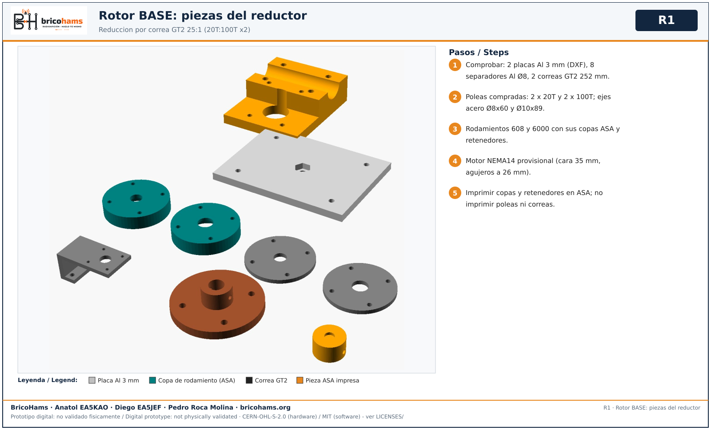
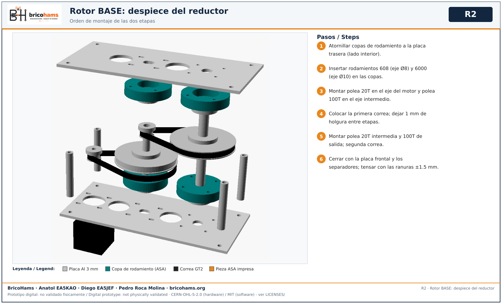
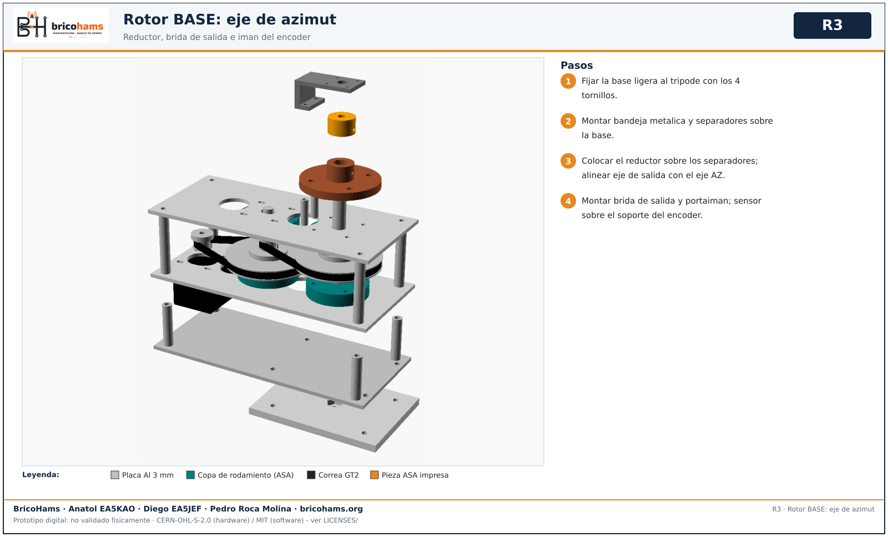
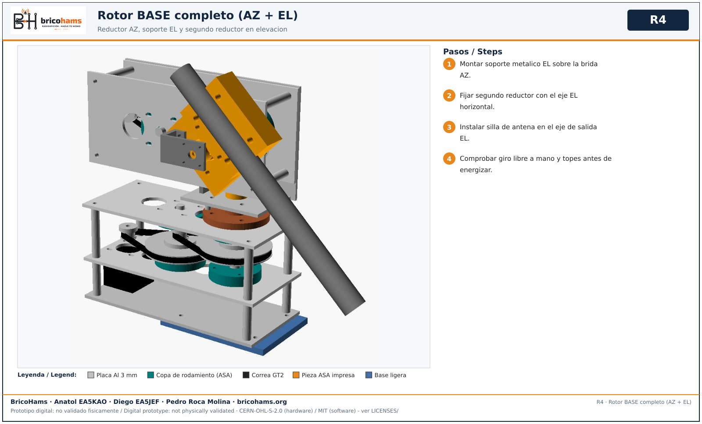
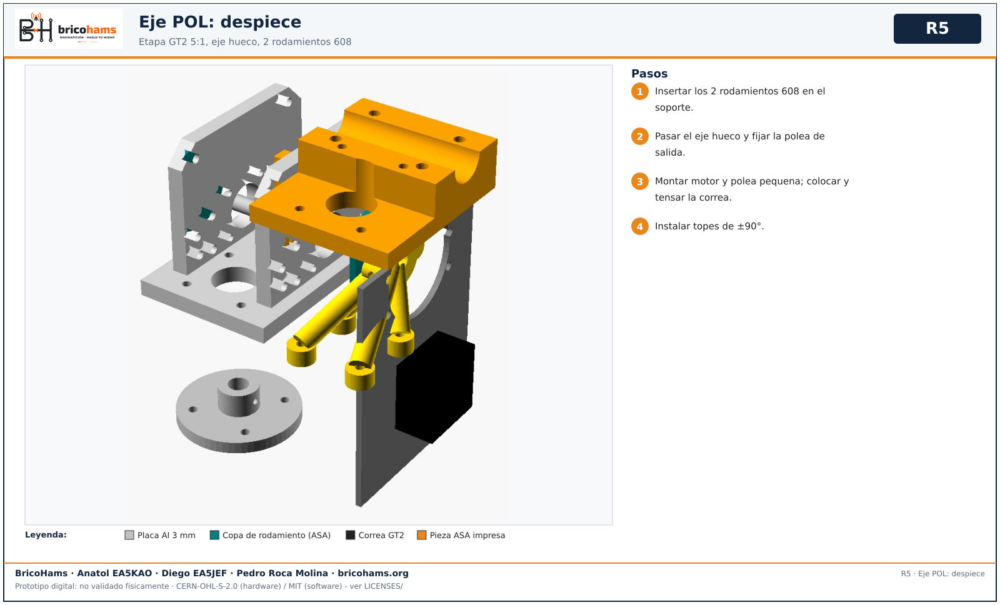
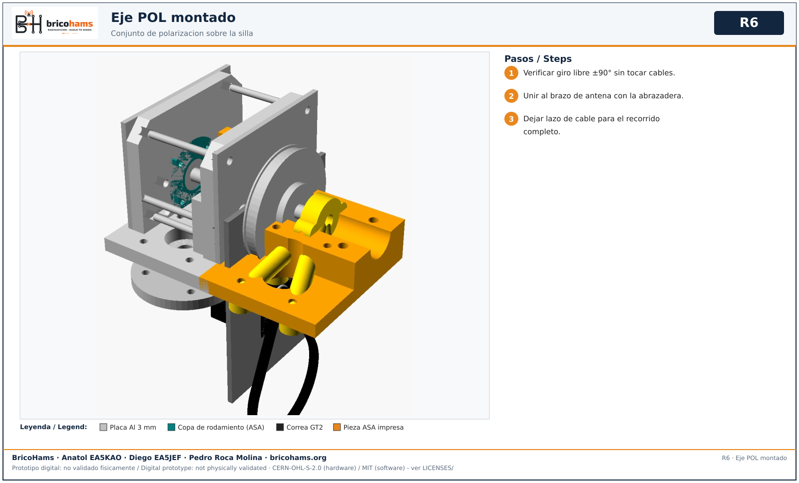

# Montaje del rotor

Rotor BASE por correa: 2 etapas GT2 20T:100T = 25:1, correas de 252 mm, placas de aluminio de 3 mm, poleas compradas, rodamientos 608/6000, copas ASA. Motor NEMA14 provisional. Ver [MECHANICAL.md](../MECHANICAL.md) y [MODULE-ROTOR.md](../MODULE-ROTOR.md).

## 1. Piezas

*R1* — BricoHams · Anatol EA5KAO · Diego EA5JEF · Pedro Roca Molina

## 2. Reductor

*R2* — BricoHams · Anatol EA5KAO · Diego EA5JEF · Pedro Roca Molina

Tensar la correa con las ranuras de ±1.5 mm de la placa antes de apretar. Las poleas y correas son compradas: el modelo solo muestra su envolvente.

## 3. Eje de azimut

*R3* — BricoHams · Anatol EA5KAO · Diego EA5JEF · Pedro Roca Molina

## 4. Rotor completo AZ + EL

*R4* — BricoHams · Anatol EA5KAO · Diego EA5JEF · Pedro Roca Molina

**Parada:** no energizar hasta comprobar giro libre a mano, topes y cableado ([04-electronica.md](04-electronica.md)).

## 5. Eje de polarizacion (POL, opcional)

*R5* — BricoHams · Anatol EA5KAO · Diego EA5JEF · Pedro Roca Molina

*R6* — BricoHams · Anatol EA5KAO · Diego EA5JEF · Pedro Roca Molina

Concepto de tercer eje de roll: una etapa GT2 5:1, eje hueco, 2 rodamientos 608, topes ±90°. Ver [POLARIZATION-MECHANICAL.md](../POLARIZATION-MECHANICAL.md).
