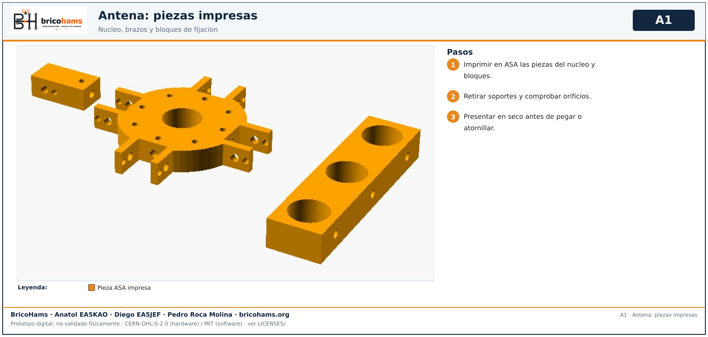
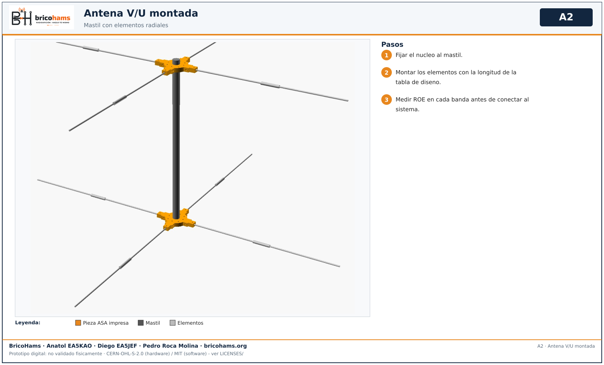

# Montaje de la antena

Antena V/U sobre mastil. Ver [MODULE-ANTENNA.md](../MODULE-ANTENNA.md).

## 1. Piezas impresas

*A1* — BricoHams · Anatol EA5KAO · Diego EA5JEF · Pedro Roca Molina

## 2. Montaje

*A2* — BricoHams · Anatol EA5KAO · Diego EA5JEF · Pedro Roca Molina

Medir ROE por banda antes de conectar al sistema; no transmitir sin carga o antena verificada.
