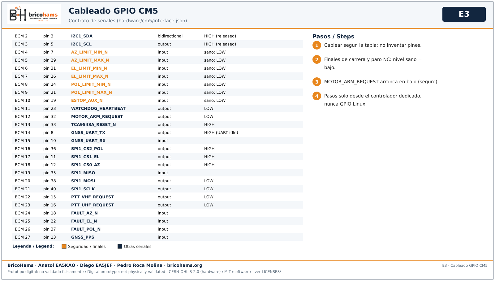

# Montaje de la electronica

Ver [ELECTRICAL.md](../ELECTRICAL.md), [PCB.md](../PCB.md), [CM5-PCB.md](../CM5-PCB.md).

> **HOLD: NO FABRICAR / NO ENERGIZAR las placas no liberadas.**
> Esta guia permite identificar y revisar piezas, no autoriza cablearlas.
> Una tabla GPIO asigna senales logicas; no especifica niveles, protecciones
> ni un arnes de campo aprobado.

## Elegir una sola arquitectura

| Variante | Lista y control | Limite |
| --- | --- | --- |
| ESP32 AZ/EL | [electrical.csv](../../bom/electrical.csv), [pcb.csv](../../bom/pcb.csv), E1 | Dos ejes; no enchufar cabecera CM5 |
| CM5 AZ/EL/POL | [multimode-assembly.csv](../../bom/multimode-assembly.csv), auxiliar E2 | Tres ejes previstos; proveedor real y guard pendientes |

Todas las filas tienen [ficha visual](components/README.md). Los valores
de fusible de la BOM ESP32 no se trasladan al sistema CM5.

## 1. PCB portadora

*E1* — BricoHams · Anatol EA5KAO · Diego EA5JEF · Pedro Roca Molina

## 2. PCB cm5-guard-A (solo revision)

*E2* — BricoHams · Anatol EA5KAO · Diego EA5JEF · Pedro Roca Molina

Esta placa **no es apta para fabricacion**; DRC/ERC en KiCad pendiente tras anadir el logo.

No repetir ni atribuir a la revision con logo los resultados anteriores
de ERC/DRC: [BRANDING](../BRANDING.md) explica que se modifico serigrafia
sin regeneracion completa desde KiCad. Antes de liberar hacen falta
ERC/DRC, correspondencia fuente/Gerber/BOM/CPL y cierre de bloqueos.

## 3. Cableado GPIO

*E3* — BricoHams · Anatol EA5KAO · Diego EA5JEF · Pedro Roca Molina

Fuente unica: `hardware/cm5/interface.json`. Los pasos de motor nunca se generan por GPIO de Linux.

## Revision e instalacion por etapas

1. Con todo desconectado, fijar revision de placa y contrastar cada
   conector con esquema y ficha del modulo exacto. Fotografiar orientacion
   y etiquetar ambos extremos. No deducir polaridad por color ni apariencia.
2. Revisar el camino de energia: bateria externa, fusible proximo al
   positivo, distribucion y ramas protegidas. **Nunca 12 V en el rail de
   5 V del CM5 ni en GPIO de 3,3 V.** La bateria de referencia necesita
   convertidores y protecciones seleccionados y ensayados.
3. Con placas y motores desconectados, comprobar continuidad, aislamiento
   y polaridad del arnes. No alimentar convertidores sin revisar su
   conexion e instrucciones; sus salidas se miden antes de conectar cargas.
4. Verificar parada enclavada y finales NC en el banco definido en
   [02-electronica](../testing/02-electronica.md). La parada debe cortar
   potencia por hardware, no solo comunicar un cambio a Linux.
5. Solo tras liberar circuito e interfaces, probar logica con fuente
   limitada y sin motores/RF. No usar simultaneamente USB y fuente externa
   sin resolver el retorno y la prevencion de realimentacion.
6. Verificar cada sensor por separado y luego conjuntamente. Tres AS5600
   no pueden compartir el mismo bus sin separacion/multiplexor aprobado.
   GNSS da sitio/UTC, no rumbo estacionario; IMU no mide el eje EL.
7. Probar un driver y motor descargado con corriente segun ficha; luego
   cada eje y fallos. Conectar/desconectar motores solo sin energia.
8. Registrar medidas y revision en el
   [registro de pruebas](../testing/registro-pruebas.csv). Fallo de parada,
   NC, sensor o watchdog impide pasar a carga o TX.

La [puerta previa PCB](../testing/03-puerta-pcb.md) debe estar cerrada
antes de pedir fabricacion. No puentearla para seguir estas instrucciones.
