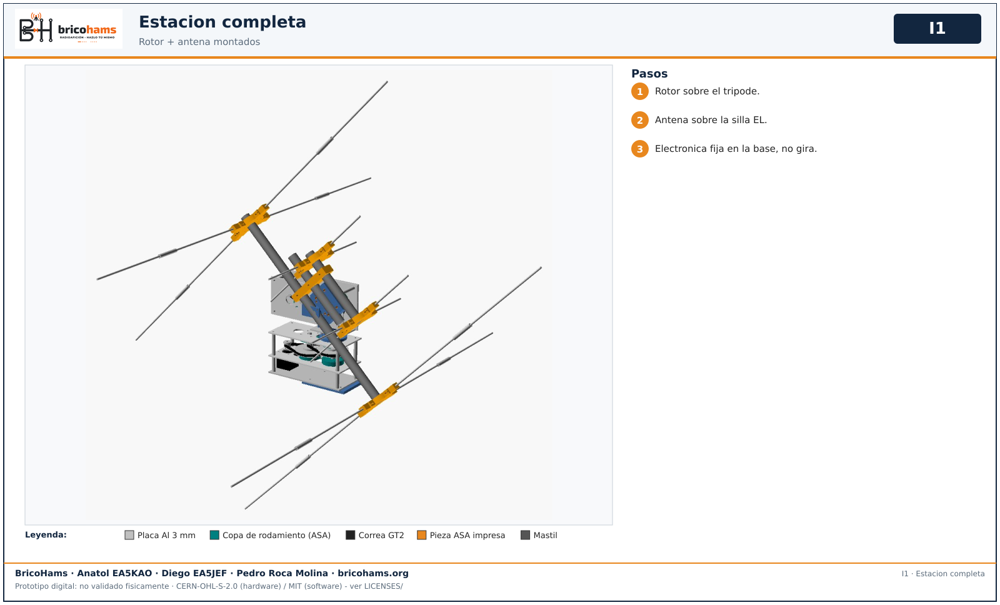

# Montaje colectivo

Solo tras aceptar cada modulo por separado. No sumar dos CM5 ni dos sistemas de energia.

## 1. Secuencia

*I2* — BricoHams · Anatol EA5KAO · Diego EA5JEF · Pedro Roca Molina

## 2. Estacion montada

*I1* — BricoHams · Anatol EA5KAO · Diego EA5JEF · Pedro Roca Molina

La electronica, la radio y la bateria quedan en la base fija y no giran con la antena. Detalle en [MODULE-INTEGRATED.md](../MODULE-INTEGRATED.md).
