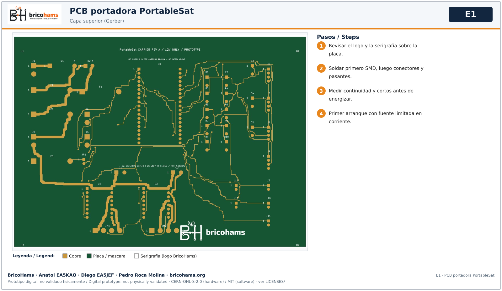
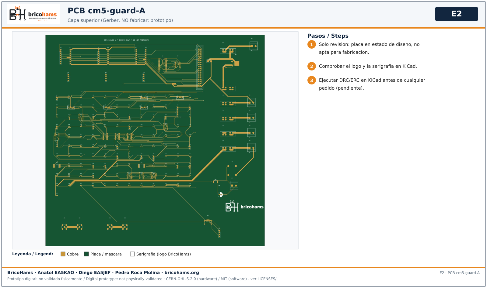

# BricoHams: instalacion visual de software y puesta en servicio

Esta guia separa **instalar software**, **ensayar en banco** y **autorizar
operacion fisica**. No se ha conectado ni flasheado ningun equipo durante
esta revision. Las placas siguen en HOLD; no habilitar motores ni TX.


## 1. Elegir el recorrido correcto

| Equipo que se prepara | Software | Guia detallada |
| --- | --- | --- |
| Antena manual sola | Ninguno | [02-antena](02-antena.md) |
| Rotor ESP32 AZ/EL y RT3S independiente | Firmware ESP32, AP web y opcional Android | [CONTROL](../CONTROL.md), [WEBFLASH](../WEBFLASH.md) |
| CM5 radio-only | Receta BricoHams OS y host de radio | [Instalacion radio](../../os/install/radio-only.md) |
| CM5 rotor-only | Perfil rotor; sin proveedor de movimiento comisionado | [Instalacion rotor](../../os/install/rotor-only.md) |
| CM5 integrated | Dependencias de radio y rotor; servicio integrado no operativo | [Instalacion completa](../../os/install/full-station.md) |
| PortableSatLite | Firmware, CAD y pruebas de su propio subproyecto | [README independiente](../../PortableSatLite/README.md) |

**No usar WebFlash ESP32 para CM5 ni instalar firmware principal en
PortableSatLite.** El telefono no sustituye el motor orbital del controlador.

## 2. Verificar los fuentes en Windows

Desde la raiz, con Node.js >=22:

```powershell
node --version
.\scripts\validate.ps1
node scripts\component-catalog.cjs --check
```

Resultado esperado: cero fallos; toda omision se registra aparte. Esto
comprueba software, contratos y documentacion; no compila automaticamente
Android/ESP32 ni valida hardware. El
[registro de revision](../PROJECT-REVIEW.md) distingue cada superficie.

Las [fichas de componentes](components/README.md) se regeneran sin paquetes
adicionales mediante `node scripts\component-catalog.cjs`. Tras cambiar una
BOM, regenerar y revisar el diff, no editar las fichas individualmente.

## 3. ESP32: preparar y cargar solo la revision correcta



1. Comprobar modulo ESP32-WROOM clasico y entorno `esp32` de
   [platformio.ini](../../firmware/platformio.ini). No asumir C3/S3.
2. Seguir versiones y comandos de [WEBFLASH](../WEBFLASH.md). Si se compila
   localmente, conservar informe de compilacion, revision y hashes.
3. Mantener motores desconectados y revisar alimentacion USB/externa.
   No cargar una placa que no tenga autorizacion electrica para el banco.
4. Usar un bundle verificado; no inventar offsets ni borrar NVS para
   resolver una incompatibilidad. Guardar configuracion antes de cambios.
5. Configurar AP/BLE y credenciales privadamente. No publicar claves ni
   esperar que BLE se habilite por instalar una imagen publica.
6. Verificar arranque desarmado, estado visible y parada antes de calibrar.
   TLE y sitio/UTC deben ser validos; no mover un eje aun no aceptado.

La RT3S/OpenGD77 sigue siendo una radio independiente: no se presume CAT,
audio Bluetooth o full-duplex por conectarla al conjunto.

## 4. CM5: preparar sistema, perfiles e identidades



1. Confirmar CM5, CM5IO oficial, refrigeracion, alimentacion y medio de
   arranque exactos. No confundir la auxiliar GPIO con una portadora CM5IO.
2. Construir la receta en Linux conforme a
   [BRICOHAMS-OS](../BRICOHAMS-OS.md), con su commit pi-gen fijado. La receta
   no es una imagen binaria ya probada ni se construye nativamente en Windows.
3. Verificar el SHA-256 del archivo emitido. Identificar y respaldar el
   medio de destino antes de grabar: la grabacion borra ese medio. No
   ejecutar escritura a disco a partir de un nombre supuesto.
4. En la consola local, usar la cuenta inicial documentada en
   [BRICOHAMS-OS](../BRICOHAMS-OS.md) y cambiar inmediatamente su
   contrasena publica con `passwd`. Mantener SSH deshabilitado hasta
   hacerlo. Configurar red local y elegir explicitamente `rotor-only`,
   `radio-only` o `integrated`; no hay eleccion automatica de perfil.
5. En perfiles de radio, identificar ambos LimeSDR por serie y asignacion
   VHF/UHF. Mantener USB3 para SDR y resolver audio con hardware aprobado.
   No seleccionar silenciosamente el primer dispositivo USB encontrado.
6. Configurar identidades locales siguiendo la guia del perfil. El selector
   instala dependencias, pero **no habilita automaticamente el servicio**.
7. Mantener TX inhibido. `integrated` y movimiento real requieren proveedor
   CM5 y guard comisionados; instalar paquetes no cierra ese bloqueo.

## 5. Android

1. Elegir app/variante compatible con el controlador: no atribuir pruebas
   ESP32 al protocolo CM5. Consultar [ANDROID](../ANDROID.md) y
   [matriz funcional](../ANDROID-FEATURE-MATRIX.md).
2. Para reproducir la compilacion se necesitan JDK 17, SDK Android 35 y el
   wrapper del proyecto. Seguir los comandos completos del manual Android,
   sin almacenar rutas o claves personales en el repositorio.
3. Si se usa una APK conservada, verificar su SHA-256 contra el registro de
   esa revision. Es una APK debug, no una firma de distribucion.
4. Revisar permisos Bluetooth, notificaciones y microfono segun la funcion.
   Emparejar con el equipo elegido; una lista BLE no demuestra conexion.
5. Transferir TLE y consultar estado primero sin movimiento. En CM5, JSON y
   ACK no prueban mapa/radar ni posicion alcanzada.
6. Ensayar reconexion, permisos denegados y datos caducados siguiendo
   [07-app-android](../testing/07-app-android.md).

## 6. Aceptacion y uso del conjunto


Continuar por [05-integracion](05-integracion.md) solo con los modulos
aceptados. Primero recepcion; TX requiere cadena RF cualificada, licencia,
carga/instrumentos y permiso fisico independiente. Un unico TX activo.
Guardar medidas en [registro-pruebas.csv](../testing/registro-pruebas.csv).
No sustituir los estados pendientes por aprobacion de software.
