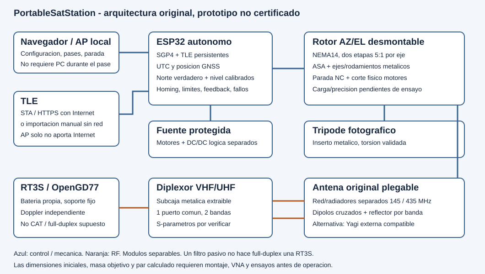

# PortableSatStation - portable 145/435 MHz station

## Languages

Project documentation is maintained in Spanish, English, and Hungarian.
English and Hungarian translations are being synchronized against the
current technical revision; they are not declared complete until coverage
and correspondence have been checked. Original third-party license texts
remain unchanged.

## Reference prices and materials

The project records indicative EUR reference prices for components,
assembly materials, and consumables, including quantities, model/revision,
date, sources, VAT, and shipping. A mean is calculated only from comparable
quotes; a single observation is identified as such. Components without an
approved model have a clearly separated indicative allowance or a pending
price, never an invented price or zero cost. Reusable tools are budgeted
separately from station cost. Illustrated build steps are linked to BOM IDs
to distinguish parts, cables, fasteners, and external materials.
Observations and pending categories are in
[reference-prices.csv](../../bom/reference-prices.csv); methods and
limitations are in [REFERENCE-PRICES.md](REFERENCE-PRICES.md). The quoted
electronics subset totals EUR 1,313.90 normalized pre-VAT; it is not the
complete station cost. Collection remains open and is not a closed quotation.

The original project is a modular amateur satellite station: foldable
dual-band antenna, AZ/EL/POL rotor, CM5 radio host, and separable antenna,
rotor, radio, and RF modules.

**Current authors:** Anatol EA5KAO, Diego EA5JEF, and Pedro Roca Molina.
Scientific outreach reference for children and adolescents:
[Bricohams](https://bricohams.org). See [authorship](AUTHORS.md),
[acknowledgements](ACKNOWLEDGEMENTS.md), and the
[liability notice](DISCLAIMER.md). Educational use must always be supervised.

**Status: engineering prototype, not certified RF/mechanical equipment.**
Compilation, test, and export results are recorded in
[VALIDATION.md](VALIDATION.md). A successful build or valid STL does NOT
demonstrate VSWR, gain, wind resistance, or safety of an assembled structure.
Do not manufacture in quantity or transmit without the commissioning
procedure.



## Agreed baseline

| Aspect | Decision |
| --- | --- |
| Bands | 145 and 435 MHz; exact channels depend on satellite and regulations |
| Motors | Two NEMA 14 motors; current/torque per datasheet of selected motor |
| Reduction | BASE: two GT2 belt stages, 20:100 each, total 25:1; planetary design is LEGACY |
| Material | ASA for mechanical parts; metal conductors and shafts |
| Tracking | SGP4 on ESP32 in the historical baseline; the phone is not the orbital computer |
| Network | AP without Internet; STA with Internet or manual TLE import |
| Radio | Independent RT3S/OpenGD77; no assumed automatic CAT/PTT |
| Mounting | Photographic tripod, metal insert, and boom adapters |
| Modularity | Antenna, rotor, radio, and diplexer separate |
| Mass | <=5 kg for the complete operating assembly, including tripod, radio, and cables; external battery excluded by the later decision and weighed separately; earlier <=3 kg target is historical |
| Initial load | Test target: antenna <=0.5 kg, CG <=30 mm from EL axis |

**Approved historical priority change:** the planetary variant was too heavy
in its preliminary budget (3.208-4.038 kg with power supply), so a lighter
transmission was authorized. BASE retains 25:1 and 80,000
microsteps/revolution, coordinated with the ESP32 baseline. The historical
<=3 kg objective was not met by the 3.130-3.200 kg BuildLight estimate; that
estimate excludes the new radio and tripod and is not a measured mass for the
current station. The current station limit is <=5 kg with only the external
battery excluded. Mounting geometry still requires physical verification.

## In-development expansion: integrated multimode radio

This section records requests made after the initial delivery.
**These are not verified capabilities of the earlier hardware or the locally
published APK.** The table distinguishes requested scope and state; measured
figures are recorded in [VALIDATION.md](VALIDATION.md).

| Function | Technical description and limits | Expansion status |
| --- | --- | --- |
| VHF/UHF satellite radio | Nominal 145/435 MHz; exact frequencies depend on satellite and regulations; independent RX/TX chains for full duplex | RF architecture under verification; two modules selected |
| Analog modes | FM, AM, and upper-sideband SSB (USB); USB here means modulation mode, not a connector | Requested; do not claim support from an FM-only module |
| CAT and Doppler | Control RX/TX frequency and mode from the same APK; correction depends on radial velocity and frequency plan | New integration pending; RT3S remains independent, with no assumed CAT |
| Integrated computer | Raspberry Pi Compute Module 5 (CM5) with purchased official CM5IO, cooling, and a separate original auxiliary board; no ESP32 in the new variant | Architecture selected; combined performance, power, thermal behavior, and physical integration pending |
| RF modules | Two replaceable LimeSDR Minis, one per VHF/UHF path, simultaneous reception and TX-capable chains; conventional 50-ohm SMA | Current selection; only one active TX initially. Native output is low power, not 5 W; linear PAs and filters require physical qualification |
| Motion under Linux | Dedicated ramp-generation drivers, NC limits, physical power cutoff, and independent watchdog | CM5 drivers/auxiliary board remain pending; do not generate STEP in a nondeterministic loop or claim precision |
| GNSS/GPS | Receiver/antenna for SGP4 site, altitude, and UTC; UART/PPS only with verified documented levels and protocol | NMEA GNSS implemented in ESP32 variant; SBC receiver/interface and antenna to be selected; PPS optional and unverified; stationary GNSS gives no heading |
| Compass | Remote magnetometer, installed-system calibration, site/date declination, and true-north reference | New compass/magnetometer not implemented or calibrated; sensor, mount, interface, and PCB pending; earlier optional connectors do not imply a working compass |
| Tilt/level | IMU measures base tilt for compass tilt compensation; it is not antenna elevation | New IMU, mount, interface, and calibration pending; wiring/pins TBD until PCB freeze |
| Axis positions | Three independent AZ/EL/POL output encoders and six independent NC limits (two per axis); homing and conservative limits | Three feedback channels and six inputs to be designed. Three AS5600 devices share I2C address 0x36: separate buses or a specific verified multiplexer required; do not assume a shared bus works |
| Bluetooth audio | Bidirectional: receive to Android and send voice/AFSK to radio; transparent PCM transport separate from rotor BLE | Protocol and throughput in development; do not attribute audio to current control frames |
| Local audio | Small integrated speaker and microphone; external Baofeng/K1-style accessory with separate 3.5/2.5 mm jacks | Not SMA or power connectors; exact pinout, bias, PTT, and compatibility pending; do not wire by appearance |
| SSTV on Android | Receive and reconstruct ISS PD120/PD180 images from audio | Decoder and test vectors in development |
| Look4Sat/Robot36-like features | First agreed version: catalog/passes, map/radar, alerts, frequencies/Doppler, three axes, ISS SSTV, and APRS messaging | Feature matrix and staged development; no complete parity or all Robot36 modes promised |
| Android digital modes | Bell 202 AFSK1200, AX.25 with NRZI, bit stuffing and CRC; APRS interpretation | Development and PCM tests pending; other digital protocols are not automatically included |
| APRS messages | Receive, compose, and send between callsigns, with recipient, ID, and ACK/reject | Audio coding and RF transport verified separately; a WAV does not prove transmission or delivery |
| Cellular SMS | Not requested in final selection: APRS between callsigns is not SMS to a phone number | No mobile gateway or delivery promise |
| Updated PCB/Gerbers | Official CM5IO plus a separate original auxiliary board for movement/sensors/protection | Selection confirmed; new auxiliary Gerbers/BOM/CPL are in development. No custom all-in-one CM5 carrier in this revision |
| JLCPCB assembly | Gerber/drill package, PCBA BOM, and CPL pick-and-place with references, coordinates, side, and rotation; separate list of modules/manual/DNP | Requested; routed board, exact LCSC parts, and verification pending. No order submitted; no new CM5 CAD/Gerber or ERC/DRC approval |
| Enclosure and power | Bricohams branding, connector access, metal RF shielding, ventilation, battery, and protection | Reopen dimensions, consumption, temperature, and mass after hardware selection |
| Third POL axis | Motor for limited axial antenna rotation, calibrated position, physical limits, and protected coax routing | Design and recalculation of mass, loads, TX, and three motor channels in development |
| RHCP/LHCP selection | RF feed/phase switching for a compatible circular antenna, distinct from mechanical POL rotation | Per-band networks and TX-inhibited switching pending design and measurement |
| RF connectors | Standard 50-ohm SMA throughout RF path: antenna, diplexer, networks/hybrids, CP ports, SDR/radio, and bulkheads | Current lightweight choice; no RP-SMA or BNC in the base variant. Verify mating gender/center contact at every end before purchase; no adapter chains. Mass, support, strain relief, and manufacturer torque remain TBD. BNC in older variants is historical only, not the base interface |

[(tr)uSDX](https://dl2man.de/) and
[uSDX SOTA](https://antrak.org.tr/blog/usdx-sota-modular-all-mode-sdr-hf-transceiver-for-qrp-operations/)
are references for modularity, form factor, and CAT control, but are **HF**
radios: they do not scale to 145/435 MHz merely by changing firmware.
[ATU-100](https://github.com/Dfinitski/N7DDC-ATU-100-mini-and-extended-boards)
is an antenna tuner, not a transceiver, isolation filter, or VHF/UHF diplexer.
Its designs are not copied and its licenses are not replaced by this project's
licenses.

For full duplex, measure receiver isolation, blocking, and desensitization
during TX in both VHF/UHF band combinations, as well as VSWR, harmonics, and
temperature. No power, sensitivity, autonomy, latency, or accuracy value for
this expansion is guaranteed. PTT must remain disabled at startup, on fault,
on link loss, or on authorization expiry; transmission requires authorization
and physical commissioning. Voice compression and noise suppression can
prevent SSTV/AFSK decoding; a working Bluetooth link does not prove digital
audio is usable. Rotating a circular antenna about its axis does not reverse
RHCP/LHCP: handedness selection requires a suitable RF network and axial-ratio,
phase, and isolation tests. The earlier AZ/EL rotor did not have a third motor;
its drivers, limits, and budget do not cover the new axis.

The first ESP32 delivery, its firmware/WebFlash, APK, and earlier Gerbers
remain the documented reference variant, not an implementation of the new
radio. If Raspberry Pi is adopted, its installation/provisioning differs from
ESP32 WebFlash. See [ADR-024 to ADR-026](ARCHITECTURE.md) and
[requirements R25-R33](REQUIREMENTS.md).

### Location, orientation, and sensors

Stationary **GNSS does not measure station heading**: it provides site/UTC;
heading inferred from movement is not a substitute for the rotor's true-north
reference. Use GNSS UART only after verifying module, logic levels, protocol,
connector, and PCB; use PPS only after verifying its level, polarity, and
timing in the exact module's documentation. The new magnetic compass is
**not implemented or validated**. Install it remotely from motors, drivers,
RF/power, high-current wiring, and ferromagnetic parts; its location,
orientation, and pins remain TBD until PCB freeze.

Calibrate hard/soft iron and sensor-to-base alignment with the complete
station in its final configuration; record method, site/date, and
magnetic-declination source/version, and use measured IMU inclination for
tilt compensation. Validate in the field against an independent manual
true-north reference. Record variation with motors off and on under a safe
test; check RF/power effects only in a controlled, authorized test or leave
them marked pending. If the field is invalid, stale, or disagrees with the
reference, show an error and inhibit heading-dependent pointing: never infer
heading from stationary GNSS or substitute zero. The magnetometer does not
replace the three encoders or six NC limits. Invalid position/UTC prevents
tracking/Doppler; position, limit, or stop faults must inhibit motion and TX
according to verified policy.

### Updated mass limit

**Current requirement: <=5.000 kg for the complete, ready-to-operate assembly**,
including antenna, AZ/EL/POL rotor, radio, computer, enclosure, sensors,
cables/connectors, and tripod. The external battery is excluded by the later
decision; record its measured mass separately as additional carried weight.
The proposed working target of <=4.500 kg reserves 500 g, but is not a
measurement. The new variant has not demonstrated compliance. SMA connectors
are RF-only: power and sensors retain suitable connectors, and external
microphone/speaker use a verified audio interface. Panel mounting and strain
relief must prevent coax weight or torsion from loading a PCB trace or
connector contact.

The BuildLight budget with final PCB/enclosure is **3.130-3.200 kg before
pending additions: the earlier <=3 kg target was NOT met**. That historical
figure does not by itself include the new radio, POL axis, or tripod. Belt
transmission is backdrivable; balance and independent mechanical retention
are required when motors are de-energized.

The selected external reference battery is an ECO-WORTHY 12 V/30 Ah LiFePO4
unit (variant `40308275183822`). Its nominal 360 Wh is not measured usable
energy or guaranteed runtime. Confirm the exact variant's voltage limits,
BMS, charge/temperature limits, and mass; do not transfer specifications
from a 100 Ah version. Its BMS does not replace an external fuse or converters.
Use Powerpole and a main fuse near battery positive, with protected branches
for CM5/USB-C 5 V, motors, and RF. Select fuses against load/inrush and the
wire, connector, and holder capacities—not the BMS maximum current. Do not
connect or disconnect under load unless the connector rating permits it.
Battery cost remains in the project budget even though its mass is excluded
from the 5 kg station limit.

The commercial image informs the portability concept; its geometry and files
are not reproduced. A reference design at 449.55 MHz is not presumed
compatible with 145/435 MHz.

## Documentation and files

- [Standalone antenna module: materials, assembly, and tuning](MODULE-ANTENNA.md).
- [Standalone rotor module: assembly, sensors, and configuration](MODULE-ROTOR.md).
- [Standalone SDR radio module: assembly, audio, and configuration](MODULE-RADIO.md).
- [General step-by-step module integration](MODULE-INTEGRATED.md).
- [Architecture and justified decisions](ARCHITECTURE.md).
- [CM5, SDR, motors, and RF-selection evidence](CM5-RF-SELECTION.md).
- [Reference prices and open budget](REFERENCE-PRICES.md).
- [BricoHams operating-system image recipe](BRICOHAMS-OS.md).
- [Requirements and traceability](REQUIREMENTS.md).
- [Analysis of the PDFs](REFERENCE-ANALYSIS.md).
- [Sources, licenses, and provenance](SOURCES.md).
- [RF, diplexer, and OpenGD77](RF-AND-RADIO.md).
- [CAD, printing, and assembly](MECHANICAL.md).
- [Illustrated step-by-step assembly guide (per module and collective)](assembly/README.md).
- [PortableSatLite: lightweight portable V/U station (sub-project)](../../PortableSatLite/README.md).
- [BricoHams branding on PCB and printed parts](BRANDING.md).
- [Control, logical wiring, and API](CONTROL.md).
- [PCB and fabrication files](PCB.md).
- [WebFlash and GitHub build](WEBFLASH.md).
- [Android BLE app and TLE transfer](ANDROID.md).
- [Android app and mobile-protocol tests](ANDROID-ACCEPTANCE.md).
- [Power and electrical separation](ELECTRICAL.md).
- [Preliminary calculations](../../calc/design.json).
- [Numerical development and margins](DESIGN-CALCULATIONS.md).
- [Build sequence](BUILD-GUIDE.md).
- [Transport and field operation](FIELD-MANUAL.md).
- [Risks and mitigations](RISKS.md).
- [Tests and acceptance criteria](ACCEPTANCE.md).
- [Verifiable result of this delivery](VALIDATION.md).
- [CAD](../../cad/), [firmware](../../firmware/), [web](../../web/), [BOM](../../bom/).

## Local validation

Requires Node.js 22 or later for dependency-free calculations:

```powershell
node --test tests\engineering.test.cjs
node scripts\engineering-report.cjs
```

The control manual describes firmware compilation and flashing. The
mechanical manual describes exporting each part in OpenSCAD. No cloud service
or required PC is needed during a pass.

## Field use

1. Set up a stable tripod; level, balance, and verify attachment.
2. Connect modules with power disconnected; check the stop.
3. Obtain valid position and UTC; confirm true north and level.
4. Home and check limits without the antenna before loading it.
5. Import/update TLE and verify age and frequencies.
6. Select a reachable pass and deliberately arm tracking.
7. Operate the radio independently: OpenGD77 and rotor must use the same
   satellite, position, and time. Do not expect reception while a single RT3S
   is transmitting.
8. Stop, disconnect power, disassemble, and fold; never fold moving parts.

Detailed instructions and interlocks take precedence over this list. An ASA
enclosure does not provide RF shielding; passive networks are installed in a
metal submodule and verified with a VNA.

## Git

Independent local repository, `main` branch. It is not published
automatically. It contains no attached PDFs, Wi-Fi credentials, or commercial
models. Selected licenses: MIT for original software and CERN-OHL-S-2.0 for
original hardware; see scope and third-party rights in [NOTICE.md](NOTICE.md).

GitHub Actions / Pages workflow is prepared to build and offer WebFlash for
the control board. A local bundle was generated and checked; Pages has not
been published or run remotely. Deployment requires the documented approvals
and does not mean hardware approval.

The controller implements guided web calibration and a BLE protocol. The
Android app downloads TLE over HTTPS and transfers them to the rotor; passes
and tracking are calculated on the ESP32, not the phone. Debug APK built,
29 JVM tests, lint, and signature verified; interoperability with a physical
phone and rotor has not been tested.
