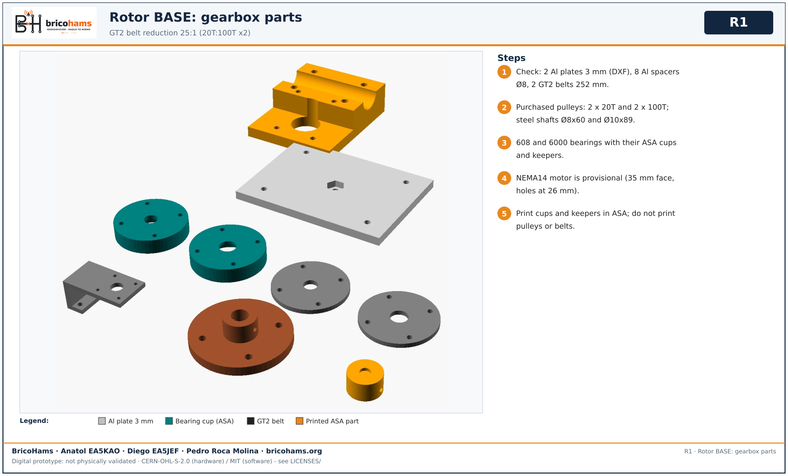
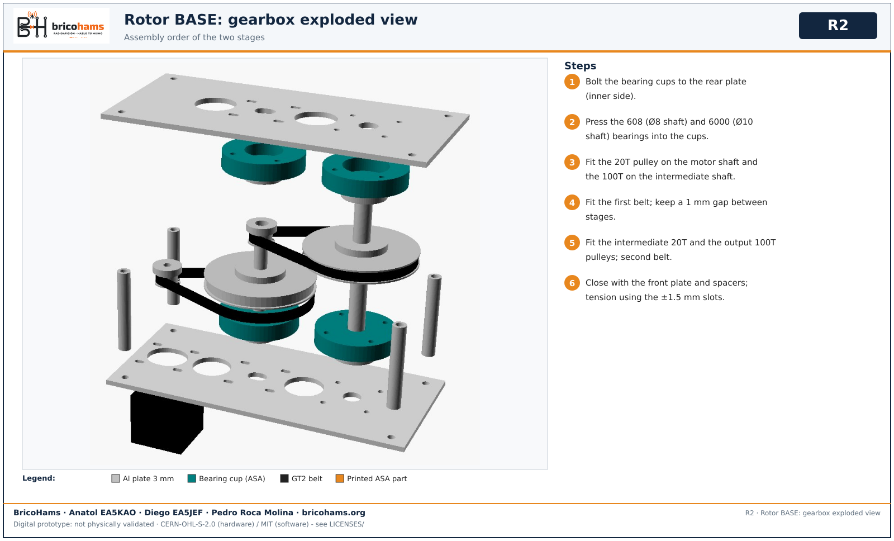
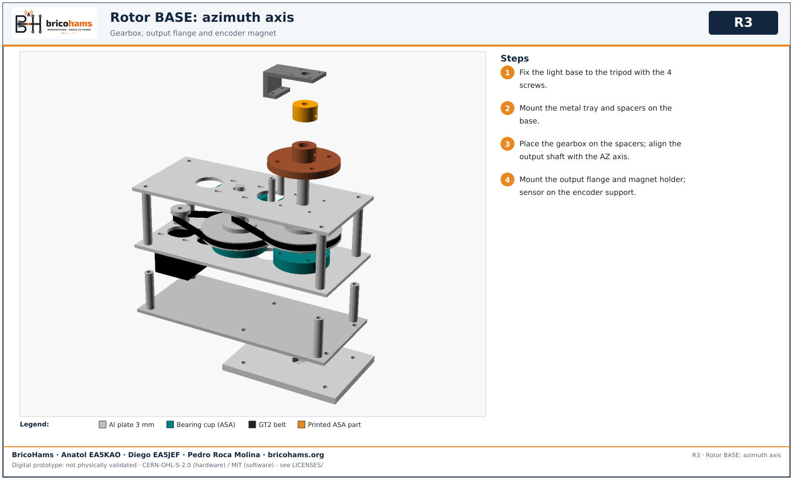
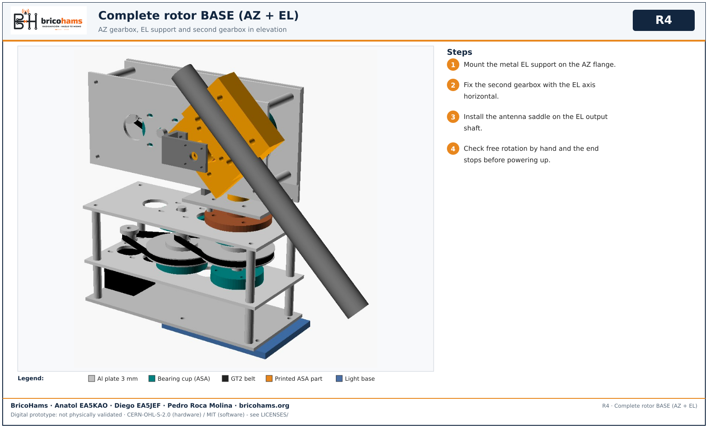
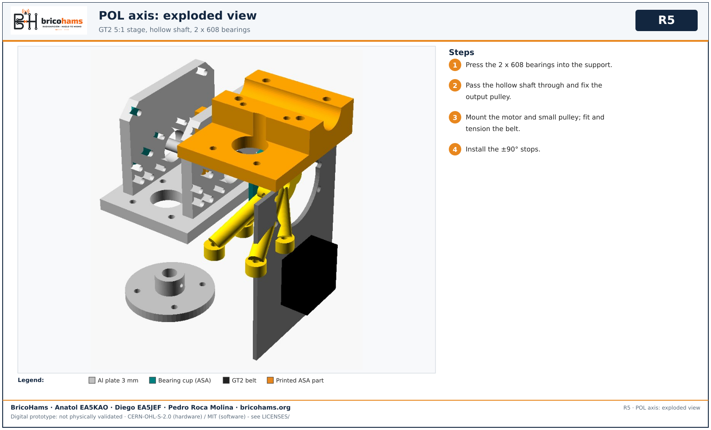
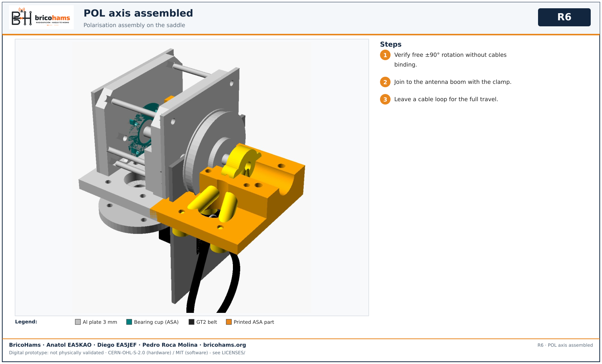

# Rotor assembly

Belt BASE: two GT2 20T:100T stages = 25:1, 252 mm belts, 3 mm aluminium plates, purchased pulleys, 608/6000 bearings, ASA cups. NEMA14 motor is provisional.

*R1* — BricoHams · Anatol EA5KAO · Diego EA5JEF · Pedro Roca Molina

1. Check parts: 2 plates, 8 spacers, 2 belts, 4 pulleys, shafts 8x60 and 10x89.

*R2* — BricoHams · Anatol EA5KAO · Diego EA5JEF · Pedro Roca Molina

2. Bolt bearing cups to the rear plate; press in 608 (8 mm shaft) and 6000 (10 mm shaft) bearings.
3. Fit the 20T pulley on the motor shaft and the 100T on the intermediate shaft; first belt; keep a 1 mm gap between stages.
4. Fit second-stage pulleys and belt; close with the front plate and spacers; tension with the ±1.5 mm slots.

*R3* — BricoHams · Anatol EA5KAO · Diego EA5JEF · Pedro Roca Molina

5. Mount the light base on the tripod, the metal tray and spacers, then the gearbox, output flange, magnet holder and encoder support.

*R4* — BricoHams · Anatol EA5KAO · Diego EA5JEF · Pedro Roca Molina

6. Fit the EL support, second gearbox (horizontal EL axis) and antenna saddle. **Do not power up** before checking free rotation and end stops.

*R5* — BricoHams · Anatol EA5KAO · Diego EA5JEF · Pedro Roca Molina

*R6* — BricoHams · Anatol EA5KAO · Diego EA5JEF · Pedro Roca Molina

7. Optional POL roll axis: one GT2 5:1 stage, hollow shaft, 2x608, stops ±90°.
