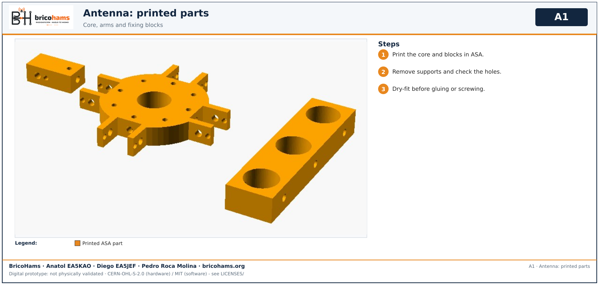
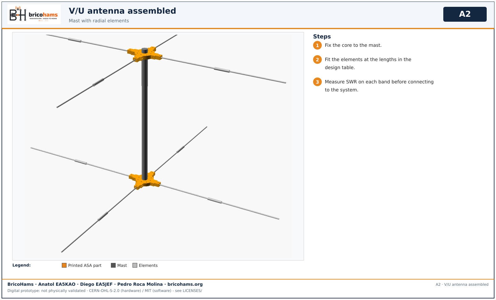

# Antenna assembly

*A1* — BricoHams · Anatol EA5KAO · Diego EA5JEF · Pedro Roca Molina

1. Print core and blocks in ASA; clean supports; dry-fit.

*A2* — BricoHams · Anatol EA5KAO · Diego EA5JEF · Pedro Roca Molina

2. Fix the core on the mast, fit the elements to the design-table lengths, and measure SWR per band before connecting to the system.
