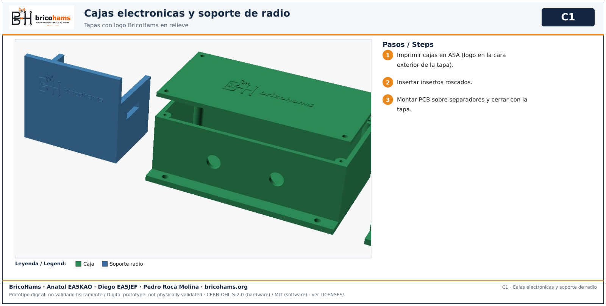

# Enclosures and radio cradle

Lids carry the BricoHams logo embossed 0.6 mm on the outer face. Print in ASA.

*C1* — BricoHams · Anatol EA5KAO · Diego EA5JEF · Pedro Roca Molina

1. Install threaded inserts. 2. Mount the PCB on spacers. 3. Close with the lid.
