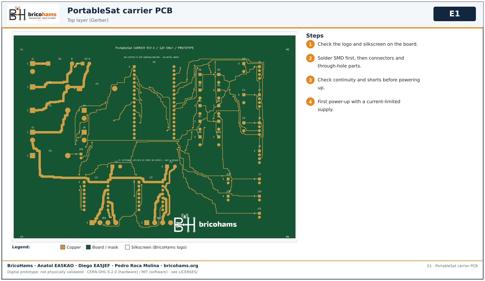
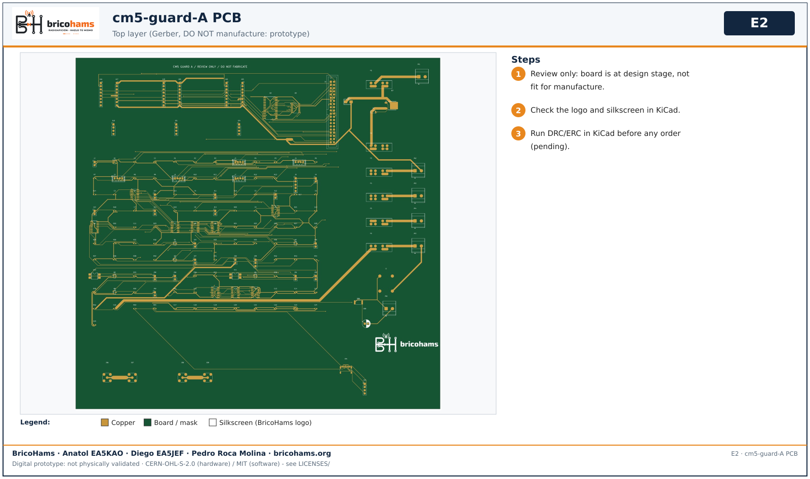
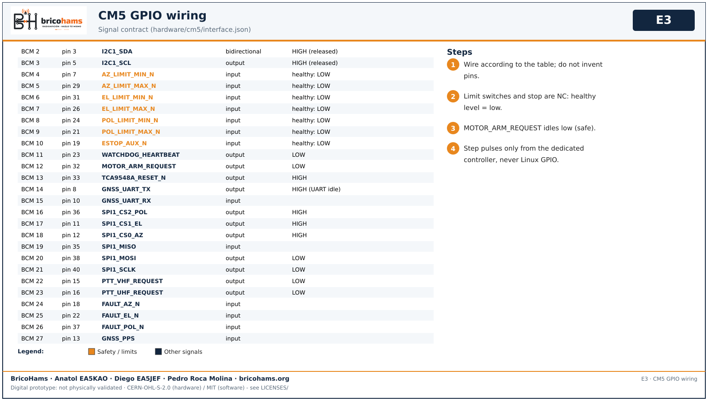

# Electronics assembly

*E1* — BricoHams · Anatol EA5KAO · Diego EA5JEF · Pedro Roca Molina

1. Carrier PCB: solder SMD first, then connectors and through-hole; check continuity; first power-up with a current-limited supply.

*E2* — BricoHams · Anatol EA5KAO · Diego EA5JEF · Pedro Roca Molina

2. cm5-guard-A is **review only, not for manufacture**; KiCad DRC/ERC after the logo addition is pending.

*E3* — BricoHams · Anatol EA5KAO · Diego EA5JEF · Pedro Roca Molina

3. Wire per the table (source: `hardware/cm5/interface.json`). Limits/E-stop healthy level = low; MOTOR_ARM_REQUEST idles low. Step pulses never come from Linux GPIO.
