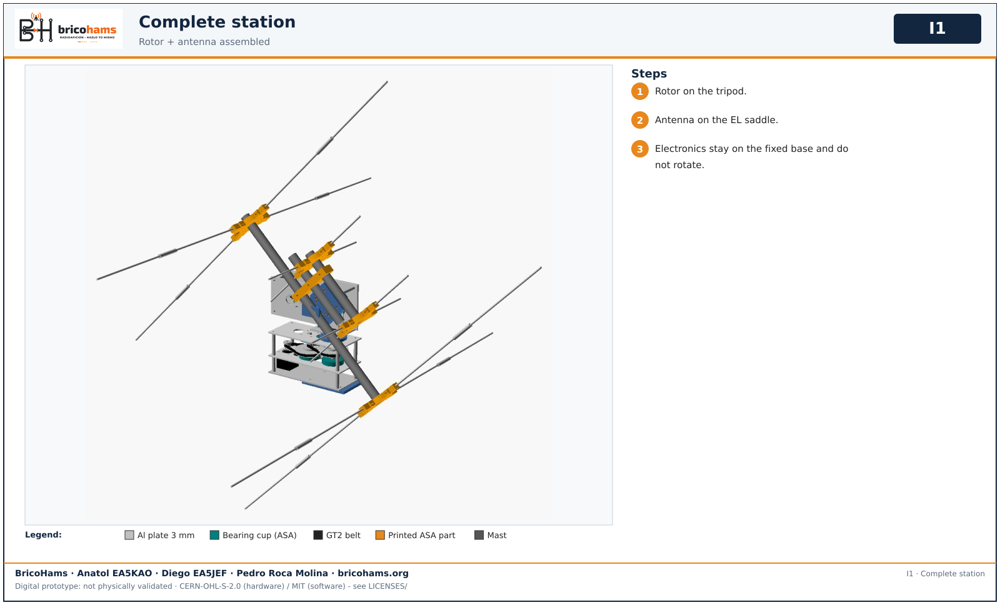

# Collective assembly

Only after each module is accepted on its own. Do not add a second CM5 or second power system.

*I2* — BricoHams · Anatol EA5KAO · Diego EA5JEF · Pedro Roca Molina

1. Accept antenna, rotor, radio separately. 2. Tripod and fixed base. 3. Couple antenna to rotor. 4. SMA RF per band, TX inhibited. 5. Powerpole/fuse distribution. 6. Integrated profile and SDR identities. 7. Calibrate UTC, north, AZ/EL/POL zeros. 8. Validate passes, Doppler, audio, SSTV/APRS without TX. 9. Qualify TX/full-duplex with load and instruments. 10. Weigh (<=5 kg target) and test 2 h endurance.

*I1* — BricoHams · Anatol EA5KAO · Diego EA5JEF · Pedro Roca Molina

Electronics, radio and battery stay on the fixed base and do not rotate.
