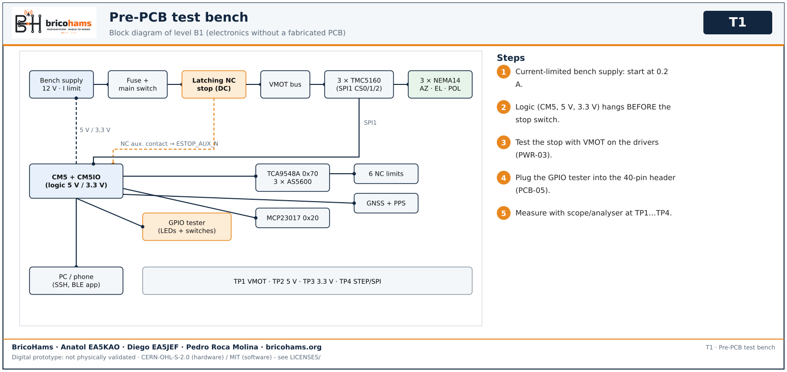
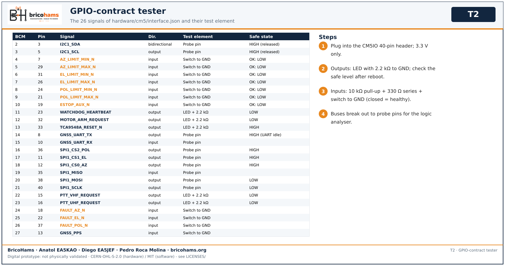
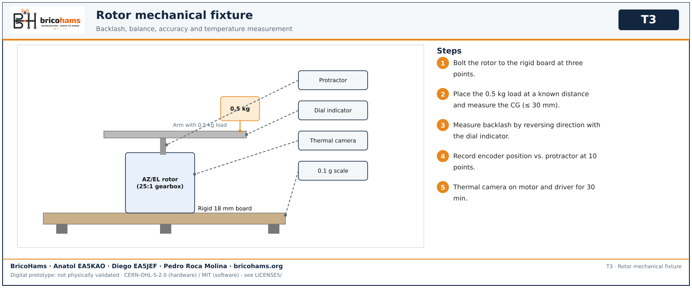

# Test bench design

The bench lets every block be tested with real modules and prototype wiring **before** the PCBs are made: if the equivalent circuit does not pass on the bench, the board is not ordered.

*T1* — BricoHams · Anatol EA5KAO · Diego EA5JEF · Pedro Roca Molina · bricohams.org

## Bench levels

| Level | Contents | Tests |
|---|---|---|
| **B0** Digital desk | Development computer, 2 Android phones (8-11 and 12+), optional CM5/Raspberry. No power stage. | SW, APP-01…06, PCB-01…03 |
| **B1** Electronics without a fabricated PCB | Bench supply, stop chain, guard emulator on prototype board, GPIO tester, 3 TMC5160 drivers on breakouts, NEMA14 motors, AS5600 + TCA9548A + MCP23017 modules, NC limit switches, GNSS, CM5 + CM5IO. | PWR, DRV, SNS, PCB-04…07, APP-07…10 |
| **B2** Mechanics | Rotor mounted on a rigid bench with a 0.5 kg load, protractor, dial indicator, scale, thermal camera/thermocouple. | MEC |
| **B3** RF | VNA with calibration kit, 50 Ω load ≥ 25 W, attenuators, wattmeter, SDR as source/monitor, antenna outdoors. | ANT, RAD |
| **B4** System in the field | Tripod, chosen battery, complete station, heading/time reference, real satellite. | SYS |

## Stop chain

Bench stop chain (mirrors the design, without a PCB):
`supply + → fuse → main switch → DC contact of the latching NC stop (or DC contactor) → VMOT bus → drivers`.
The NC auxiliary contact of the same stop goes to `ESTOP_AUX_N` (BCM10, healthy level = LOW). The logic (CM5, 5 V, 3.3 V) is connected BEFORE the stop, so it stays alive and reports the fault. The stop contact must carry the three motors' current with margin (the exact part of the design is unselected).

## GPIO-contract tester

GPIO-contract tester (prototype board, NOT production): it plugs into the CM5IO 40-pin header and uses 3.3 V only.
- Each CM5 **output** (WATCHDOG_HEARTBEAT, MOTOR_ARM_REQUEST, TCA9548A_RESET_N, SPI CS, PTT_*_REQUEST…) drives an LED with a 2.2 kΩ resistor to GND, to see its safe level after reboot.
- Each **input** (6 NC limits, ESTOP_AUX_N, FAULT_*_N, GNSS_PPS) has a 10 kΩ pull-up to 3.3 V, a 330 Ω series resistor and a switch to GND: closed = LOW = healthy; open/cut wire = HIGH = fault.
- The buses (I2C1, SPI1, GNSS UART) break out to probe pins for the logic analyser.
- 5 V or 12 V is never connected to this board.
Figure T2 lists the 26 signals of `hardware/cm5/interface.json` with their test element.

*T2* — BricoHams · Anatol EA5KAO · Diego EA5JEF · Pedro Roca Molina · bricohams.org

## Mechanical fixture

Rotor bolted to a rigid 18 mm board on three support points; arm with the 0.5 kg target load at a known distance; protractor fixed to the shaft and dial indicator on the arm for backlash; scale for mass; thermal camera on drivers and motor.

*T3* — BricoHams · Anatol EA5KAO · Diego EA5JEF · Pedro Roca Molina · bricohams.org

## Bench equipment and component list

| Ref. | Qty | Equipment / component | Used in |
|---|---|---|---|
| EQ-01 | 1 | Bench supply 0–30 V / 0–5 A with current limit | PWR, DRV |
| EQ-02 | 1 | Stop chain: latching NC emergency stop (DC-rated contact) or DC contactor + NC auxiliary contact | PWR |
| EQ-03 | 1 | Fuse and holder sized for wire and load; Powerpole connectors | PWR |
| EQ-04 | 1 | Oscilloscope ≥ 100 MHz, 2-4 channels, with ground spring | PWR, DRV, SNS |
| EQ-05 | 1 | Logic analyser, 8+ channels (≥ 24 MS/s) with SPI/I2C/UART decoding | DRV, SNS, PCB |
| EQ-06 | 1 | 4½-digit multimeter or better, DC clamp ammeter | PWR, DRV |
| EQ-07 | 1 | Thermal camera or 2-channel K thermocouple | PWR, DRV, MEC |
| EQ-08 | 1 | GPIO-contract tester (own prototype board, see below) | PCB-05 |
| EQ-09 | 3 | TMC5160 v1.5 driver (SilentStepStick) on breakout / prototype board | DRV |
| EQ-10 | 3 | NEMA14 bipolar 200-step motor (the intended model) | DRV, MEC |
| EQ-11 | 3+1 | AS5600 module + diametric magnets (one spare) | SNS |
| EQ-12 | 1+1 | TCA9548A (0x70) and MCP23017 (0x20) modules | SNS, PCB |
| EQ-13 | 6 | NC limit switches with cable and connector | SNS |
| EQ-14 | 1 | 3.3 V UART GNSS module with antenna and PPS | SNS |
| EQ-15 | 1 | Remote compass/IMU and true-north reference (bubble level) | SNS, SYS |
| EQ-16 | 1 | CM5 + official CM5IO board + storage + heatsink | SW, PCB, APP |
| EQ-17 | 2 | LimeSDR Mini with USB and SMA cables | RAD |
| EQ-18 | 1 | Rigid bench (18 mm board) and rotor fixture with 0.5 kg load | MEC |
| EQ-19 | 1 | Protractor, dial indicator, calipers, 0.1 g / 5 kg scale | MEC |
| EQ-20 | 1 | VNA (e.g. NanoVNA or LibreVNA) with SOL + THRU kit | ANT |
| EQ-21 | 1 | 50 Ω dummy load ≥ 25 W, 10/20 dB attenuators, RF wattmeter | ANT, RAD |
| EQ-22 | 2 | Android phones 8-11 and 12+ with the debug APK | APP |
| EQ-23 | 1 | Isolated audio cable (ground isolator) and SSTV/APRS test WAVs | RAD, APP |

## Criteria to release PCB manufacturing

1. PWR, DRV and SNS APPROVED on B1 with the equivalent circuit.
2. GPIO tester: all 26 signals match (PCB-05).
3. ERC/DRC with no errors, hashes verified and review by a second person (PCB-01…03, 08).
4. No order without explicit approval by the owner. [Pre-fabrication gate](03-puerta-pcb.md).

[Back to the index](README.md)
