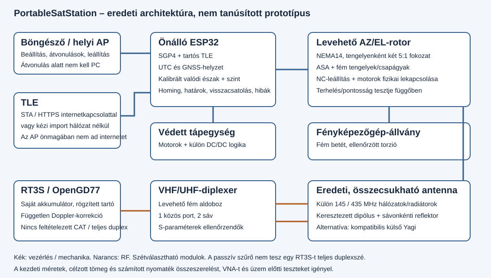

# PortableSatStation – hordozható 145/435 MHz-es állomás

## Nyelvek / Languages / Idiomas

A dokumentáció spanyol, angol és magyar nyelven készül. Az angol és magyar
kiadások fordítási/szinkronizálási állapotban vannak, és csak a lefedettség,
valamint az aktuális műszaki revízióval való egyezés ellenőrzése után
tekinthetők teljesnek. A nyelvi indexet e tesztek befejezése után kell
hivatkozni. A harmadik féltől származó licencek eredeti szövege változatlan
marad.

## Tájékoztató árak és anyagok

A bővített dokumentáció EUR-ban megadott tájékoztató árakat tartalmaz majd
az alkatrészekhez, szerelési anyagokhoz és fogyóeszközökhöz, mennyiséggel,
modellel/revízióval, dátummal, forrásokkal, ÁFÁ-val és szállítással együtt.
Átlagot csak összehasonlítható ajánlatokból számítunk; egyetlen megfigyelést
egyértelműen így jelölünk. A még jóvá nem hagyott típusú alkatrészhez külön
tájékoztató tartalékot vagy függő árat adunk meg, soha nem nullás vagy
kitalált árat. Az újra felhasználható szerszámokat külön költségvetésben
tartjuk az állomás költségétől. Az ábrázolt szerelési lépések a BOM-
azonosítókhoz kapcsolódnak, hogy az alkatrészek, kábelek, kötőelemek és
külső anyagok megkülönböztethetők legyenek. Az árak gyűjtése folyamatban
van; az adatok nem jelentenek végleges árajánlatot. A megfigyelések és a
függőben lévő kategóriák a [referenciaárak táblázatában](../../bom/reference-prices.csv)
találhatók; a módszert és korlátokat a [REFERENCE-PRICES.md](REFERENCE-PRICES.md)
rögzíti. Az árazott elektronikai részösszeg 1313,90 EUR, egységesített ÁFA
nélkül; ez nem a teljes állomás költsége.

A PortableSatStation eredeti, moduláris rádióamatőr műholdasállomás-terv:
kétsávos, összecsukható antenna, két tengelyű AZ/EL-rotor, ESP32-vezérlő
helyi AP webes felülettel és követéssel, levehető RF-rekesz, valamint
RT3S-tartó.

**Jelenlegi szerzők:** Anatol EA5KAO, Diego EA5JEF és Pedro Roca Molina.
A [Bricohams](https://bricohams.org) tudományos ismeretterjesztési
hivatkozás gyermekek és serdülők számára. Lásd a [szerzőket](AUTHORS.md),
a [köszönetnyilvánítást](ACKNOWLEDGEMENTS.md) és a
[felelősségi nyilatkozatot](DISCLAIMER.md). Az oktatási célú használat
mindig felügyelet mellett történjen.

**Állapot: mérnöki prototípus, nem tanúsított RF-/mechanikai berendezés.**
A fordítás, tesztek és export eredményeit a [VALIDATION.md](VALIDATION.md)
rögzíti. A sikeres fordítás vagy az érvényes STL NEM igazolja az SWR-t,
nyereséget, szélállóságot vagy egy felállított szerkezet biztonságát.
Üzembe helyezési eljárás nélkül ne gyártsd sorozatban és ne adj vele.



Az ábra az első, ESP32-es AZ/EL-változatot mutatja; nem a később kiválasztott
CM5-alapú, két LimeSDR Minivel és POL-tengellyel bővített architektúrát.
Lásd az alábbi fejlődési táblázatot, valamint az
[architektúra-döntéseket](ARCHITECTURE.md).

## Egyeztetett alapkonfiguráció

| Szempont | Döntés |
| --- | --- |
| Sávok | 145 és 435 MHz; a konkrét csatorna műholdtól és szabályozástól függ |
| Motorok | Két NEMA 14; áram/nyomaték a kiválasztott motor adatlapja szerint |
| Áttétel | BASE: két GT2 20:100 szíjfokozat, összesen 25:1; a bolygómű LEGACY |
| Anyag | ASA a mechanikai elemekhez; fém vezetők és tengelyek |
| Követés | SGP4 az ESP32-n; a mobil nem a pályaszámító motor |
| Hálózat | Internet nélküli AP; STA internetkapcsolattal vagy kézi TLE-importtal |
| Rádió | Független RT3S/OpenGD77; nem feltételezünk automatikus CAT/PTT-t |
| Szerelés | Fényképezőgép-állvány, fém betét és boomadapterek |
| Modularitás | Antenna, rotor, rádió és diplexer szétválasztható |
| Tömeg | <=5 kg a teljes üzemkész egységre, az állvánnyal, rádióval és kábelekkel; a külső akkumulátor későbbi döntés szerint kizárva, a korábbi <=3 kg-os cél történeti |
| Kezdeti terhelés | Tesztelendő cél: antenna <=0,5 kg, CG <=30 mm az EL tengelytől |

**Jóváhagyott prioritásváltás:** az előzetes költségvetésben a bolygóműves
változat túl nehéznek bizonyult (tápellátással 3,208–4,038 kg). A felhasználó
könnyebb áttételre váltott, hogy a <=3 kg prioritást kapja. A BASE változat
megtartja a 25:1-et és a firmware-rel összehangolt 80000 microstep/fordulat
értéket. A szerelési geometria még fizikai ellenőrzést igényel; az eredeti
bolygómű-számítás összehasonlító adat, nem a könnyű változat bizonyítéka.
A későbbi, teljes állomásra vonatkozó <=5 kg követelmény felülírja a korábbi
3 kg-os célkitűzést; a korábbi mérési/becslési eredményeket a történeti
összefüggés megőrzése érdekében megtartjuk.

## Fejlesztés alatt: integrált, multimódusú rádió

Ez a rész az első átadás utáni kéréseket rögzíti.
**Ezek nem az előző hardver vagy a helyben kiadott APK már igazolt
képességei.** A táblázat elválasztja a kért hatókört az állapottól;
a mért értékek a [VALIDATION.md](VALIDATION.md) dokumentumba kerülnek.

| Funkció | Műszaki leírás és korlátok | A bővítés állapota |
| --- | --- | --- |
| VHF/UHF műholdas rádió | Névlegesen 145/435 MHz; konkrét frekvenciák műholdtól és szabályozástól függnek; független RX/TX-láncok teljes duplexhez | RF-architektúra ellenőrzés alatt; két modult választottunk |
| Analóg módok | FM, AM és felső oldalsávos SSB (USB); itt az USB modulációs mód, nem csatlakozó | Kért módok; kizárólag FM-es modulról nem állítható, hogy képes rájuk |
| CAT és Doppler | RX/TX-frekvencia és mód vezérlése ugyanabból az APK-ból; a korrekció függ a radiális sebességtől és frekvenciatervtől | Új integráció függőben; az RT3S továbbra is önálló, feltételezett CAT nélkül |
| Integrált számítógép | Raspberry Pi Compute Module 5 (CM5), hivatalos CM5 I/O-panel, tápellátás és hűtés SDR-hez, audióhoz, SGP4-hez és ESP32 nélküli rotorhoz | Kiválasztott architektúra; az együttes teljesítmény, a tápellátás és a hőviselkedés függőben |
| Hordozópanel és PCBA | Beszerzett hivatalos CM5IO-panel, valamint saját segédpanel a mozgatáshoz, érzékelőkhöz és védelmekhez | A választás megerősítve; a segédpanel Gerber/BOM/CPL-állománya fejlesztés alatt. Ebben a revízióban nem készül egyedi, egypaneles CM5-hordozó |
| RF-modulok | Két, cserélhető LimeSDR Mini, sávonként egy, egyidejű VHF/UHF-vétellel és adásra képes láncokkal; SMA-csatlakozók | Aktuális választás; kezdeti szabályzat szerint egyszerre csak egy TX aktív. Több wattot PA/szűrők nélkül nem adnak le |
| Mozgatás Linux alatt | Dedikált mozgásgenerátor a meghajtókban, NC-határolók, fizikai tápmegszakítás és független watchdog | Új meghajtók és panel függőben; nem determinisztikus ciklusból ne generálj STEP-et, majd állíts pontosságot |
| GNSS/GPS | Vevő és antenna telephelyhez, magassághoz és SGP4 UTC-hez; UART és PPS csak dokumentált/ellenőrzött szintekkel és protokollal | ESP32-változatban NMEA GNSS megvalósítva; SBC-vevő/interfész és antenna kiválasztandó; PPS opcionális, nem igazolt; az álló GNSS nem ad irányt |
| Iránytű | Távoli magnetométer, beépített rendszer kalibrálása, telephely/dátum szerinti deklináció és valódi északi referencia | Új iránytű/magnetométer nincs implementálva vagy kalibrálva; érzékelő, szerelés, interfész és PCB függőben; régebbi opcionális csatlakozók nem jelentenek működő iránytűt |
| Dőlés/szint | Az IMU az alap dőlését méri az iránytű dőléskompenzációjához; ez nem az antenna elevációja | Új IMU, szerelés, interfész és kalibrálás függőben; a PCB befagyasztásáig kábelezés/lábkiosztás TBD |
| Tengelypozíció | Három független kimeneti AZ/EL/POL-encoder és hat független NC-végállás (tengelyenként kettő); homing és konzervatív határok | Három visszacsatolási csatorna és hat bemenet tervezendő. A három AS5600 címe I2C 0x36: külön busz vagy konkrét, ellenőrzött multiplexor kell; közös buszt ne feltételezz |
| Bluetooth-audio | Kétirányú: vétel Androidra és hang/AFSK küldése a rádió felé; átlátszó PCM-átvitel, a rotor BLE-jétől külön | Protokoll és adatsebesség fejlesztés alatt; a hangot ne tulajdonítsd a jelenlegi vezérlőkereteknek |
| Helyi hang | Beépített kis hangszóró és mikrofon; külső Baofeng/K1-típusú tartozék külön 3,5/2,5 mm-es jackekkel | Nem SMA- vagy tápcsatlakozó. Pontos bekötés, bias, PTT és kompatibilitás függőben; külső megjelenés alapján ne kábelezz |
| Android SSTV | ISS PD120/PD180 képek vétele és visszaállítása audióból | Dekóder és tesztvektorok fejlesztés alatt |
| Look4Sat/Robot36 jellegű funkciók | Egyeztetett első változat: katalógus/átvonulás, térkép/radar, riasztások, frekvencia/Doppler, három tengely, ISS SSTV és APRS-üzenetek | Funkciómátrix és szakaszos fejlesztés; nincs teljes paritás vagy az összes Robot36-mód ígérete |
| Digitális módok Androidon | Bell202 AFSK1200, AX.25 NRZI-vel, bit stuffinggal és CRC-vel; APRS-értelmezés | PCM-fejlesztés és teszt függőben; más digitális protokollok nem járnak automatikusan vele |
| APRS-üzenetek | Vétel, szerkesztés és küldés hívójelek között, címzett, ID és ACK/rej | Az audio-kódolás és RF-átvitel külön ellenőrzendő; egy WAV nem bizonyít adást vagy kézbesítést |
| Mobilhálózati SMS | A végleges választás nem kéri: a hívójelek közötti APRS nem telefonszámra küldött SMS | Nincs mobilátjáró vagy kézbesítési ígéret |
| Frissített PCB/Gerber | Új számítógép-, motor-, audio- és védelmi hordozó, levehető RF-modulokkal | Külön revízió alkatrész-/lábkiosztás-ellenőrzéssel függőben; a régi ERC/DRC-jóváhagyás nem alkalmazható |
| JLCPCB-összeszerelés | Gerber/fúráscsomag, PCBA BOM és CPL pick-and-place hivatkozásokkal, koordinátával, oldallal és forgatással; a modulok/kézi szerelés/DNP külön | Kért; a vezetékes panel, pontos LCSC-alkatrészek és ellenőrzés függőben. Megrendelés nem történt |
| Burkolat és táp | Bricohams-jelölés, csatlakozó-hozzáférés, fém RF-árnyékolás, szellőzés, akkumulátor és védelem | Hardverválasztás után újra kell nyitni a méreteket, fogyasztást, hőmérsékletet és tömeget |
| Autonómia | Kétórás cél két aktív vevővel és szakaszos adással; a CM5, Bluetooth, érzékelők és három tengely fogyasztását is bele kell számítani | A fogyasztás, az adási időarány, a hasznos kapacitás és a hatásfok még mérendő; az üzemidő nem garantált |
| Harmadik, POL-tengely | Az antenna korlátozott axiális forgatásához motor, kalibrált helyzet, fizikai határok és védett koaxátvezetés | Három motorcsatornához tartozó tervezés, valamint tömeg-, terhelés- és hajtás-újraszámítás fejlesztés alatt |
| RHCP/LHCP-választás | RF-táplálás/fázis átkapcsolása kompatibilis körpolarizált antennán; külön a mechanikai POL-forgástól | Sávonkénti hálózatok és tiltott TX melletti kapcsolás tervezése/mérése függőben |
| RF-csatlakozók | Hagyományos, 50 ohmos SMA a teljes RF-útvonalon: antenna, diplexer, hálózatok/hibridek, CP-portok, SDR/radio és bulkheadek | Aktuális választás a tömeg csökkentésére; nincs RP-SMA vagy BNC az alapváltozatban. Vásárlás előtt ellenőrizd minden vég csatlakozási nemét és középérintkezőjét; adapterlánc nélkül, a tömeg, alátámasztás, húzásmentesítés és gyártói nyomaték TBD. Régi változatok BNC-je csak örökölt lehetőség |
| USB-C | Tápellátáshoz és adatátvitelhez előnyben részesített; az RF-hez SMA, a hanghoz K1, a kétirányú hanghoz Bluetooth marad | Portonként ellenőrizendő a host-szerep/provisioning, sebesség, feszültség, valamint a tápforrás és a kábel teljesítmény-egyeztetése; ne feltételezz egyetlen, mindenre alkalmas portot |
| Powerpole-táp és biztosítékok | Piros/fekete Powerpole-csatlakozó a külső akkumulátor és az állomás közötti összeköttetéshez; főbiztosíték az akkumulátor pozitív pólusához közel, külön biztosítékágak a CM5, a motorok és az RF számára | Az érintkezőket, DC-kábelt és biztosítéktartókat, valamint a vezeték-keresztmetszetet terhelés, bekapcsolási áram és vezeték-védelem alapján kell kiválasztani; a BMS nem helyettesíti a biztosítékot |
| Tápellátási EMI | Közös módusú fojtó, csillapított differenciális szűrő és ágankénti hidegítés vizsgálata; a motorok, átalakítók és RF visszavezetését/tápját szét kell választani | Az áramot/telítést/DCR-t, az átalakító stabilitását, tranzienseket és a vételi zajt mérni kell; az RF-izoláció nem garantált |
| BricoHams operációs rendszer | A CM5-höz készült, hivatalos ARM64 Raspberry Pi OS-ből származtatott rendszer, saját bannerrel/arculattal, projektfüggőségekkel és szolgáltatásokkal, helyi privát provisioninggel | A telepítési recept/CI fejlesztés alatt; nincs igazoltan elindított vagy flashelt rendszerkép. Indítás mozgás/PTT nélkül, a szolgáltatások kifejezett üzembe helyezésével |

A [(tr)uSDX](https://dl2man.de/) és az [uSDX SOTA](https://antrak.org.tr/blog/usdx-sota-modular-all-mode-sdr-hf-transceiver-for-qrp-operations/)
a modularitás, méret és CAT-vezérlés hivatkozásai, de **HF**-berendezések:
pusztán firmware-váltással nem terjeszthetők ki 145/435 MHz-re. Az
[ATU-100](https://github.com/Dfinitski/N7DDC-ATU-100-mini-and-extended-boards)
illesztőegység, nem adó-vevő, leválasztószűrő vagy VHF/UHF-diplexer.
Tervrajzait nem másoljuk, licenceiket nem cseréljük a projekt licenceire.

Teljes duplexhez mindkét VHF/UHF irányban mérni kell a leválasztást,
blokkolást és a vevő deszenzitizációját adás közben, továbbá az SWR-t,
harmonikusokat és hőmérsékletet. A bővítés egyetlen teljesítmény-,
érzékenység-, üzemidő-, késleltetés- vagy pontosságértéke sem garantált.
A PTT maradjon tiltva indításkor, hiba, kapcsolatvesztés vagy engedély-
lejárat esetén; az adáshoz engedély és fizikai üzembe helyezés szükséges.
A hangkompresszió és zajelnyomás megakadályozhatja az SSTV/AFSK-vételt;
a sikeres Bluetooth-kapcsolat nem bizonyítja, hogy a digitális audio
használható. A körpolarizált antenna tengely körüli forgatása nem fordítja
meg az RHCP/LHCP irányt: a kéz kiválasztásához megfelelő RF-hálózat és
tengelyarány-/fázis-/leválasztásmérés szükséges. A harmadik motor nem volt
része a korábbi AZ/EL-rotornak; a régi meghajtók, határok és költségvetés
nem fedik le az új tengelyt.

Az első ESP32-kiadás, firmware-e/WebFlash-e, APK-ja és korábbi Gerberjei
továbbra is a dokumentált referencia-változatot jelentik, nem az új rádió
implementációját. Raspberry Pi választása esetén annak telepítése/beállítása
eltér az ESP32 WebFlash-től. Lásd az [ADR-024–ADR-026](ARCHITECTURE.md)
döntéseket és az [R25–R33](REQUIREMENTS.md) nyomon követést.

### Hely, tájolás és érzékelők

Az álló GNSS **nem méri az állomás irányát**: helyet/UTC-t ad; a mozgásból
következtetett irány nem helyettesíti a rotor valódi északi irányát.
GNSS-vevő UART-ot csak akkor használj, ha a pontos modul, logikai szintek,
protokoll, csatlakozó és PCB ellenőrzött; PPS-t csak a konkrét modul
dokumentációjában ellenőrzött szint, polaritás és időzítés után használj.
Az új magnetométeres iránytű **nincs megvalósítva és validálva**. A motortól,
meghajtóktól, RF-/tápkörtől, nagyáramú kábelektől és ferromágneses
alkatrészektől távol kell felszerelni; helye, iránya és lábkiosztása a PCB
befagyasztásáig TBD.

A teljes állomás végleges konfigurációjában kalibráld a hard/soft-iron
eltérést és az érzékelő-alap igazítását; jegyezd fel a módszert, helyet/
dátumot és a mágneses deklináció forrását/verzióját, és az IMU mért
dőlésével kompenzáld az irányt. Terepen független, kézi valódiészak-
referenciához képest validáld. Biztonságos tesztben jegyezd fel az
eltérést álló és járó motor mellett; az RF/teljesítmény hatását csak
engedélyezett, ellenőrzött tesztben vizsgáld, különben jelöld függőben.
Érvénytelen/elavult, vagy a referenciától eltérő mező esetén jelezz hibát,
és tiltsd a tájolásfüggő célzást: álló GNSS-ből soha ne következtess
irányra, és ne helyettesítsd nullával. A magnetométer nem helyettesíti a
három encodert és hat NC-végállást. Érvénytelen hely/UTC tiltja a követést/
Dopplert; a pozíció-, határ- vagy leállítási hibáknak a validált szabályzat
szerint tiltaniuk kell a mozgást és a TX-et.

### Frissített tömegkorlát

**Érvényes követelmény: <=5,000 kg a teljes, üzemkész összeállításra (külső akkumulátor nélkül)**,
beleértve az antennát, AZ/EL/POL-rotort, rádiót, számítógépet, dobozt,
érzékelőket, kábeleket/csatlakozókat és állványt; **kizárólag a külső
akkumulátor van kizárva** (R47). Az összes többi elemet mérd le; a javasolt munkacél <=4,500 kg, hogy 500 g
tartalék maradjon — ez nem mérési eredmény. Az új változat még nem bizonyítja
a határ teljesítését. Az SMA csak RF-csatlakozó; táp és érzékelők megfelelő
csatlakozót kapnak, a külső mikrofon/hangszóró pedig ellenőrzött audio-
interfészt használ. A panelrögzítés és húzásmentesítés akadályozza meg,
hogy a koax súlya vagy csavarónyomatéka PCB-vezetősávot vagy csatlakozó-
érintkezőt terheljen.

A végleges PCB-vel/dobozzal számolt BuildLight-költség **3,130–3,200 kg
a még függő tételek előtt: a korábbi <=3 kg-os cél NEM teljesült**, és ez a
történeti érték önmagában nem tartalmazza az új rádiót, a POL-t vagy az
állványt. A szíjhajtás visszahajtható; a motorok feszültségmentes állapotában
kiegyensúlyozás és független mechanikai megtartás szükséges.

A kereskedelmi kép csak a hordozhatóság koncepcióját szemlélteti; geometriáját
vagy fájljait nem reprodukáljuk. Egy hivatkozás 449,55 MHz-re tervezett
antennájáról nem feltételezzük, hogy kompatibilis 145/435 MHz-en.

## Dokumentáció és fájlok

- [Architektúra és indokolt döntések](ARCHITECTURE.md).
- [Követelmények és nyomon követhetőség](REQUIREMENTS.md).
- [PDF-ek elemzése](REFERENCE-ANALYSIS.md).
- [Források, licencek és eredet](SOURCES.md).
- [RF, diplexer és OpenGD77](RF-AND-RADIO.md).
- [CAD, nyomtatás és összeszerelés](MECHANICAL.md).
- [Vezérlés, logikai kábelezés és API](CONTROL.md).
- [PCB és gyártási fájlok](PCB.md).
- [WebFlash és GitHub-fordítás](WEBFLASH.md).
- [Android BLE-alkalmazás és TLE-átvitel](ANDROID.md).
- [Mobilalkalmazás-tesztek és protokoll](ANDROID-ACCEPTANCE.md).
- [Tápellátás és elektromos elkülönítés](ELECTRICAL.md).
- [Előzetes számítások](../../calc/design.json).
- [Numerikus levezetés és tartalékok](DESIGN-CALCULATIONS.md).
- [Építési sorrend](BUILD-GUIDE.md).
- [Tesztelés: komponensenkénti ellenőrzőlisták, várt viselkedés és a PCB-gyártás előtti tesztpad](testing/README.md).
- [Illusztrált lépésenkénti összeszerelési útmutató (modulonként és együtt)](assembly/README.md).
- [PortableSatLite: könnyű hordozható V/U állomás (alprojekt)](../../PortableSatLite/README.md).
- [BricoHams-arculat a PCB-n és a nyomtatott alkatrészeken](BRANDING.md).
- [Szállítás és terepi üzem](FIELD-MANUAL.md).
- [Kockázatok és enyhítés](RISKS.md).
- [Tesztek és elfogadási kritériumok](ACCEPTANCE.md).
- [A kiadás ellenőrizhető eredménye](VALIDATION.md).
- [CAD](../../cad/), [firmware](../../firmware/), [web](../../web/), [BOM](../../bom/).

## Helyi validálás

A függőség nélküli számításokhoz Node.js 22 vagy újabb szükséges:

```powershell
node --test tests\engineering.test.cjs
node scripts\engineering-report.cjs
```

A vezérlési kézikönyv ismerteti a firmware fordítását és feltöltését.
A mechanikai kézikönyv az egyes alkatrészek OpenSCAD-exportját írja le.
Átvonulás közben nem szükséges felhőszolgáltatás vagy PC.

## Terepi használat

1. Állíts fel stabil állványt; szintezd, egyensúlyozd, és ellenőrizd a rögzítést.
2. Leválasztott tápnál csatlakoztasd a modulokat; ellenőrizd a leállítót.
3. Szerezz érvényes helyet és UTC-t; erősítsd meg a valódi északi irányt és szintet.
4. Antenna felrakása előtt végezz homingot, és antenna nélkül ellenőrizd a határokat.
5. Importáld/frissítsd a TLE-t, ellenőrizd az epoch korát és frekvenciákat.
6. Válassz elérhető átvonulást, és tudatosan élesítsd a követést.
7. A rádiót önállóan üzemeltesd: az OpenGD77 és a rotor ugyanazt a műholdat,
   helyet és időt használja. Egyetlen RT3S adás közben ne várj vételt.
8. Állítsd le, vedd le a tápot, szereld szét és hajtsd össze; mozgó alkatrészt
   ne hajts össze.

A részletes utasítások és reteszelések elsőbbséget élveznek e listával szemben.
Az ASA-doboz nem RF-árnyékolás; a passzív hálózatokat fém almodulban kell
elhelyezni és VNA-val ellenőrizni.

## Git

Független helyi tároló, `main` ág. Automatikus közzététel nincs. Nem
tartalmazza a csatolt PDF-eket, Wi-Fi-hitelesítő adatokat vagy kereskedelmi
modelleket. Kiválasztott licencek: eredeti szoftver MIT, eredeti hardver
CERN-OHL-S-2.0; a hatókört és harmadik felek jogait lásd a
[NOTICE.md](NOTICE.md) fájlban.

A GitHub Actions/Pages folyamat elő van készítve a vezérlőpanel WebFlash
fordítására és elérhetővé tételére. A helyi bundle elkészült és ellenőrzött;
Pages nem került közzétételre, és távoli futtatás sem történt. A telepítéshez
a dokumentált jóváhagyások szükségesek, és nem jelent hardverjóváhagyást.

A vezérlő vezetett webes kalibrálást és BLE-protokollt valósít meg. Az
Android-alkalmazás HTTPS-en tölti le és továbbítja a TLE-t a rotornak;
az átvonulások és követés az ESP32-n, nem a telefonon számolódnak. A debug
APK lefordult, 29 JVM-tesztje, lintje és aláírás-ellenőrzése sikeres; fizikai
telefon és rotor együttműködését nem teszteltük.
