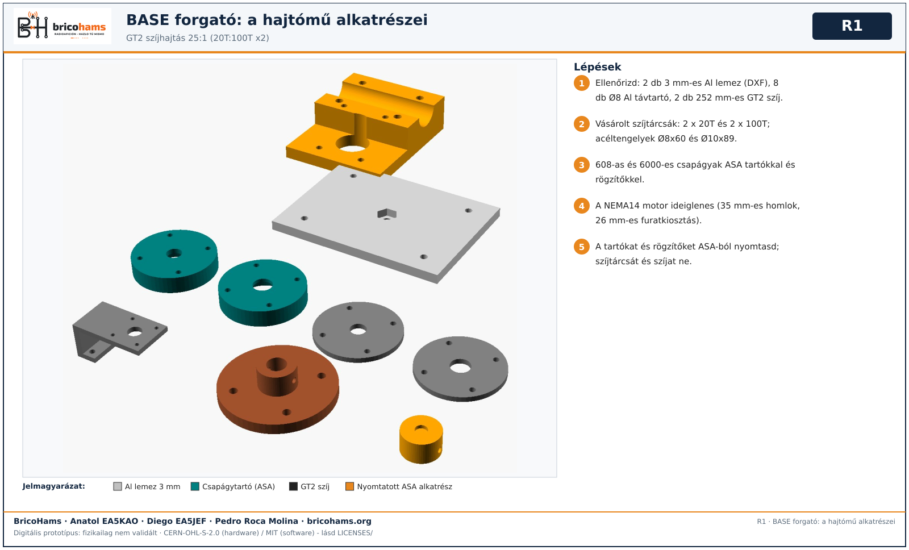
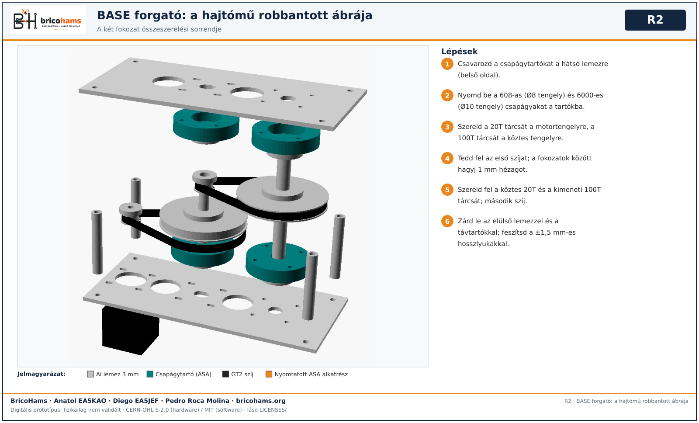
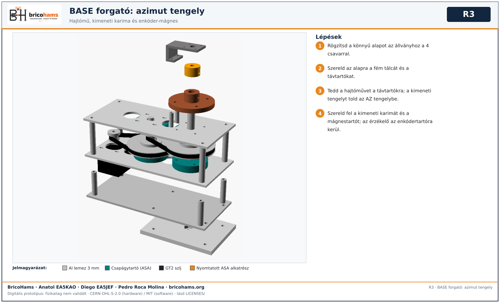
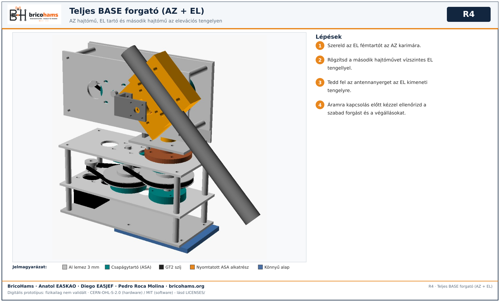
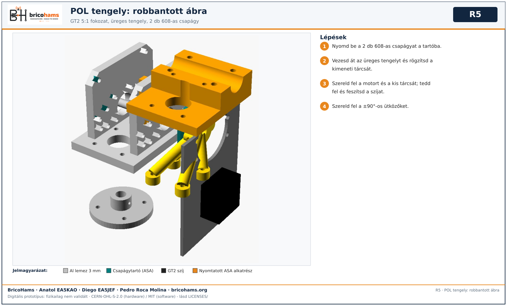
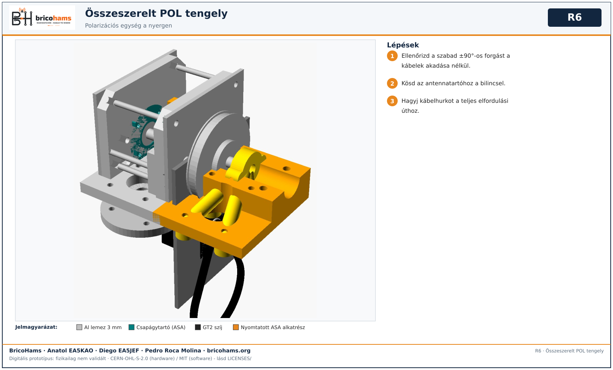

# A forgató összeszerelése

Szíjas BASE: két GT2 20T:100T fokozat = 25:1, 252 mm-es szíjak, 3 mm-es alumínium lemezek, vásárolt szíjtárcsák, 608/6000 csapágyak, ASA tartók. A NEMA14 motor ideiglenes.

*R1* — BricoHams · Anatol EA5KAO · Diego EA5JEF · Pedro Roca Molina

1. Ellenőrizd az alkatrészeket: 2 lemez, 8 távtartó, 2 szíj, 4 szíjtárcsa, Ø8x60 és Ø10x89 tengelyek.

*R2* — BricoHams · Anatol EA5KAO · Diego EA5JEF · Pedro Roca Molina

2. Csavarozd a csapágytartókat a hátsó lemezre; nyomd be a 608-as (8 mm-es tengely) és 6000-es (10 mm-es tengely) csapágyakat.
3. Szereld a 20T tárcsát a motortengelyre, a 100T-t a köztes tengelyre; első szíj; a fokozatok között 1 mm hézag.
4. Szereld fel a második fokozat tárcsáit és szíját; zárd le az elülső lemezzel és a távtartókkal; feszítsd a ±1,5 mm-es hosszlyukakkal.

*R3* — BricoHams · Anatol EA5KAO · Diego EA5JEF · Pedro Roca Molina

5. Szereld az állványra a könnyű alapot, a fém tálcát és a távtartókat, majd a hajtóművet, a kimeneti karimát, a mágnestartót és az enkódertartót.

*R4* — BricoHams · Anatol EA5KAO · Diego EA5JEF · Pedro Roca Molina

6. Szereld fel az EL tartót, a második hajtóművet (vízszintes EL tengely) és az antennanyerget. **Ne kapcsold áram alá**, amíg nem ellenőrizted a szabad forgást és a végállásokat.

*R5* — BricoHams · Anatol EA5KAO · Diego EA5JEF · Pedro Roca Molina

*R6* — BricoHams · Anatol EA5KAO · Diego EA5JEF · Pedro Roca Molina

7. Opcionális POL (roll) tengely: egy GT2 5:1 fokozat, üreges tengely, 2 db 608, ±90°-os ütközők.
