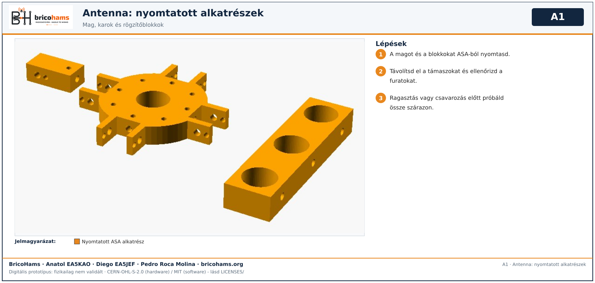
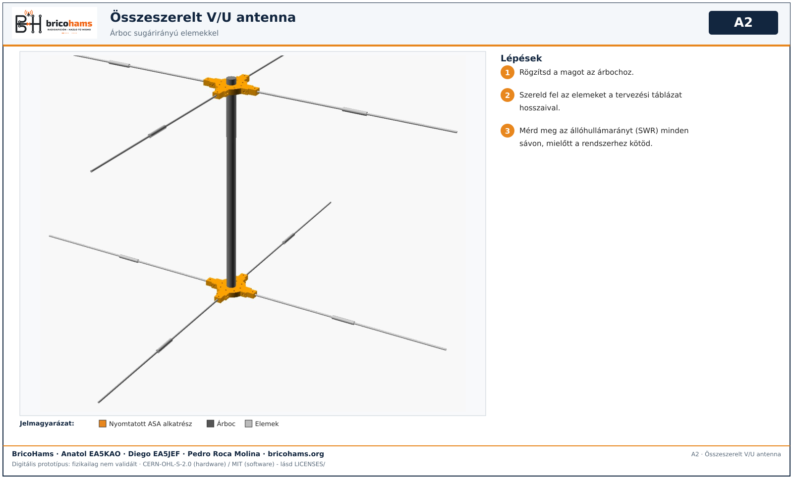

# Az antenna összeszerelése

*A1* — BricoHams · Anatol EA5KAO · Diego EA5JEF · Pedro Roca Molina

1. A magot és a blokkokat ASA-ból nyomtasd; távolítsd el a támaszokat; próbáld össze szárazon.

*A2* — BricoHams · Anatol EA5KAO · Diego EA5JEF · Pedro Roca Molina

2. Rögzítsd a magot az árbochoz, szereld fel az elemeket a tervezési táblázat hosszaival, és a rendszerhez kötés előtt mérd meg az SWR-t sávonként.
