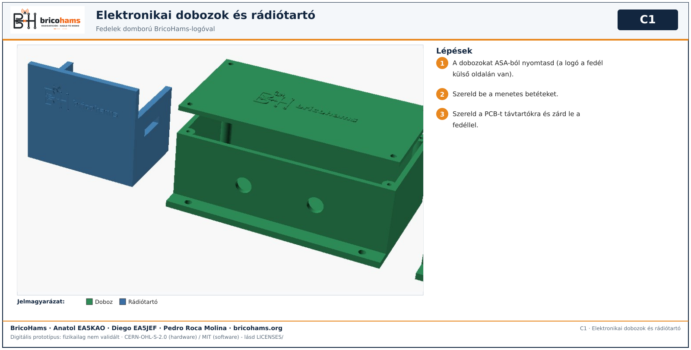

# Dobozok és rádiótartó

A fedeleken a BricoHams-logó 0,6 mm-es domborműként a külső oldalon van. ASA-ból nyomtasd.

*C1* — BricoHams · Anatol EA5KAO · Diego EA5JEF · Pedro Roca Molina

1. Szereld be a menetes betéteket. 2. A PCB-t távtartókra szereld. 3. Zárd le a fedéllel.
