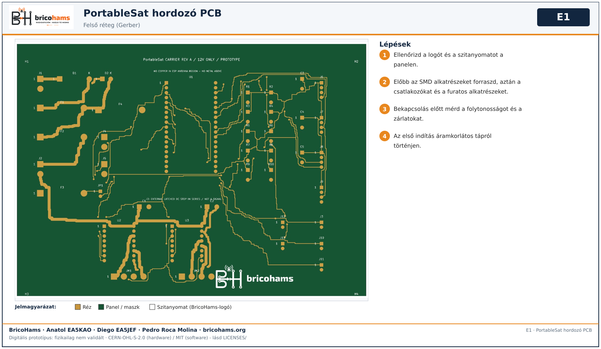
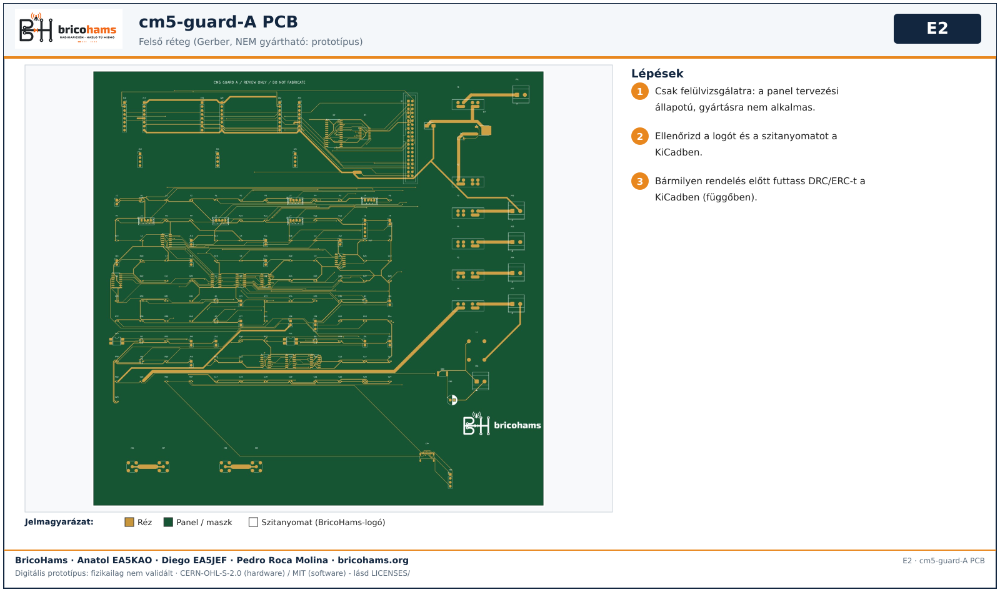
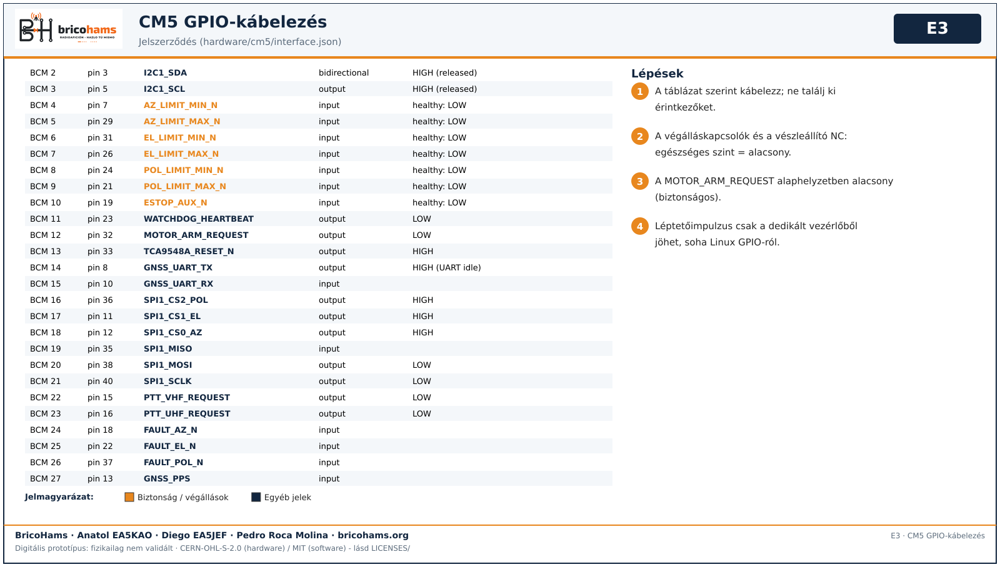

# Az elektronika összeszerelése

*E1* — BricoHams · Anatol EA5KAO · Diego EA5JEF · Pedro Roca Molina

1. Hordozó PCB: előbb az SMD alkatrészeket forraszd, aztán a csatlakozókat és a furatos alkatrészeket; ellenőrizd a folytonosságot; az első indítás áramkorlátos tápról történjen.

*E2* — BricoHams · Anatol EA5KAO · Diego EA5JEF · Pedro Roca Molina

2. A cm5-guard-A **csak felülvizsgálatra való, nem gyártható**; a logó hozzáadása utáni KiCad DRC/ERC függőben van.

*E3* — BricoHams · Anatol EA5KAO · Diego EA5JEF · Pedro Roca Molina

3. Kábelezz a táblázat szerint (forrás: `hardware/cm5/interface.json`). A végállások/vészleállító egészséges szintje alacsony; a MOTOR_ARM_REQUEST alaphelyzetben alacsony. Léptetőimpulzus soha nem jön Linux GPIO-ról.
