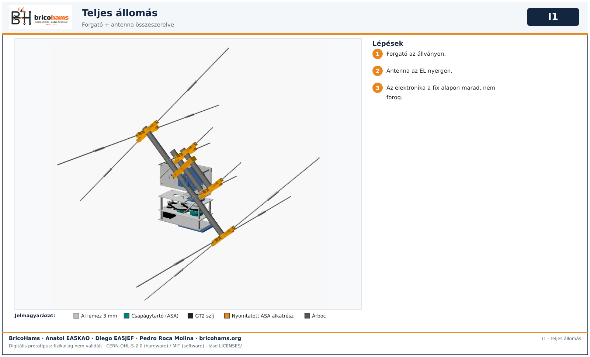

# Közös összeszerelés

Csak akkor, ha minden modult külön elfogadtál. Ne adj hozzá második CM5-öt vagy második tápellátó rendszert.

*I2* — BricoHams · Anatol EA5KAO · Diego EA5JEF · Pedro Roca Molina

1. Antenna, forgató és rádió külön elfogadása. 2. Állvány és fix alap. 3. Az antenna a forgatóhoz. 4. SMA RF sávonként, TX tiltva. 5. Powerpole/biztosíték elosztás. 6. Integrated profil és SDR-azonosítók. 7. UTC, észak, AZ/EL/POL nullpontok kalibrálása. 8. Átvonulások, Doppler, hang, SSTV/APRS ellenőrzése TX nélkül. 9. TX/full-duplex minősítése terheléssel és műszerekkel. 10. Mérd meg az együttest (cél <=5 kg) és próbáld ki a 2 órás üzemidőt.

*I1* — BricoHams · Anatol EA5KAO · Diego EA5JEF · Pedro Roca Molina

Az elektronika, a rádió és az akkumulátor a fix alapon marad, és nem forog.
