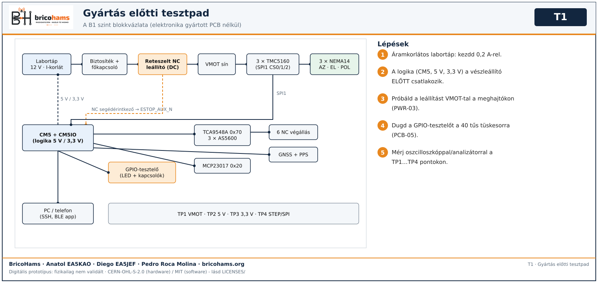
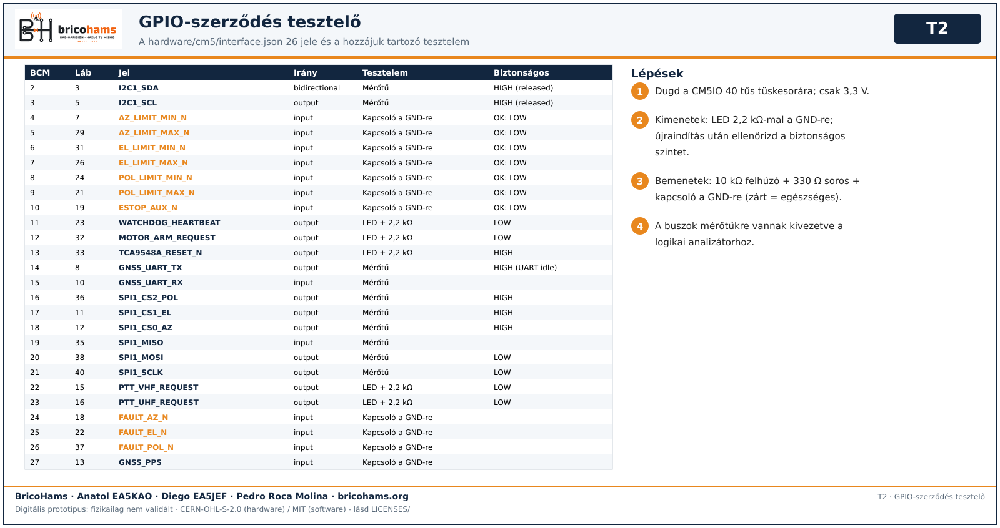
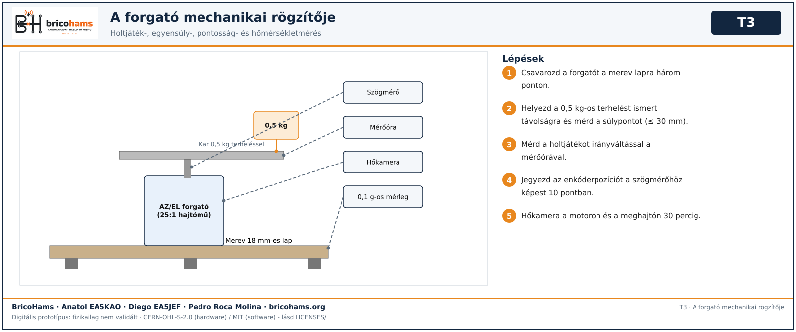

# A tesztpad kialakítása

A pad lehetővé teszi, hogy minden blokkot valódi modulokkal és prototípus-kábelezéssel teszteljünk **a PCB-k gyártása előtt**: ha az egyenértékű áramkör nem teljesít a padon, a panelt nem rendeljük meg.

*T1* — BricoHams · Anatol EA5KAO · Diego EA5JEF · Pedro Roca Molina · bricohams.org

## A pad szintjei

| Szint | Tartalom | Tesztek |
|---|---|---|
| **B0** Digitális asztal | Fejlesztői számítógép, 2 Android telefon (8-11 és 12+), opcionálisan CM5/Raspberry. Teljesítményfokozat nélkül. | SW, APP-01…06, PCB-01…03 |
| **B1** Elektronika gyártott PCB nélkül | Labortáp, leállítási lánc, védelmi emulátor próbapanelen, GPIO-tesztelő, 3 TMC5160 meghajtó adapteren, NEMA14 motorok, AS5600 + TCA9548A + MCP23017 modulok, NC végállások, GNSS, CM5 + CM5IO. | PWR, DRV, SNS, PCB-04…07, APP-07…10 |
| **B2** Mechanika | Merev padon rögzített forgató 0,5 kg-os terheléssel, szögmérő, mérőóra, mérleg, hőkamera/hőelem. | MEC |
| **B3** RF | VNA kalibráló készlettel, 50 Ω-os lezárás ≥ 25 W, csillapítók, wattmérő, SDR forrásként/monitorként, antenna kültéren. | ANT, RAD |
| **B4** Rendszer a terepen | Állvány, választott akkumulátor, teljes állomás, irány-/időreferencia, valódi műhold. | SYS |

## Leállítási lánc

A pad leállítási lánca (a tervet másolja, PCB nélkül):
`táp + → biztosíték → főkapcsoló → a reteszelt NC vészleállító DC érintkezője (vagy DC kontaktor) → VMOT sín → meghajtók`.
Ugyanennek a vészleállítónak az NC segédérintkezője az `ESTOP_AUX_N`-re megy (BCM10, egészséges szint = ALACSONY). A logika (CM5, 5 V, 3,3 V) a leállító ELŐTT csatlakozik, így él és jelzi a hibát. A leállító érintkezőjének tartalékkal kell viselnie a három motor áramát (a terv pontos alkatrésze nincs kiválasztva).

## GPIO-szerződés tesztelő

GPIO-szerződés tesztelő (próbapanel, NEM gyártási): a CM5IO 40 tűs tüskesorára dugható, és csak 3,3 V-ot használ.
- A CM5 minden **kimenete** (WATCHDOG_HEARTBEAT, MOTOR_ARM_REQUEST, TCA9548A_RESET_N, SPI CS, PTT_*_REQUEST…) egy LED-et hajt 2,2 kΩ-os ellenálláson át a GND-re, hogy újraindítás után látható legyen a biztonságos szint.
- Minden **bemenet** (6 NC végállás, ESTOP_AUX_N, FAULT_*_N, GNSS_PPS) 10 kΩ felhúzót kap 3,3 V-ra, 330 Ω soros ellenállást és kapcsolót a GND-re: zárt = ALACSONY = egészséges; nyitott/szakadt vezeték = MAGAS = hiba.
- A buszok (I2C1, SPI1, GNSS UART) mérőtűkre vannak kivezetve a logikai analizátorhoz.
- Erre a panelre soha nem kötünk 5 V-ot vagy 12 V-ot.
A T2 ábra felsorolja az `hardware/cm5/interface.json` 26 jelét a hozzájuk tartozó tesztelemmel.

*T2* — BricoHams · Anatol EA5KAO · Diego EA5JEF · Pedro Roca Molina · bricohams.org

## Mechanikai rögzítő

A forgató merev, 18 mm-es lapra csavarozva három támasztási ponton; a 0,5 kg-os célterhelést viselő kar ismert távolságban; a tengelyre rögzített szögmérő és a karon mérőóra a holtjátékhoz; mérleg a tömeghez; hőkamera a meghajtókon és a motoron.

*T3* — BricoHams · Anatol EA5KAO · Diego EA5JEF · Pedro Roca Molina · bricohams.org

## A pad eszköz- és komponenslistája

| Hiv. | Db | Eszköz / komponens | Felhasználás |
|---|---|---|---|
| EQ-01 | 1 | Labortáp 0–30 V / 0–5 A áramkorláttal | PWR, DRV |
| EQ-02 | 1 | Leállítási lánc: reteszelt NC vészleállító (DC-névleges érintkező) vagy DC kontaktor + NC segédérintkező | PWR |
| EQ-03 | 1 | Vezetékre és fogyasztásra méretezett biztosíték és tartó; Powerpole csatlakozók | PWR |
| EQ-04 | 1 | Oszcilloszkóp ≥ 100 MHz, 2-4 csatorna, földrugóval | PWR, DRV, SNS |
| EQ-05 | 1 | Logikai analizátor 8+ csatornával (≥ 24 MS/s), SPI/I2C/UART dekódolással | DRV, SNS, PCB |
| EQ-06 | 1 | 4½ jegyű multiméter vagy jobb, DC lakatfogó | PWR, DRV |
| EQ-07 | 1 | Hőkamera vagy 2 csatornás K hőelem | PWR, DRV, MEC |
| EQ-08 | 1 | GPIO-szerződés tesztelő (saját próbapanel, lásd alább) | PCB-05 |
| EQ-09 | 3 | TMC5160 v1.5 meghajtó (SilentStepStick) adapteren / próbapanelen | DRV |
| EQ-10 | 3 | NEMA14 bipoláris 200 lépéses motor (a tervezett típus) | DRV, MEC |
| EQ-11 | 3+1 | AS5600 modul + átmérős mágnesek (egy tartalék) | SNS |
| EQ-12 | 1+1 | TCA9548A (0x70) és MCP23017 (0x20) modulok | SNS, PCB |
| EQ-13 | 6 | NC végálláskapcsolók kábellel és csatlakozóval | SNS |
| EQ-14 | 1 | 3,3 V-os UART GNSS modul antennával és PPS-sel | SNS |
| EQ-15 | 1 | Távoli iránytű/IMU és valódi észak referencia (libella) | SNS, SYS |
| EQ-16 | 1 | CM5 + hivatalos CM5IO panel + tároló + hűtőborda | SW, PCB, APP |
| EQ-17 | 2 | LimeSDR Mini USB és SMA kábelekkel | RAD |
| EQ-18 | 1 | Merev pad (18 mm-es lap) és forgatórögzítő 0,5 kg-os terheléssel | MEC |
| EQ-19 | 1 | Szögmérő, mérőóra, tolómérő, 0,1 g / 5 kg-os mérleg | MEC |
| EQ-20 | 1 | VNA (pl. NanoVNA vagy LibreVNA) SOL + THRU készlettel | ANT |
| EQ-21 | 1 | 50 Ω-os műterhelés ≥ 25 W, 10/20 dB csillapítók, RF wattmérő | ANT, RAD |
| EQ-22 | 2 | Android telefonok 8-11 és 12+ a debug APK-val | APP |
| EQ-23 | 1 | Leválasztott audiokábel (földleválasztó) és SSTV/APRS teszt-WAV-ok | RAD, APP |

## A PCB-gyártás felszabadításának feltételei

1. PWR, DRV és SNS JÓVÁHAGYVA a B1 szinten az egyenértékű áramkörrel.
2. GPIO-tesztelő: mind a 26 jel egyezik (PCB-05).
3. ERC/DRC hiba nélkül, ellenőrzött hashek és egy második személy általi átnézés (PCB-01…03, 08).
4. Kifejezett tulajdonosi jóváhagyás nélkül nincs rendelés. [Gyártás előtti kapu](03-puerta-pcb.md).

[Vissza a tartalomjegyzékhez](README.md)
