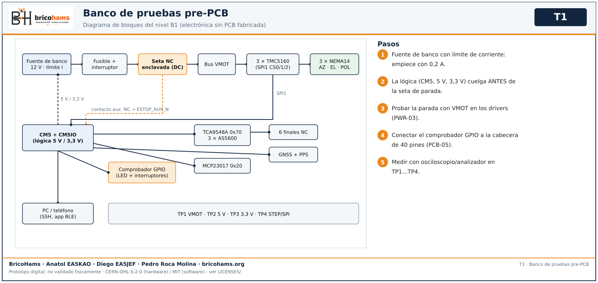
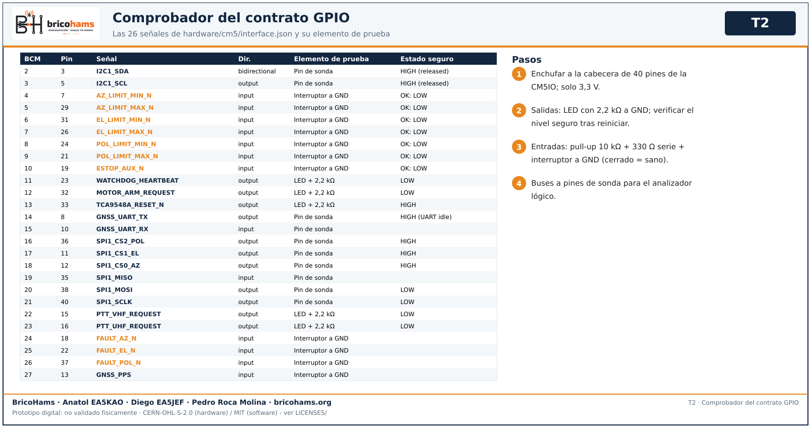
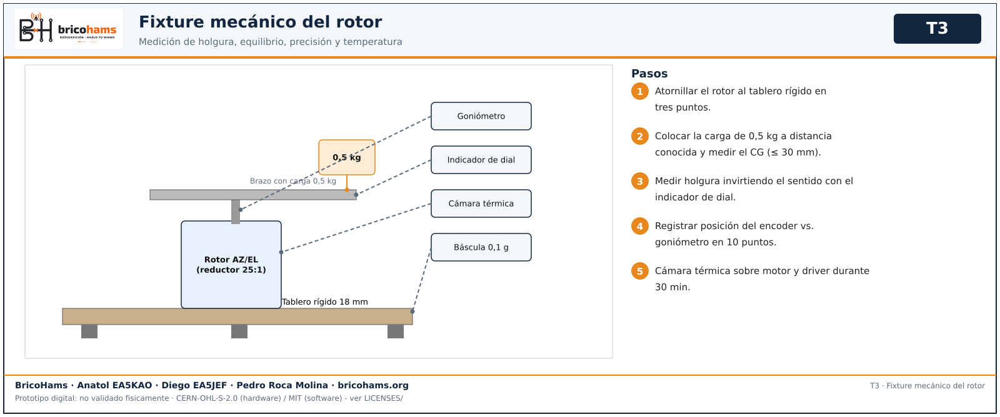

# Diseño del banco de pruebas

El banco permite probar cada bloque con módulos reales y cableado de prototipo **antes** de fabricar las PCB: si el circuito equivalente no pasa en el banco, la placa no se pide.

*T1* — BricoHams · Anatol EA5KAO · Diego EA5JEF · Pedro Roca Molina · bricohams.org

## Niveles del banco

| Nivel | Contenido | Pruebas |
|---|---|---|
| **B0** Mesa digital | Ordenador de desarrollo, 2 teléfonos Android (8-11 y 12+), opcional CM5/Raspberry. Sin energía de potencia. | SW, APP-01…06, PCB-01…03 |
| **B1** Electrónica sin PCB fabricada | Fuente de banco, cadena de parada, emulador de guarda en placa de prototipos, comprobador GPIO, 3 drivers TMC5160 en adaptador, motores NEMA14, AS5600 + TCA9548A + MCP23017 en módulos, finales NC, GNSS, CM5 + CM5IO. | PWR, DRV, SNS, PCB-04…07, APP-07…10 |
| **B2** Mecánica | Rotor montado en un banco rígido con carga de 0,5 kg, goniómetro, indicador de dial, báscula, cámara térmica/termopar. | MEC |
| **B3** RF | VNA con kit de calibración, carga de 50 Ω ≥ 25 W, atenuadores, vatímetro, SDR como fuente/monitor, antena en exterior. | ANT, RAD |
| **B4** Sistema en campo | Trípode, batería elegida, estación completa, referencia de rumbo/horario, satélite real. | SYS |

## Cadena de parada

Cadena de parada del banco (replica la del diseño, sin PCB):
`fuente + → fusible → interruptor general → contacto DC de la seta NC enclavada (o contactor DC) → bus VMOT → drivers`.
El contacto auxiliar NC de la misma seta va a `ESTOP_AUX_N` (BCM10, nivel sano = BAJO). La lógica (CM5, 5 V, 3,3 V) cuelga ANTES de la parada, para seguir viva y señalar el fallo. El contacto de la parada debe soportar la corriente de los tres motores con margen (el modelo exacto del diseño está sin seleccionar).

## Comprobador del contrato GPIO

Comprobador del contrato GPIO (placa de prototipos, NO es producción): se enchufa a la cabecera de 40 pines de la CM5IO y solo usa 3,3 V.
- Cada **salida** del CM5 (WATCHDOG_HEARTBEAT, MOTOR_ARM_REQUEST, TCA9548A_RESET_N, CS SPI, PTT_*_REQUEST…) alimenta un LED con resistencia de 2,2 kΩ a GND, para ver su nivel seguro tras reiniciar.
- Cada **entrada** (6 finales NC, ESTOP_AUX_N, FAULT_*_N, GNSS_PPS) lleva pull-up de 10 kΩ a 3,3 V, resistencia serie de 330 Ω y un interruptor a GND: cerrado = BAJO = sano; abierto/cable roto = ALTO = fallo.
- Los buses (I2C1, SPI1, UART GNSS) salen a pines de sonda para el analizador lógico.
- Nunca se conecta 5 V ni 12 V a esta placa.
La figura T2 lista las 26 señales de `hardware/cm5/interface.json` con su elemento de prueba.

*T2* — BricoHams · Anatol EA5KAO · Diego EA5JEF · Pedro Roca Molina · bricohams.org

## Fixture mecánico

Rotor atornillado a un tablero rígido de 18 mm con tres puntos de apoyo; brazo con la carga objetivo de 0,5 kg a distancia conocida; goniómetro fijo al eje y indicador de dial sobre el brazo para holgura; báscula para la masa; cámara térmica sobre drivers y motor.

*T3* — BricoHams · Anatol EA5KAO · Diego EA5JEF · Pedro Roca Molina · bricohams.org

## Lista de equipos y componentes del banco

| Ref. | Cant. | Equipo / componente | Usado en |
|---|---|---|---|
| EQ-01 | 1 | Fuente de banco 0–30 V / 0–5 A con límite de corriente | PWR, DRV |
| EQ-02 | 1 | Cadena de parada: seta de emergencia con enclavamiento NC (contacto DC) o contactor DC + contacto auxiliar NC | PWR |
| EQ-03 | 1 | Fusible y portafusibles dimensionados por cable y consumo; conectores Powerpole | PWR |
| EQ-04 | 1 | Osciloscopio ≥ 100 MHz, 2-4 canales, con muelle de masa | PWR, DRV, SNS |
| EQ-05 | 1 | Analizador lógico de 8 canales o más (≥ 24 MS/s) con decodificador SPI/I2C/UART | DRV, SNS, PCB |
| EQ-06 | 1 | Multímetro de 4½ dígitos o mejor, pinza amperimétrica DC | PWR, DRV |
| EQ-07 | 1 | Cámara térmica o termopar K de 2 canales | PWR, DRV, MEC |
| EQ-08 | 1 | Comprobador del contrato GPIO (placa de prototipos propia, ver abajo) | PCB-05 |
| EQ-09 | 3 | Driver TMC5160 v1.5 (SilentStepStick) en adaptador / placa de prototipos | DRV |
| EQ-10 | 3 | Motor NEMA14 bipolar de 200 pasos (el mismo modelo previsto) | DRV, MEC |
| EQ-11 | 3+1 | Módulo AS5600 + imanes diametrales (uno de repuesto) | SNS |
| EQ-12 | 1+1 | Módulos TCA9548A (0x70) y MCP23017 (0x20) | SNS, PCB |
| EQ-13 | 6 | Finales de carrera NC con cable y conector | SNS |
| EQ-14 | 1 | Módulo GNSS UART 3,3 V con antena y PPS | SNS |
| EQ-15 | 1 | Brújula/IMU remoto y referencia de norte verdadero (nivel de burbuja) | SNS, SYS |
| EQ-16 | 1 | CM5 + placa oficial CM5IO + almacenamiento + disipador | SW, PCB, APP |
| EQ-17 | 2 | LimeSDR Mini con cable USB y SMA | RAD |
| EQ-18 | 1 | Banco rígido (tablero de 18 mm) y fixture del rotor con carga de 0,5 kg | MEC |
| EQ-19 | 1 | Goniómetro, indicador de dial, calibre, báscula de 0,1 g / 5 kg | MEC |
| EQ-20 | 1 | VNA (p. ej. NanoVNA o LibreVNA) con kit SOL + THRU | ANT |
| EQ-21 | 1 | Carga ficticia de 50 Ω ≥ 25 W, atenuadores 10/20 dB, vatímetro RF | ANT, RAD |
| EQ-22 | 2 | Teléfonos Android 8-11 y 12+ con el APK debug | APP |
| EQ-23 | 1 | Cable de audio aislado (aislador de masa) y WAV de prueba SSTV/APRS | RAD, APP |

## Criterios para liberar la fabricación de PCB

1. PWR, DRV y SNS APROBADOS en B1 con el circuito equivalente.
2. Comprobador GPIO: las 26 señales coinciden (PCB-05).
3. ERC/DRC sin errores, hashes verificados y revisión por una segunda persona (PCB-01…03, 08).
4. Ningún pedido sin aprobación explícita del responsable. [Puerta previa](03-puerta-pcb.md).

[Volver al índice](README.md)
